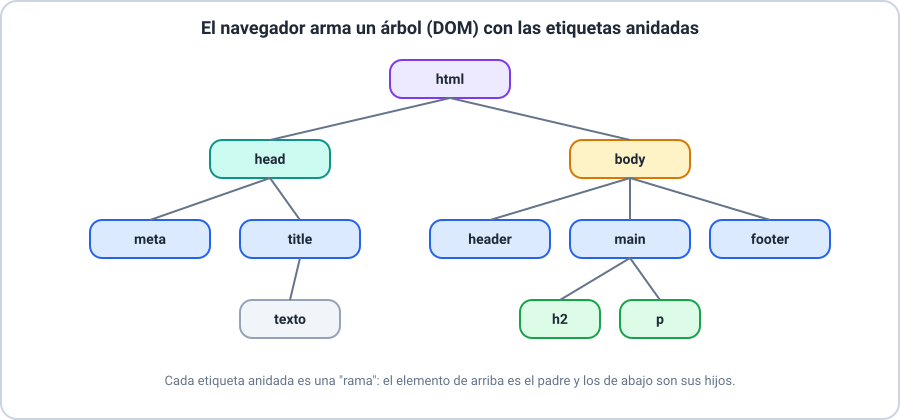
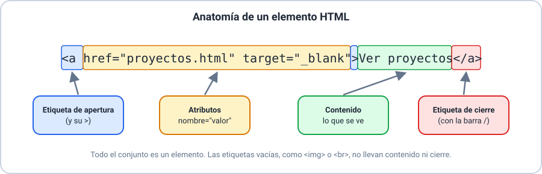
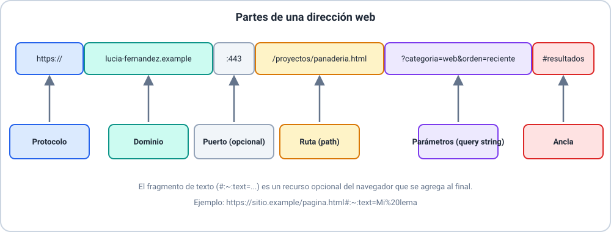
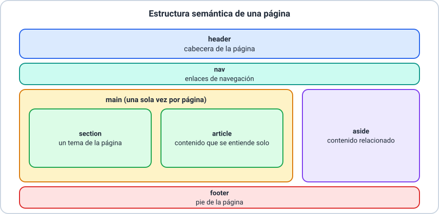

# 🌐 Fundamentos HTML

Curso **HTML y CSS** · Clase 01

---

## 🎯 Objetivos de la clase

- 🔹 Entender qué es HTML5 y preparar tu entorno.
- 🔹 Escribir documentos con buena estructura, texto y comentarios.
- 🔹 Crear enlaces e incorporar multimedia.
- 🔹 Organizar la página con etiquetas semánticas.

> 📌 No hace falta saber programar.

---

## 🌐 ¿Qué es HTML5?

- Lenguaje de **marcado**: da estructura y significado al contenido.
- **No** es un lenguaje de programación.
- El **navegador** lo lee y lo muestra como página.

> 💡 El aspecto (colores, tipografías) lo define CSS, el próximo módulo.

---

## 🧰 Entorno de desarrollo

Dos herramientas alcanzan:

| Herramienta | Para qué |
|---|---|
| 📝 Editor de código (VS Code) | Escribir y guardar el archivo `.html` |
| 🌍 Navegador | Ver y probar la página |

> 💡 Sin VS Code, podés usar un editor en línea.

---

## 🏗️ Estructura de un documento

```html
<!doctype html>
<html lang="es">
  <head>
    <meta charset="utf-8">
    <title>Mi página</title>
  </head>
  <body>
    <h1>Hola</h1>
  </body>
</html>
```

`head`: datos de la página · `body`: lo que se ve.

---

## 🌳 El DOM



Cada etiqueta anidada es un **hijo** de la que la contiene.

---

## ✏️ Sintaxis y anidación



La última etiqueta que se abre es la primera que se cierra.

---

## ✍️ Texto y formato

| Texto | Formato |
|---|---|
| `h1`–`h6`, `p`, `br`, `hr` | `strong`, `em`, `mark` |
| `ul`, `ol`, `li` | `small`, `sub`, `sup` |
| | `del`, `ins`, `code` |

> 💡 Un solo `h1` por página.

---

## 💬 Comentarios

```html
<!-- Esto no se ve en el navegador -->
```

- Explican y organizan el código.
- Cualquiera puede leerlos: nada privado.

---

## 🔗 Hipervínculos y direcciones



---

## ⚓ Rutas, anclas y fragmentos

- 📁 Ruta relativa: `sobre-mi.html`, `imagenes/foto.png`.
- ⚓ Ancla: `href="#contacto"` + `id="contacto"`.
- 🔦 Fragmento de texto: `#:~:text=` — **opcional del navegador**.

> 📌 Si no se admite, el enlace funciona igual.

---

## 🖼️ Imágenes

```html

```

- `src`: la ruta. `alt`: qué muestra.
- Si no se ve: revisá carpeta, nombre y extensión.

---

## 🎬 Video e iframe

- `<video controls>` con `<source>`.
- `<iframe title="…" src="…">` incrusta otra página.

> ⚠️ Algunos sitios no se dejan incrustar.

---

## 🧭 Semántica



---

## 📦 ¿Y el `div`?

- Contenedor **genérico**, sin significado.
- Usalo **solo si ninguna etiqueta semántica** describe lo que agrupás.

---

## 🚧 Errores frecuentes

| Error | Cómo evitarlo |
|---|---|
| Etiqueta sin cerrar | Cerrala siempre |
| Etiquetas solapadas | Cerrá en orden inverso |
| Imagen que no se ve | Revisá ruta y extensión |
| Imagen sin `alt` | Describí lo que muestra |

---

## 🛠️ Actividad práctica

**Taller 01 — Construí tu primer sitio**

Tres páginas, con tu propio tema: estructura, texto, enlaces, multimedia y semántica.

---

## 🎓 Resumen y evaluación

- ✅ HTML marca estructura y significado.
- ✅ Estructura, sintaxis y anidación correctas.
- ✅ Enlaces, multimedia y semántica.

📝 Ahora: **Quiz 01** (8 ítems).
