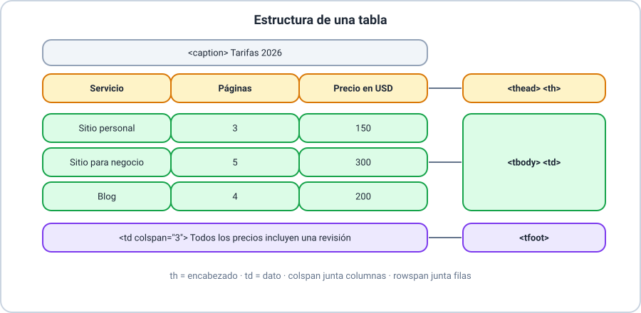
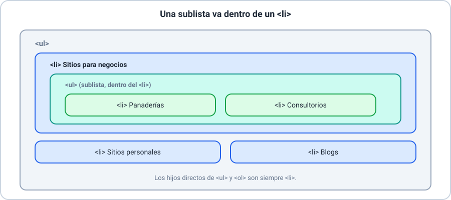
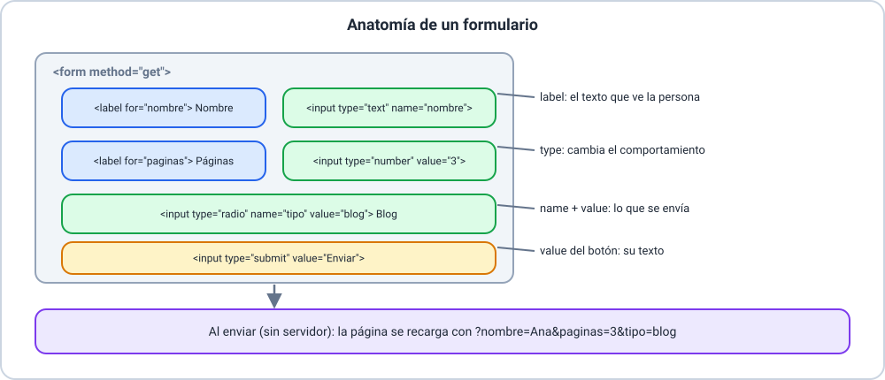

# 📚 Explicación conceptual — HTML para presentación

En esta clase seguís con el **sitio de Lucía Fernández**: le vas a sumar una página de **servicios y tarifas** (separadores,
listas, tablas y citas) y una página de **contacto** con un formulario. Se recomienda haber hecho la Clase 01. No necesitás
saber programar.

Resultados de aprendizaje de la clase:

- **RA-1**: separar y organizar el contenido de una página con separadores.
- **RA-2**: presentar datos en una tabla con filas, columnas y encabezados.
- **RA-3**: crear listas no enumeradas y enumeradas, incluidas listas dentro de listas.
- **RA-4**: marcar citas y referencias y atribuir su fuente.
- **RA-5**: explicar qué es un formulario y qué información recoge.
- **RA-6**: escribir un formulario básico con `form` y campos `input`, usando los atributos `type` y `value`.

## 🗒️ Glosario

| Término | Equivalente |
|---|---|
| *table* | tabla |
| *row* / *cell* | fila / celda |
| *header cell* | celda de encabezado |
| *list item* | elemento de la lista |
| *quote* | cita |
| *form* | formulario |
| *input* | campo de entrada |
| *query string* | parámetros de la dirección |

> 📌 **Origen de la información.** Las descripciones de las etiquetas están contrastadas con **MDN Web Docs**. Que las tablas
> sean «para datos y no para el diseño» es una **buena práctica** de la comunidad, no una regla del lenguaje.

---

## ➖ Separadores

_Resultados de aprendizaje: RA-1_

> 🔗 **Ejemplos de este concepto**
>
> - [Ejemplo 01 — Separadores y listas](01-separadores-y-listas.md): los separadores entre las secciones de la página de servicios.

### 🌍 Contexto

Una página con mucho contenido cansa si todo se ve seguido. Necesitás marcar dónde termina un tema y empieza otro.

### 💡 Concepto

Un **separador** es la etiqueta `<hr>`: marca un **cambio de tema** dentro del contenido. El navegador lo muestra como una
**línea horizontal**.

### 📖 Explicación

`<hr>` es una etiqueta **vacía**: no lleva contenido ni etiqueta de cierre.

```html
<h2>Servicios</h2>
<p>…</p>
<hr>
<h2>Cómo trabajamos</h2>
```

> 💡 Usalo cuando haya un cambio de tema real. Para separar títulos de secciones ya tenés `h2` y `section`; `<hr>` es un
> refuerzo, no un adorno.

---

## 📊 Tablas

_Resultados de aprendizaje: RA-2_

> 🔗 **Ejemplos de este concepto**
>
> - [Ejemplo 02 — Tablas](02-tablas.md): la tabla de tarifas y la de horarios de Lucía.



### 🌍 Contexto

Los precios, los horarios o las notas de un curso son **datos con filas y columnas**. Escribirlos en párrafos seguidos los
hace difíciles de comparar.

### 💡 Concepto

Una **tabla** presenta datos en **filas y columnas**. Se arma con `<table>`; cada fila es un `<tr>`, cada celda de
encabezado es un `<th>` y cada celda de datos es un `<td>`.

### 📖 Explicación

**Las partes de una tabla.**

| Etiqueta | Para qué sirve |
|---|---|
| `<table>` | Contiene toda la tabla |
| `<caption>` | Título que describe la tabla; va **primero** dentro de `<table>` |
| `<thead>` | Agrupa la fila de **encabezados** |
| `<tbody>` | Agrupa las filas de **datos** |
| `<tfoot>` | Agrupa el **pie** (por ejemplo, un resumen o una aclaración) |
| `<tr>` | Una fila |
| `<th>` | Una celda de **encabezado** (en negrita y centrada, habitualmente) |
| `<td>` | Una celda de **datos** |

**Un ejemplo mínimo.**

```html
<table>
  <caption>Tarifas 2026</caption>
  <thead>
    <tr><th>Servicio</th><th>Precio en USD</th></tr>
  </thead>
  <tbody>
    <tr><td>Blog</td><td>200</td></tr>
  </tbody>
</table>
```

**Combinar celdas.** Con `colspan` una celda ocupa **varias columnas** y con `rowspan`, **varias filas**. El valor por
defecto de los dos es 1.

```html
<td colspan="3">Todos los precios incluyen una revisión</td>
<th rowspan="2">Lunes y martes</th>
```

> ⚠️ **Con cuidado.** MDN advierte que las celdas combinadas hacen **tablas más complejas** que las tecnologías de apoyo
> pueden interpretar peor, y recomienda, cuando se puede, dividirlas en tablas más pequeñas.

**Cuándo no usar una tabla.** Las tablas son para **datos**. No las uses para ubicar elementos en la página (un menú a la
izquierda y el contenido a la derecha): para eso está CSS, el próximo módulo.

---

## 📋 Listas

_Resultados de aprendizaje: RA-3_

> 🔗 **Ejemplos de este concepto**
>
> - [Ejemplo 01 — Separadores y listas](01-separadores-y-listas.md): la lista de servicios con una sublista y la lista «Cómo trabajamos».



### 🌍 Contexto

Ya usaste listas en la Clase 01. Ahora vamos a distinguir bien las dos clases y a **anidarlas**.

### 💡 Concepto

Una **lista** agrupa **elementos**. La **lista no enumerada** (`<ul>`) muestra viñetas y se usa cuando el orden no importa. La
**lista enumerada** (`<ol>`) muestra números y se usa cuando el orden importa. Cada **elemento de la lista** va en un `<li>`.

### 📖 Explicación

| Etiqueta | Se ve como | Cuándo |
|---|---|---|
| `<ul>` | Viñetas | El orden no importa: servicios, ingredientes |
| `<ol>` | Números | El orden importa: pasos de un procedimiento |
| `<li>` | Un elemento | Siempre dentro de `<ul>` o `<ol>` |

```html
<ol>
  <li>Hablamos</li>
  <li>Escribo el contenido</li>
</ol>
```

**Listas anidadas.** Una **sublista** se escribe **dentro de un `<li>`**, nunca directamente dentro del `<ul>` o `<ol>`
exterior:

```html
<ul>
  <li>Sitios para negocios
    <ul>
      <li>Panaderías</li>
      <li>Consultorios</li>
    </ul>
  </li>
  <li>Sitios personales</li>
</ul>
```

**`ol` con opciones.** `<ol start="4">` empieza a contar desde 4, y `<ol reversed>` cuenta hacia atrás.

---

## 💬 Citas o referencias

_Resultados de aprendizaje: RA-4_

> 🔗 **Ejemplos de este concepto**
>
> - [Ejemplo 03 — Citas y referencias](03-citas-y-referencias.md): los testimonios de los clientes de Lucía.

### 🌍 Contexto

Cuando citás lo que dijo otra persona, el lector tiene que distinguir **tus palabras** de las **ajenas** y saber de **dónde**
salen.

### 💡 Concepto

Una **cita** reproduce un texto de otra persona o fuente. `<blockquote>` marca una cita **extensa**, `<q>` una cita **corta
dentro de un párrafo** y `<cite>` el **título de una obra** a la que se hace referencia.

### 📖 Explicación

| Etiqueta | Para qué sirve | Cómo se ve |
|---|---|---|
| `<blockquote>` | Cita extensa | Con sangría |
| `<q>` | Cita corta en línea | Entre comillas (las agrega el navegador) |
| `<cite>` | Título de una obra (libro, película, artículo) | En cursiva |

**La fuente.** `blockquote` y `q` aceptan el atributo `cite`, que lleva la **dirección** de donde sale la cita. No se ve en
la página: es información para quien lea el código. La **atribución visible** (quién lo dijo) va **fuera** del
`<blockquote>`, por ejemplo en un párrafo siguiente.

```html
<blockquote cite="https://lucia-fernandez.example/testimonios/marta">
  <p>Lucía armó el sitio de mi panadería en una semana.</p>
</blockquote>
<p>— Marta Gómez, panadería La Espiga</p>
```

> 💡 `<cite>` es para **títulos de obras**, no para el nombre de una persona. Por eso el nombre de quien dice la cita va
> como texto común.

---

## 📨 ¿Qué es un formulario?

_Resultados de aprendizaje: RA-5_

> 🔗 **Ejemplos de este concepto**
>
> - [Ejemplo 04 — ¿Qué es un formulario?](04-que-es-un-formulario.md): un formulario mínimo, su sintaxis y lo que pasa al enviarlo.
> - [Ejemplo 06 — El formulario de contacto](06-formulario-de-contacto.md): la página de contacto completa.



### 🌍 Contexto

Hasta ahora la página **muestra** información. Un formulario permite lo contrario: que la persona que visita la página
**ingrese** información (su nombre, su correo, lo que necesita).

### 💡 Concepto

Un **formulario** es un conjunto de **campos** con los que la persona ingresa información en una página. Se escribe con la
etiqueta contenedora `<form>`, y dentro van los campos.

### 📖 Explicación

**La información de un formulario.** Cada dato que se pide es un **campo**. Cada campo tiene un **nombre** (`name`) y un
**valor** (el contenido): al enviar, el navegador junta los pares «nombre = valor».

**La sintaxis básica.**

```html
<form method="get">
  <label for="nombre">Nombre</label>
  <input type="text" id="nombre" name="nombre">
  <input type="submit" value="Enviar">
</form>
```

| Parte | Para qué sirve |
|---|---|
| `<form method="get">` | Contiene los campos; `method` indica cómo se envían los datos |
| `<label for="nombre">` | El texto que acompaña al campo; `for` apunta al `id` del campo |
| `<input …>` | Un campo de entrada |
| `<input type="submit">` | El botón que envía el formulario |

**¿Qué pasa al enviar?** Un formulario necesita un **servidor** que reciba los datos, pero en esta clase no tenemos
ninguno. Con `method="get"` y **sin `action`**, el navegador **recarga la misma página** y agrega los datos a la
**dirección**: `…/contacto.html?nombre=Ana`. Así ves qué se enviaría, **sin que salga nada de tu computadora**.

> 📌 **Recibir** los datos y guardarlos requiere un servidor, que queda fuera de esta clase.
>
> ⚠️ **Datos de prueba.** Usá siempre datos inventados (como «Ana Pérez» y `ana@example.com`). Con `method="get"` los datos
> quedan **visibles en la dirección**.

---

## ⌨️ Input: `value` y `type`

_Resultados de aprendizaje: RA-6_

> 🔗 **Ejemplos de este concepto**
>
> - [Ejemplo 05 — Input: type y value](05-input-type-y-value.md): los siete tipos de campo y la dirección que se genera.
> - [Ejemplo 06 — El formulario de contacto](06-formulario-de-contacto.md): los campos aplicados a la página de contacto.

### 🌍 Contexto

No todos los datos son iguales: un nombre es texto, una edad es un número, un correo tiene forma de correo. El navegador
puede ayudarte si le decís **qué tipo** de dato esperás.

### 💡 Concepto

`<input>` es la etiqueta del campo. El atributo **`type`** define **qué clase de campo** es y cómo se comporta; el atributo
**`value`** es su **valor** (el inicial, o el que se envía en casillas y opciones); el atributo **`name`** es el nombre con el
que viaja el dato.

### 📖 Explicación

**Los tipos esenciales.**

| `type` | Qué hace |
|---|---|
| `text` | Una línea de texto (es el tipo por defecto) |
| `email` | Un correo: el navegador **valida** que tenga forma de correo antes de enviar |
| `number` | Un número, con flechas para subir y bajar |
| `password` | Texto **oculto** con puntos |
| `checkbox` | Una casilla que se marca o se desmarca |
| `radio` | Una opción entre varias; las opciones de un grupo comparten el mismo `name` |
| `submit` | El botón que envía el formulario |

**El atributo `value`.** En un campo de texto o de número es el **valor inicial**: `<input type="number" name="paginas"
value="3">` aparece con un 3. En `checkbox` y `radio` es el valor que **se envía** si están marcados. En `submit` es el **texto
del botón**.

**El atributo `name`.** Es el nombre con el que viaja el dato. **Un campo sin `name` no se envía.** Las casillas y las opciones
sin marcar tampoco se envían.

**Casillas y opciones.** Varios `radio` con el **mismo `name`** forman un grupo: se puede marcar uno solo. Cada uno lleva su
`value`.

```html
<input type="radio" id="tipo-blog" name="tipo" value="blog">
<label for="tipo-blog">Blog</label>
```

> ⚠️ **Contraseñas.** `type="password"` solo **oculta** lo que se escribe en pantalla; **no protege** el dato. Con
> `method="get"` la contraseña **aparece en la dirección**. Nunca pruebes con una contraseña real.
>
> 💡 **`label`.** Al hacer clic en el texto de un `label`, el navegador activa su campo. Eso es especialmente útil en casillas
> y opciones, que son chicas.
