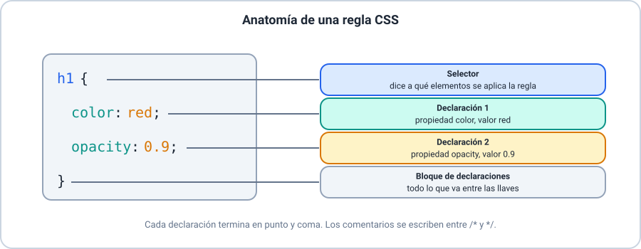
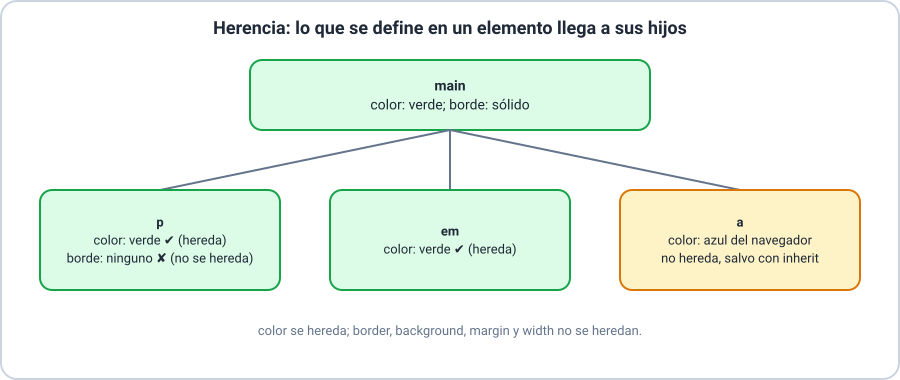
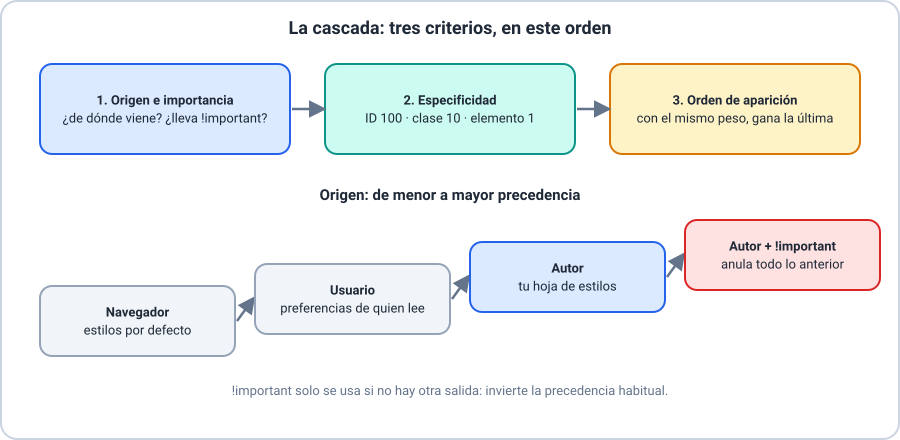
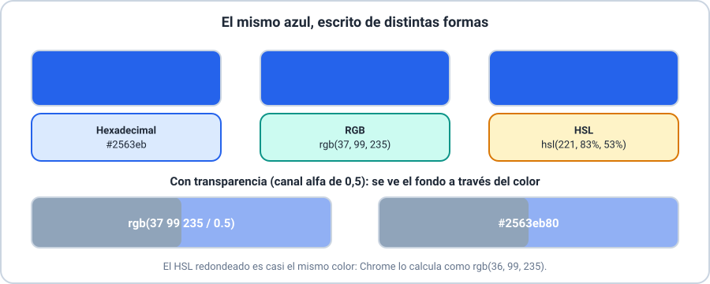

# 🎨 Introducción a CSS

Curso **HTML y CSS** · Clase 03

---

## 🎯 Objetivos de la clase

- 🔹 Entender qué es CSS y enlazarlo a una página.
- 🔹 Escribir reglas y entender la herencia y la cascada.
- 🔹 Usar variables, colores, gradientes e imágenes.

> 📌 Se recomiendan las Clases 01 y 02.

---

## 🎨 ¿Qué es CSS?

- **C**ascading **S**tyle **S**heets: hojas de estilo en cascada.
- Define **cómo se ve** una página; el HTML dice **qué es**.
- Un archivo CSS puede dar estilo a todo un sitio.

---

## 🔗 Formas de enlazar CSS

| Forma | Cuándo |
|---|---|
| `<link rel="stylesheet">` (archivo externo) | **Un sitio**: la mejor opción |
| `<style>` (bloque interno) | Una sola página |
| `style="…"` (en línea) | Evitarlo |

---

## ✍️ La sintaxis de una regla



Las reglas se guardan en un archivo `.css`, con comentarios entre `/* */`.

---

## 🎯 Los selectores esenciales

| Selector | Se escribe |
|---|---|
| Elemento | `h1` |
| Clase | `.destacado` |
| Identificador | `#portada` |
| Grupo | `h1, h2` |
| Universal | `*` |

---

## 🔍 Las herramientas del navegador

- **F12** o clic derecho → *Inspeccionar*.
- Ves qué reglas se aplican y probás cambios en vivo.

> ⚠️ Lo que cambies ahí **no modifica tu archivo**.

---

## 🌳 Herencia



---

## 🌊 La cascada: origen e importancia



---

## ⚖️ La cascada: especificidad y orden

| Selector | Valor |
|---|---|
| Elemento `p` | 1 |
| Clase `.destacado` | 10 |
| Identificador `#aviso` | 100 |

Con el mismo peso, gana la **última** regla.

---

## 🧩 Variables CSS

```css
:root {
  --color-principal: #2563eb;
}

a {
  color: var(--color-principal);
}
```

Un valor, definido **una vez**, usado en muchos lugares.

---

## 🌈 Colores



---

## 🪟 Transparencia: alfa y opacidad

| | `opacity: 0.5` | `rgb(… / 0.5)` en el fondo |
|---|---|---|
| Atenúa | Todo, con el texto | Solo el fondo |

---

## 🌅 Gradientes

```css
background-image: linear-gradient(90deg, #1e3a8a, #2563eb);
background-image: radial-gradient(circle, #f59e0b, #1e3a8a);
```

Un gradiente es una **imagen**: va en `background-image`.

---

## 🖼️ Imágenes de fondo

- `background-image: url("../imagenes/patron.png");`
- `background-repeat`: `repeat` o `no-repeat`.
- `background-size`: `cover` o `contain`.

> 💡 La ruta de `url()` se cuenta **desde el archivo CSS**.

---

## 🚧 Errores frecuentes

| Error | Cómo evitarlo |
|---|---|
| Un `;` o una `}` olvidados | Revisá con las herramientas |
| `!important` para todo | Revisá la especificidad |
| Ruta de imagen mal contada | Contala desde el CSS |
| Texto ilegible por poco contraste | Probá el color |

---

## 🛠️ Actividad práctica

**Taller 01 — Dale estilo a tu sitio**

Una hoja de estilos para las dos páginas de tu taller anterior.

---

## 🎓 Resumen y evaluación

- ✅ CSS separa el aspecto del contenido.
- ✅ Herencia y cascada deciden qué estilo gana.
- ✅ Variables, colores, gradientes, imágenes y opacidad.

📝 Ahora: **Quiz 01** (8 ítems).
