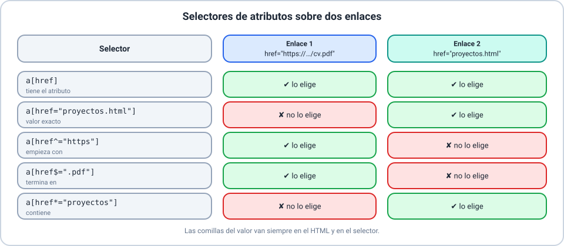
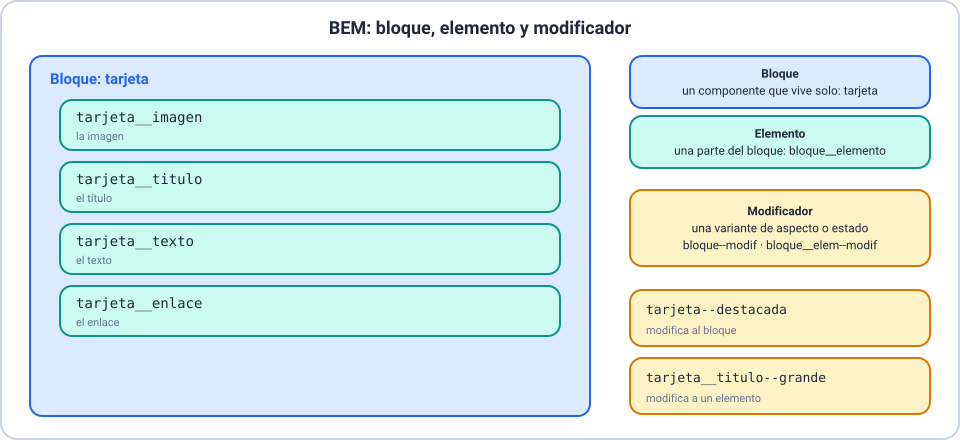
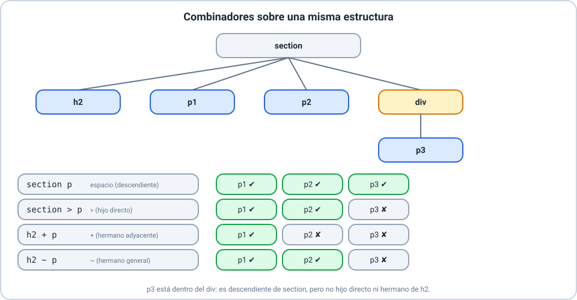
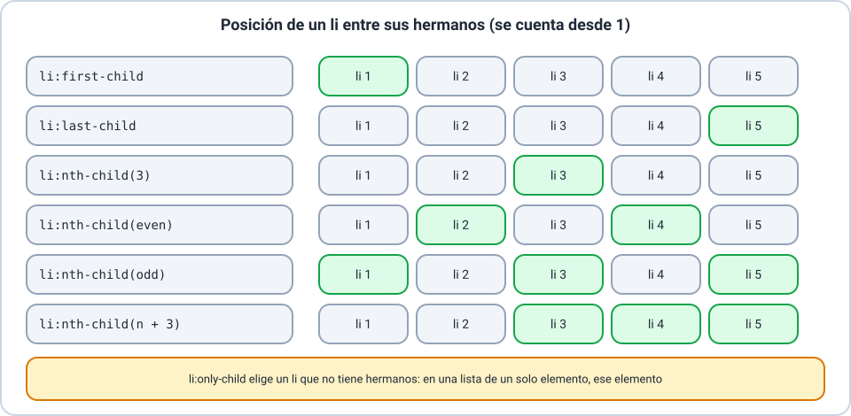

# 📚 Explicación conceptual — Selectores y reglas

En la Clase 03 diste estilo a la página con selectores simples. Ahora vas a aprender a **elegir con precisión** a qué elementos se
aplica cada regla: por sus atributos, por su relación con otros elementos, por su estado y por su posición. Seguimos con el sitio de
**Lucía Fernández**, con una página de práctica llamada `laboratorio.html`. Se recomienda haber hecho las Clases 01 a 03.

Resultados de aprendizaje de la clase:

- **RA-1**: explicar qué es un selector y usar los selectores básicos.
- **RA-2**: elegir elementos con los selectores de atributos.
- **RA-3**: nombrar clases con la metodología BEM.
- **RA-4**: relacionar selectores con los combinadores.
- **RA-5**: agrupar, excluir y combinar condiciones con los selectores lógicos.
- **RA-6**: dar estilo según el estado o la posición con las pseudoclases.
- **RA-7**: escribir y organizar reglas de forma clara y mantenible.

## 🗒️ Glosario

| Término | Equivalente |
|---|---|
| *selector* | selector (lo que elige elementos) |
| *attribute selector* | selector de atributo |
| *combinator* | combinador |
| *pseudo-class* | pseudoclase |
| *sibling* | hermano (elemento con el mismo padre) |
| *specificity* | especificidad |
| *block / element / modifier* | bloque / elemento / modificador (BEM) |

> 📌 **Origen de la información.** Las descripciones están contrastadas con **MDN Web Docs**; la metodología BEM, con su documentación
> oficial en **bem.info**. Los conteos y los resultados de los ejemplos se comprobaron en un navegador.

---

## 🎯 Selectores

_Resultados de aprendizaje: RA-1_

> 🔗 **Ejemplos de este concepto**
>
> - [Ejemplo 01 — Qué es un selector](01-que-es-un-selector.md): los selectores básicos aplicados a la página de práctica, con cuántos elementos elige cada uno.

### 🌍 Contexto

Una regla CSS solo sirve si llega a los elementos correctos. Un selector demasiado amplio cambia lo que no querías; uno demasiado
estrecho no cambia nada.

### 💡 Concepto

Un **selector CSS** es el patrón que **elige los elementos** de una página a los que se aplica una regla. Es la parte de la regla que
va antes de las llaves.

### 📖 Explicación

**Repaso de los selectores básicos.**

| Selector | Se escribe | Elige |
|---|---|---|
| Elemento (tipo) | `h2` | Todos los elementos con esa etiqueta |
| Clase | `.destacado` | Los elementos con `class="destacado"` |
| Identificador | `#contacto` | El elemento con `id="contacto"` |
| Grupo | `h1, h3` | Los elementos que elige **cualquiera** de los selectores de la lista |
| Universal | `*` | Todos los elementos |

> ⚠️ En un grupo con comas, si un solo selector está mal escrito, **toda la regla se ignora**.

**Cómo saber qué elige un selector.** Con las herramientas del navegador (Clase 03) ves a qué elementos llega cada regla. También
podés escribir en la consola `document.querySelectorAll("h2").length` para contar cuántos elementos elige un selector.

> 💡 En `laboratorio.html`, el selector `h2` elige **5** elementos, `.destacado` elige **1** y `#contacto` elige **1** (que además es un
> `h2`: si los dos tienen reglas, gana la del identificador por su especificidad).

---

## 🔖 Selectores de atributos

_Resultados de aprendizaje: RA-2_

> 🔗 **Ejemplos de este concepto**
>
> - [Ejemplo 02 — Selectores de atributos](02-selectores-de-atributos.md): enlaces externos, a un PDF, internos y campos de correo.



### 🌍 Contexto

A veces los elementos no tienen clase, pero sí un atributo que los distingue: los enlaces que abren en otra pestaña, los que llevan a un
PDF o los campos de tipo correo.

### 💡 Concepto

Un **selector de atributo** elige los elementos por la **presencia** o por el **valor** de uno de sus atributos. Se escribe entre
corchetes.

### 📖 Explicación

| Selector | Elige los elementos cuyo atributo… | Ejemplo |
|---|---|---|
| `[a]` | existe, con cualquier valor | `a[href]` |
| `[a="v"]` | vale **exactamente** `v` | `a[target="_blank"]` |
| `[a^="v"]` | **empieza** con `v` | `a[href^="https"]` |
| `[a$="v"]` | **termina** en `v` | `a[href$=".pdf"]` |
| `[a*="v"]` | **contiene** `v` | `a[href*="proyectos"]` |

Se puede combinar con un tipo (`a[href]`) o con una clase. Dos selectores de atributo juntos exigen **las dos condiciones**:
`a[href^="https"][target]`.

> 💡 En `laboratorio.html`: `a[href^="https"]` elige **2** enlaces, `a[href$=".pdf"]` elige **1** y `a[href*="proyectos"]` elige **5**.

---

## 🧱 Metodología BEM

_Resultados de aprendizaje: RA-3_

> 🔗 **Ejemplos de este concepto**
>
> - [Ejemplo 03 — La metodología BEM](03-metodologia-bem.md): la tarjeta de proyecto con su bloque, sus elementos y sus modificadores.



### 🌍 Contexto

Cuando un proyecto crece, aparecen cientos de clases. Si cada persona las nombra a su manera, nadie sabe qué hace cada una ni dónde se
puede tocar sin romper otra cosa.

### 💡 Concepto

**BEM** (*Block, Element, Modifier*: bloque, elemento, modificador) es una metodología para **nombrar las clases** de forma ordenada:

- El **bloque** es un componente independiente (`tarjeta`).
- El **elemento** es una parte del bloque, que no tiene sentido fuera de él (`tarjeta__titulo`).
- El **modificador** es una variante de un bloque o de un elemento (`tarjeta--destacada`).

### 📖 Explicación

**La convención de nombres.**

| Parte | En el ejemplo | Regla |
|---|---|---|
| Bloque | `tarjeta` | En minúsculas; las palabras se separan con guion |
| Elemento | `tarjeta__titulo` | Se une al bloque con **dos guiones bajos** |
| Modificador de un bloque | `tarjeta--destacada` | Se une con **dos guiones** (variante habitual) |
| Modificador de un elemento | `tarjeta__titulo--grande` | Igual: se une al elemento |

> 📌 **Una precisión.** La documentación **oficial** de BEM (bem.info) escribe los modificadores con **un guion bajo**
> (`tarjeta_destacada`, `tarjeta__titulo_grande`). La forma con **dos guiones** (`--`) es una **variante habitual** de la comunidad y la que
> usamos en esta clase. Lo importante es elegir **una** y usarla siempre igual en todo el proyecto.

**Reglas que conviene recordar.**

- **No hay elementos de elementos.** Se escribe `tarjeta__titulo`, no `tarjeta__cabecera__titulo`, aunque en el HTML el título esté
  dentro de otra etiqueta.
- **Un modificador acompaña a su bloque o elemento.** En el HTML se escriben las dos clases: `class="tarjeta tarjeta--destacada"`.
- **El modificador va después en la hoja.** Las dos reglas valen lo mismo (una clase), así que gana la última: el modificador puede
  cambiar lo que fijó el bloque.

**Por qué conviene.** Cada regla usa **un solo selector de clase**: todas valen lo mismo y es fácil predecir cuál gana. Además, con solo leer
una clase sabés a qué componente pertenece.

---

## 🔗 Combinadores

_Resultados de aprendizaje: RA-4_

> 🔗 **Ejemplos de este concepto**
>
> - [Ejemplo 04 — Combinadores](04-combinadores.md): el menú, las listas y los párrafos después de un título.



### 🌍 Contexto

A veces lo que distingue a un elemento no es un atributo ni una clase, sino **dónde está**: dentro del menú, justo después de un título,
como hijo directo de una lista.

### 💡 Concepto

Un **combinador** es el símbolo que une dos selectores y dice qué relación tienen sus elementos en el árbol del documento.

### 📖 Explicación

| Combinador | Se escribe | Elige | Ejemplo |
|---|---|---|---|
| Descendiente | espacio | Los elementos **dentro** del primero, a cualquier profundidad | `nav a` |
| Hijo directo | `>` | Solo los **hijos directos** del primero | `ul > li` |
| Hermano adyacente | `+` | El elemento que va **inmediatamente después** del primero (mismo padre) | `h2 + p` |
| Hermano general | `~` | **Todos** los hermanos que van después del primero (mismo padre) | `h2 ~ p` |

**Un ejemplo.** En un `<section>` con un `h2`, dos `p` y un `div` que contiene un `p`: `section p` elige los tres párrafos; `section > p`,
solo los dos que son hijos directos; `h2 + p`, solo el primero; y `h2 ~ p`, los dos hermanos.

> 💡 En `laboratorio.html`: `nav a` elige **5** enlaces, `ul > li` elige **5**, `h2 + p` elige **1** y `h2 ~ p` elige **2**.
>
> ⚠️ **Cuidado con la especificidad.** Cada combinador suma los selectores que une: `nav a` vale más que `a`. Un selector muy largo
> vale mucho y después cuesta anularlo (lo vemos en «Reglas»).

---

## 🧮 Combinadores lógicos

_Resultados de aprendizaje: RA-5_

> 🔗 **Ejemplos de este concepto**
>
> - [Ejemplo 05 — Selectores lógicos](05-selectores-logicos.md): agrupar con `:is()` y `:where()`, excluir con `:not()` y elegir por contenido con `:has()`.

### 🌍 Contexto

A medida que las condiciones se complican, los selectores se vuelven largos y repetitivos: «los títulos y los subtítulos», «todos los
enlaces menos los externos», «las tarjetas que tienen una imagen».

### 💡 Concepto

Los **selectores lógicos** son pseudoclases que reciben otros selectores como argumento: agrupan (`:is()`, `:where()`), excluyen
(`:not()`) o miran el contenido de un elemento (`:has()`).

### 📖 Explicación

| Selector | Qué hace | Ejemplo | Especificidad |
|---|---|---|---|
| `:is()` | Elige lo que cumpla **alguno** de los selectores de la lista | `:is(h1, h2, h3)` | La del argumento **más específico** |
| `:where()` | Igual que `:is()` | `:where(ul, ol) li` | **Siempre cero** |
| `:not()` | Elige lo que **no** cumple la lista | `a:not([href^="https"])` | La del argumento más específico |
| `:has()` | Elige un elemento **si contiene** algo que cumple el selector | `article:has(img)` | La del argumento más específico |

- **`:is()` frente a `:where()`.** Hacen lo mismo, pero `:where()` no suma especificidad: una regla posterior más simple la puede
  anular. Es útil para estilos «de base» fáciles de sobrescribir.
- **Listas tolerantes.** Dentro de `:is()` y `:where()`, un selector inválido se ignora y se usan los demás. Dentro de `:not()`, uno
  inválido anula toda la regla.
- **`:has()` mira hacia adentro.** Es el «selector padre»: elige al contenedor según lo que tiene adentro.

> 📌 **Compatibilidad de `:has()`.** Es una función relativamente reciente. MDN la marca como disponible en todos los navegadores
> principales desde diciembre de 2023 (Chrome y Edge 105, Firefox 121 y Safari 15.4). Si necesitás dar soporte a navegadores más antiguos,
> pensá una alternativa, por ejemplo una clase en el HTML.
>
> 💡 En `laboratorio.html`: `:is(h1, h2, h3)` elige **9** elementos, `a:not([href^="https"])` elige **11** y `article:has(img)` elige **2**.

---

## 🖱️ Pseudoclases

_Resultados de aprendizaje: RA-6_

> 🔗 **Ejemplos de este concepto**
>
> - [Ejemplo 06 — Pseudoclases de estado](06-pseudoclases-de-estado.md): enlaces, botón, casilla y campo deshabilitado.

### 🌍 Contexto

Una página responde a lo que hacés: un enlace cambia al pasar el cursor, un campo se resalta al escribir, una casilla marcada se ve
distinta. Con CSS podés dar estilo a **cada estado**.

### 💡 Concepto

Una **pseudoclase** es una palabra clave, que empieza con dos puntos, que se agrega a un selector para elegir los elementos **en un estado
determinado**.

### 📖 Explicación

| Pseudoclase | Se aplica cuando… |
|---|---|
| `:hover` | el cursor está sobre el elemento |
| `:focus` | el elemento tiene el foco (por clic, por toque o con la tecla Tab) |
| `:active` | el elemento se está activando (por ejemplo, mientras se presiona un botón) |
| `:visited` | el enlace ya se visitó |
| `:checked` | una casilla o una opción está marcada |
| `:disabled` | el elemento está deshabilitado: no se puede usar ni recibir el foco |

```css
a:hover {
  color: #dc2626;
}

input:checked + label {
  color: #16a34a;
}
```

**El orden de los enlaces.** Si usás varios estados, escribilos en el orden **normal, visitado, cursor, foco/activo**: los estados
posteriores anulan a los anteriores cuando valen lo mismo. Si `a:hover` va antes de `a:visited`, el cursor no cambia un enlace ya visitado.

> ⚠️ **`:hover` no existe en pantallas táctiles.** Según el navegador puede no activarse nunca o quedar «pegado». Ninguna información
> importante debe depender de `:hover`.
>
> ⚠️ **No quites el indicador de foco.** El contorno que muestra el navegador ayuda a quien navega con el teclado. Si lo cambiás,
> reemplazalo por otro que se vea bien.
>
> 📌 **`:visited` y la privacidad.** Para que ninguna página pueda averiguar qué sitios visitaste, el navegador limita lo que se puede
> cambiar con `:visited` (solo colores) y hace que las herramientas de lectura de estilos informen el color **sin visitar**. Por eso, en
> esta clase **no se puede comprobar** con una prueba automática: se explica y se confía en las reglas.

---

## 🔢 Pseudoclases de estructura

_Resultados de aprendizaje: RA-6_

> 🔗 **Ejemplos de este concepto**
>
> - [Ejemplo 07 — Pseudoclases de estructura](07-pseudoclases-de-estructura.md): el primer y el último elemento, las filas alternas y la posición exacta.



### 🌍 Contexto

Con una lista o una tabla no querés escribir una clase por cada fila: querés decir «las filas pares», «el primer elemento», «el último».

### 💡 Concepto

Las **pseudoclases de estructura** eligen un elemento según **su posición entre sus hermanos** (los elementos con el mismo padre).

### 📖 Explicación

| Pseudoclase | Elige | Ejemplo |
|---|---|---|
| `:first-child` | El primer hijo de su padre | `li:first-child` |
| `:last-child` | El último hijo de su padre | `li:last-child` |
| `:only-child` | El hijo único: no tiene hermanos | `li:only-child` |
| `:nth-child(n)` | El hijo que ocupa esa posición, contando desde 1 | `li:nth-child(3)` |
| `:nth-of-type(n)` | El que ocupa esa posición entre los hermanos **de la misma etiqueta** | `p:nth-of-type(2)` |

**El argumento de `:nth-child()`.** Admite un número, las palabras `odd` (impares) y `even` (pares) o una fórmula `An+B`:
`2n` son los pares, `2n+1` los impares, `n+3` desde el tercero en adelante.

**`:nth-child()` frente a `:nth-of-type()`.** El primero cuenta **todos** los hermanos, sean de la etiqueta que sean. El segundo cuenta
solo los de la misma etiqueta. Con `p:nth-child(2)`, el elemento tiene que ser un `p` **y** ocupar el segundo lugar entre todos sus
hermanos.

> 💡 En `laboratorio.html`: `li:first-child` elige **3** elementos, `tr:nth-child(even)` elige **2** filas (la segunda y la cuarta del cuerpo
> de la tabla) y `li:only-child` elige **1**.

---

## 🧹 Reglas

_Resultados de aprendizaje: RA-7_

> 🔗 **Ejemplos de este concepto**
>
> - [Ejemplo 08 — Escribir y organizar reglas](08-escribir-y-organizar-reglas.md): una hoja desordenada y la misma hoja reorganizada.

### 🌍 Contexto

Una hoja de estilos se lee muchas más veces de las que se escribe. Una hoja desordenada, con reglas repetidas y selectores larguísimos,
es difícil de cambiar sin romper algo.

### 💡 Concepto

Escribir **reglas claras** es ordenarlas, agruparlas, comentarlas y elegir selectores **tan simples como sea posible**, con la
especificidad justa.

### 📖 Explicación

**Buenas prácticas.**

| Práctica | Cómo |
|---|---|
| **Ordenar por tema** | Primero lo general (variables, `body`, títulos, enlaces), después los componentes |
| **Agrupar** | Una sola regla por selector; los selectores que comparten declaraciones se escriben con coma |
| **Comentar** | Un comentario `/* … */` antes de cada bloque |
| **Nombrar bien** | Clases con nombres que dicen qué son (BEM) |
| **Selectores simples** | Un solo selector de clase, en lugar de una cadena de etiquetas y clases |
| **Evitar `!important`** | Si hace falta, el selector está mal elegido |

**Especificidad.** Un selector largo vale mucho: `main article.tarjeta h3.tarjeta__titulo` vale `0-2-3` (dos clases y tres etiquetas), y una
regla `.tarjeta__titulo` posterior, que vale `0-1-0`, **no lo anula**, por más que venga después. Para cambiarlo habría que escribir
otro selector igual de largo, o usar `!important`.

**La solución.** Dar a cada elemento su clase y usar **selectores de una clase**: todos valen lo mismo y gana el último. Es justo lo que
propone BEM.

> 💡 Después de reorganizar una hoja, **comprobá que la página se ve igual**: el resultado visual tiene que ser el mismo.
