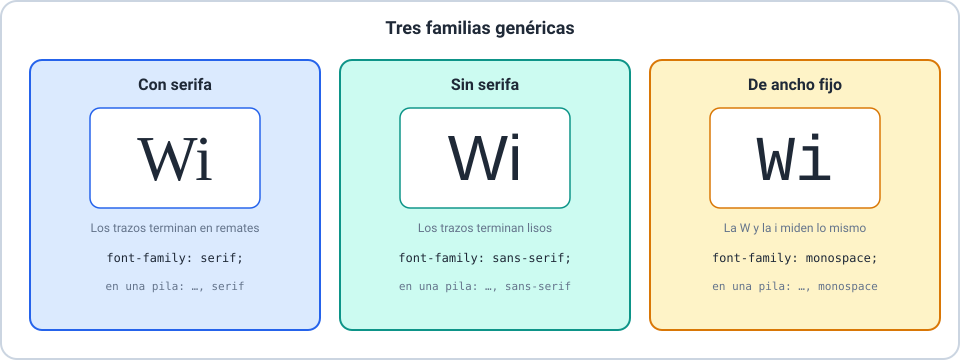

# 🔤 Tipografía y presentación de datos

Curso **HTML y CSS** · Clase 05 · **Sesión 1: texto y datos**

---

## 🎯 Objetivos de la sesión

- 🔹 Elegir tipografías y ajustar su tamaño, peso y altura de línea.
- 🔹 Alinear, espaciar y decorar el texto.
- 🔹 Dar estilo a tablas y listas.

> 📌 Se recomiendan las Clases 01 a 04.

---

## 🔤 ¿Qué es la tipografía?

El **diseño de las letras** de un texto. Cambia cómo se lee y qué personalidad transmite el sitio.

- Una **familia tipográfica** es un conjunto de letras con el mismo diseño.
- Tiene variantes de **peso** (fina, normal, negrita) y de **estilo** (normal, cursiva).
- Pocas tipografías por página: dos o tres.

---

## 🅰️ Las tres familias genéricas



---

## 📚 `font-family`: una pila de alternativas

```css
body {
  font-family: Arial, Helvetica, sans-serif;
}

h1 {
  font-family: Georgia, "Times New Roman", serif;
}
```

- Se usa la **primera instalada**.
- Los nombres con espacios, **entre comillas**.
- Se termina siempre con una **familia genérica**.

---

## 📏 Tamaño y unidades

| Unidad | Se mide contra… | `1.25` = |
|---|---|---|
| `px` | Píxeles fijos | `20px` |
| `em` | El padre | `1.25em` |
| `rem` | La raíz (`html`) | `1.25rem` |
| `%` | El padre | `125%` |

> 📌 `em` se **acumula** al anidar; `rem` no. Las unidades relativas respetan el tamaño elegido por cada persona.

---

## 💪 Peso y estilo

```css
.negrita { font-weight: 700; }
.cursiva { font-style: italic; }
```

- `font-weight`: `normal`, `bold` o un número de 100 a 900.
- `font-style`: `normal` o `italic`.

---

## ↕️ Altura de línea

```css
body {
  line-height: 1.6;
}
```

- Un **número sin unidad** se multiplica por el tamaño de la letra: `1.6 × 16px = 25.6px`.
- Para el texto principal, **al menos `1.5`**.

---

## ↔️ Alineación y sangría

| Propiedad | Valores |
|---|---|
| `text-align` | `left`, `center`, `right`, `justify` |
| `text-indent` | Sangría de la **primera línea** |

> ⚠️ `justify` en columnas angostas deja «ríos» de espacio.

---

## 🔡 Espaciado y mayúsculas

| Propiedad | Qué hace |
|---|---|
| `letter-spacing` | Espacio **extra** entre letras |
| `word-spacing` | Espacio **extra** entre palabras |
| `text-transform` | `uppercase`, `lowercase`, `capitalize` (solo al mostrar) |

---

## 🖍️ Decoraciones de texto

```css
.ondulado { text-decoration: underline wavy #dc2626; }
.tachado  { text-decoration: line-through; }
```

- Línea: `underline`, `overline`, `line-through`.
- Estilo: `solid`, `double`, `dotted`, `dashed`, `wavy`.

> ⚠️ No quites el subrayado de un enlace sin dejar otra señal clara.

---

## 🌑 Sombras de texto

```css
.sombra { text-shadow: 2px 2px 4px #94a3b8; }
```

- Desplazamiento horizontal, vertical, desenfoque y color.
- Varias sombras, separadas por comas.

---

## 📊 Tablas con estilo

```css
table { border-collapse: collapse; }
th, td { border: 1px solid #2563eb; padding: 8px 12px; }
tbody tr:nth-child(even) { background-color: #dbeafe; }
```

- `collapse` **une** los bordes; sin él se ven dobles.
- Los números, a la derecha; el título, con `caption-side`.

---

## 📋 Listas con estilo

| Propiedad | Valores |
|---|---|
| `list-style-type` | `disc`, `circle`, `square`, `none`, `upper-roman`, `lower-alpha`… |
| `list-style-position` | `outside` (inicial) o `inside` |

> 💡 Para un menú sin viñetas: `list-style-type: none` **y** `padding-left: 0`.

---

## 🚧 Errores frecuentes

| Error | Cómo evitarlo |
|---|---|
| Una pila sin familia genérica | Terminala con `serif`, `sans-serif` o `monospace` |
| `line-height: 1` en un párrafo | Usá `1.5` o más |
| Tabla con doble borde | `border-collapse: collapse` |
| Quitar el subrayado sin una señal | Dejá color, fondo o negrita |

---

## 🛠️ Actividad práctica

**Taller 01 — Dale forma a tu artículo**

Tipografía, alineación, decoraciones y estilo de tabla y lista.

---

## 🎓 Resumen y evaluación

- ✅ Familias y pila de alternativas.
- ✅ Tamaño, peso, estilo y altura de línea.
- ✅ Alineación, espaciado y decoraciones.
- ✅ Tablas y listas con estilo.

📝 Ahora: **Quiz 01** (8 ítems).
