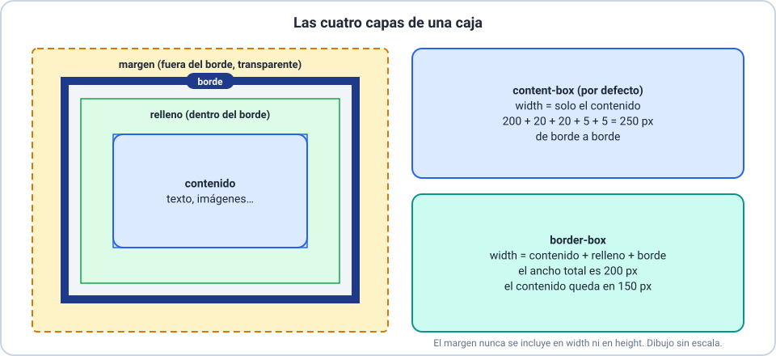

# 📦 Tipografía y presentación de datos

Curso **HTML y CSS** · Clase 05 · **Sesión 2: cajas**

---

## 🎯 Objetivos de la sesión

- 🔹 Crear bordes, también distintos en cada lado, y redondear esquinas.
- 🔹 Calcular el tamaño de una caja con `content-box` y `border-box`.
- 🔹 Controlar el desborde, los márgenes y los rellenos.

> 📌 Se recomiendan las Clases 01 a 04 y la sesión 1.

---

## 🖼️ Bordes

```css
.caja {
  border: 3px solid #2563eb;
}
```

| Propiedad | Qué fija |
|---|---|
| `border-width` | Grosor |
| `border-style` | `solid`, `dotted`, `dashed`, `double` |
| `border-color` | Color |

> ⚠️ **Sin estilo no hay borde**: el estilo inicial es `none`.

---

## 🧱 Un borde distinto en cada lado

```css
.tarjeta {
  border-top: 4px solid #1e3a8a;
  border-right: 1px solid #94a3b8;
  border-bottom: 4px double #1e3a8a;
  border-left: 1px solid #94a3b8;
}
```

- `border-top`, `border-right`, `border-bottom` y `border-left`.
- Con dos a cuatro valores: `border-width: 1px 6px;`.

---

## ⭕ Esquinas redondeadas


---

## 📐 `border-radius`: uno a cuatro valores

| Valores | Esquinas |
|---|---|
| 1 | Las cuatro |
| 2 | Arriba-izquierda y abajo-derecha · arriba-derecha y abajo-izquierda |
| 4 | Arriba-izquierda, arriba-derecha, abajo-derecha, abajo-izquierda |

`border-top-left-radius` y sus tres hermanas cambian **una** esquina. `50%` en un cuadrado da un **círculo**.

---

## 📦 El modelo de cajas



---

## ⚖️ `content-box` y `border-box`

| `box-sizing` | Ancho de borde a borde (`width: 200px`, relleno `20px`, borde `5px`) |
|---|---|
| `content-box` (por defecto) | `200 + 40 + 10` = **250px** |
| `border-box` | **200px** (el contenido queda en 150px) |

> 💡 El margen **nunca** se incluye en `width`. Se prefiere `border-box`: el ancho que escribís es el que la caja ocupa.

---

## 🌊 `overflow`: cuando el contenido no entra

| Valor | Qué hace |
|---|---|
| `visible` (inicial) | El contenido sobresale |
| `hidden` | Se recorta, sin barras |
| `scroll` | Se recorta y **siempre** hay barras |
| `auto` | Se recorta y hay barras **solo si hace falta** |

`overflow-x` y `overflow-y` fijan cada eje por separado.

---

## 📏 Márgenes y rellenos

- `margin`: espacio **fuera** del borde.
- `padding`: espacio **dentro** del borde.
- `margin: 0 auto` con un `width` fijo **centra** la caja.
- Un `margin` admite negativos; un `padding`, no.

---

## 🔢 Notación abreviada


---

## 🔗 Colapso de márgenes

Los márgenes **verticales** contiguos se combinan en uno solo, del tamaño del **mayor**.

- Margen inferior `30px` + margen superior `20px` = **30px** entre las cajas, no 50.
- Solo en vertical: los márgenes horizontales sí se suman.

---

## 🚧 Errores frecuentes

| Error | Cómo evitarlo |
|---|---|
| `border: 3px red;` y no se ve | Escribí el **estilo** |
| La caja mide más de lo que escribí | Revisá `content-box` y probá `border-box` |
| `padding: -10px` | El relleno no admite negativos |
| `margin` con cinco valores | De uno a cuatro |

---

## 🛠️ Actividad práctica

**Taller 02 — Armá tu tarjeta**

Una tarjeta con bordes, esquinas, márgenes, rellenos y desborde, y el cálculo de su tamaño.

---

## 🎓 Resumen y evaluación

- ✅ Bordes y esquinas.
- ✅ Modelo de cajas, `border-box` y `overflow`.
- ✅ Márgenes, rellenos y su notación abreviada.

📝 Ahora: **Quiz 02** (8 ítems).
