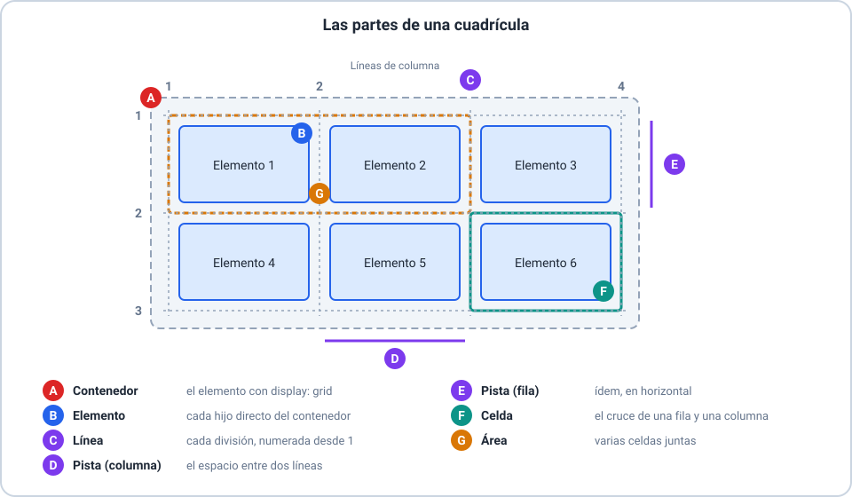
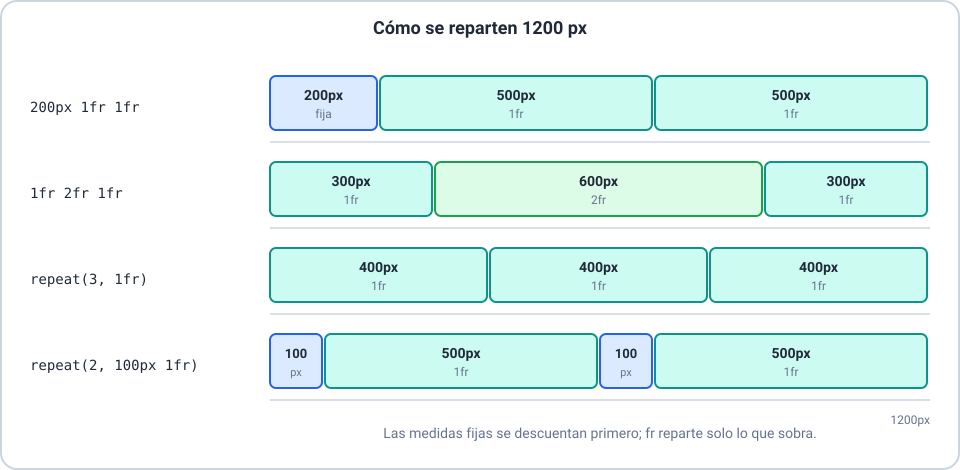
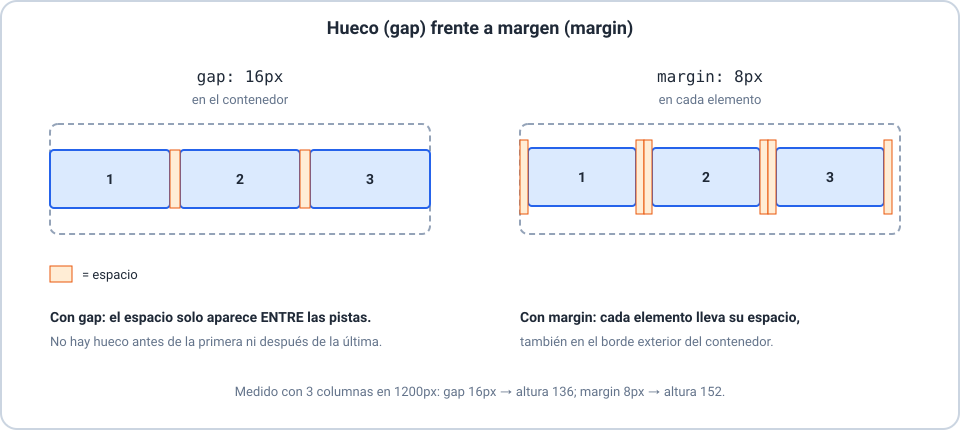
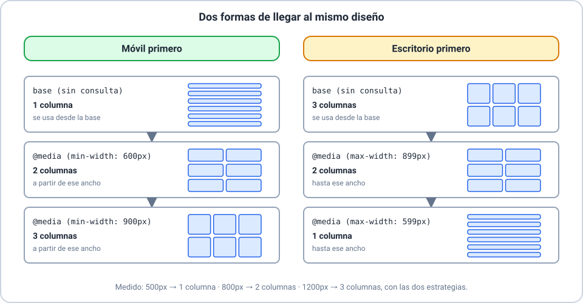
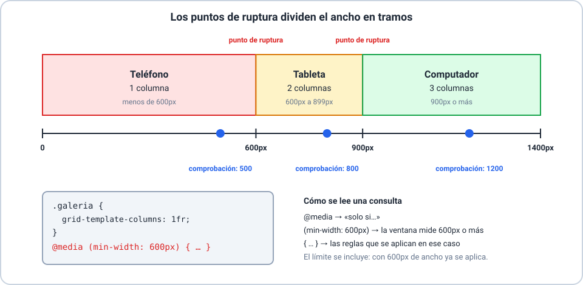

# 📚 Explicación conceptual — Grid y diseño adaptable

Hasta ahora ordenaste los elementos de la página uno debajo del otro. En esta clase aprendés a **disponerlos en filas y columnas** con Grid y a hacer que **la página se acomode** al tamaño de la pantalla (teléfono, tableta, computador) con el diseño adaptable y las consultas de medios. Seguimos con el sitio de **Lucía Fernández**, con una página de práctica por tema. Se recomienda haber hecho las Clases 01 a 06.

La clase se dicta en **dos sesiones**: la **sesión 1** cubre Grid (bloque 1) y la **sesión 2**, el diseño adaptable y las consultas de medios (bloques 2 y 3).

Resultados de aprendizaje de la clase:

- **RA-1**: explicar qué es Grid y reconocer sus partes.
- **RA-2**: crear una cuadrícula y definir filas y columnas con `px`, `%`, `fr`, `repeat()`, `minmax()` y `auto`.
- **RA-3**: separar las pistas con huecos y explicar la diferencia con el margen.
- **RA-4**: explicar qué es el diseño adaptable y la ventana de visualización.
- **RA-5**: preparar una página: ventana de visualización, imágenes flexibles y ancho con `border-box`.
- **RA-6**: elegir y aplicar una estrategia de diseño adaptable.
- **RA-7**: escribir consultas de medios y usarlas para cambiar una cuadrícula en tres tamaños.

## 🗒️ Glosario

| Término | Equivalente |
|---|---|
| *grid* | cuadrícula |
| *grid container* / *grid item* | contenedor de la cuadrícula / elemento de la cuadrícula |
| *track* | pista (una fila o una columna) |
| *grid line* | línea de la cuadrícula |
| *grid cell* / *grid area* | celda / área |
| *gap* (o *gutter*) | hueco |
| *fraction* (`fr`) | fracción |
| *responsive design* | diseño adaptable |
| *viewport* | ventana de visualización |
| *media query* | consulta de medios |
| *breakpoint* | punto de ruptura |
| *mobile first* / *desktop first* | móvil primero / escritorio primero |

> 📌 **Origen de la información.** Las medidas de todos los ejemplos se comprobaron en un navegador, con una ventana de `500px` (teléfono), `800px` (tableta) o `1200px` (computador) y sin barra de desplazamiento vertical. Las descripciones siguen la terminología de MDN Web Docs. **El efecto de la etiqueta de la ventana de visualización solo existe en navegadores de teléfono y tableta: se explica según MDN, pero no se midió.**

---

## 🔲 Grid

### 🧭 1.1 ¿Qué es la propiedad Grid? — Conceptos

*Resultados de aprendizaje: RA-1*

> 🔗 **Ejemplos de este concepto**
>
> - [Ejemplo 01 — `display: grid` y sus partes](01-display-grid-y-sus-partes.md): seis tarjetas con y sin `display: grid`, y las partes de la cuadrícula.



#### 🌍 Contexto

Hasta ahora, cada elemento de bloque ocupaba su propia línea. Para poner varios elementos **lado a lado y en varias filas** se usaban trucos. Grid es la herramienta pensada para eso.

#### 💡 Concepto

**Grid** es un sistema de disposición en **dos dimensiones** (filas y columnas a la vez). Se activa en un **contenedor** con `display: grid`; sus **hijos directos** pasan a ser los **elementos** de la cuadrícula.

#### 📖 Explicación

| Parte | Qué es |
|---|---|
| **Contenedor** | El elemento con `display: grid` |
| **Elemento** | Cada hijo directo del contenedor |
| **Línea** | Cada división entre pistas, numerada desde `1` |
| **Pista** | Una fila o una columna (el espacio entre dos líneas) |
| **Celda** | El cruce de una fila y una columna |
| **Área** | Varias celdas juntas |

- `grid-template-columns`, `gap` y las demás propiedades de cuadrícula **solo funcionan si el contenedor tiene `display: grid`**.
- Los nietos del contenedor **no** son elementos de la cuadrícula.
- Un número `n` de columnas tiene `n + 1` líneas verticales.

---

### 📐 1.2 Definir filas y columnas

*Resultados de aprendizaje: RA-2*

> 🔗 **Ejemplos de este concepto**
>
> - [Ejemplo 02 — Columnas con `fr`](02-columnas-con-fr.md): cuatro formas de definir columnas y qué pasa con un elemento ancho.
> - [Ejemplo 03 — `repeat()` y `minmax()`](03-repeat-y-minmax.md): `repeat()` y `minmax()` con espacio de sobra y con poco espacio.
> - [Ejemplo 04 — Filas y `auto`](04-filas-y-auto.md): filas fijas, `auto` y `1fr`, y las filas que se crean solas.



#### 🌍 Contexto

Una cuadrícula necesita saber cuántas columnas y filas tiene y cuánto mide cada una. Eso se define en el contenedor.

#### 💡 Concepto

`grid-template-columns` define las **columnas** y `grid-template-rows` las **filas**, con una medida por pista, separadas por espacios: `grid-template-columns: 200px 1fr 1fr`.

#### 📖 Explicación

| Medida | Qué significa |
|---|---|
| `200px`, `10rem` | Tamaño fijo |
| `25%` | Porcentaje del ancho (o alto) del contenedor |
| `1fr` | Una fracción del **espacio libre** que sobra |
| `auto` | Lo que necesite su contenido |
| `repeat(3, 1fr)` | Repite una pista (o un patrón) |
| `minmax(200px, 1fr)` | Nunca menos de `200px`; si hay espacio, hasta `1fr` |

- **`fr` reparte solo lo que sobra** después de descontar las pistas de medida fija y los huecos.
- `1fr` no baja del tamaño mínimo de su contenido; `minmax(0, 1fr)` sí.
- Si hay más elementos que celdas, el navegador crea **filas implícitas**; `grid-auto-rows` da su altura.
- `1fr` en una fila solo reparte algo si el contenedor tiene un **alto definido**.

---

### 🧱 1.3 Huecos en grid

*Resultados de aprendizaje: RA-3*

> 🔗 **Ejemplos de este concepto**
>
> - [Ejemplo 05 — Huecos con `gap`](05-huecos-gap.md): `gap` frente a margen, con medidas.
> - [Ejemplo 06 — Ocupar varias pistas](06-ocupar-varias-pistas.md): una maqueta de página y un mosaico con `span`.



#### 🌍 Contexto

Los elementos pegados unos a otros se ven apretados. En una cuadrícula, el espacio entre ellos se escribe una sola vez, en el contenedor.

#### 💡 Concepto

El **hueco** (*gap*) es el espacio entre las pistas. Se define con `gap` (filas y columnas), `row-gap` (entre filas) y `column-gap` (entre columnas).

#### 📖 Explicación

- `gap: 16px` separa filas y columnas con `16px`; `gap: 1rem 2rem` pone `1rem` entre filas y `2rem` entre columnas.
- El hueco aparece **solo entre pistas**: no hay antes de la primera ni después de la última.
- **No es un margen.** El margen rodea a cada elemento (incluido el borde exterior) y los márgenes vecinos se suman.
- El hueco **se descuenta** del espacio que reparte `fr`; los porcentajes, en cambio, no lo descuentan y pueden pasarse del ancho.
- Un elemento puede **ocupar varias pistas** con `grid-column` y `grid-row`: `1 / 3` (de la línea `1` a la `3`), `span 2` (dos pistas) o `1 / -1` (de la primera a la última línea). Si abarca varias pistas, también abarca los huecos intermedios.
- `grid-template-areas` permite ponerles nombres a las áreas; solo se menciona en esta clase.

---

## 📱 Responsive

### 🌐 2.1 Responsive — Conceptos básicos

*Resultados de aprendizaje: RA-4*

> 🔗 **Ejemplos de este concepto**
>
> - [Ejemplo 07 — Qué es el diseño adaptable y la ventana de visualización](07-que-es-responsive-y-viewport.md): una caja de ancho fijo y una flexible en tres ventanas.


#### 🌍 Contexto

Tu página se ve en un monitor grande, pero también en un teléfono, una tableta o una pantalla de televisión. Si solo la pensaste para una de ellas, en las otras se verá mal.

#### 💡 Concepto

El **diseño adaptable** (*responsive design*) es el enfoque con el que **una misma página se acomoda** al tamaño y a las características del dispositivo. La **ventana de visualización** (*viewport*) es el área de la página que se ve en el dispositivo.

#### 📖 Explicación

- Lo contrario de una página adaptable es una de **ancho fijo**: en una pantalla más angosta se sale y obliga a desplazarse de lado.
- La base del diseño adaptable son las **medidas flexibles**: porcentajes, `fr`, `max-width`, `rem` (Clase 06).
- En teléfonos y tabletas, la etiqueta `<meta name="viewport" content="width=device-width, initial-scale=1">` en el `<head>` hace que la página se dibuje en el **ancho real** del dispositivo. Sin ella, según MDN, el navegador usa una ventana virtual más ancha (por ejemplo, `980px`) y reduce la página, y las consultas de medios de `600px` o menos **nunca se activan**.
- MDN recomienda incluir esa etiqueta **siempre**.
- ⚠️ Su efecto no se ve en un navegador de escritorio: la clase la explica, pero no la mide.

---

### 🧰 2.2 Responsive — Preparación previa

*Resultados de aprendizaje: RA-5*

> 🔗 **Ejemplos de este concepto**
>
> - [Ejemplo 08 — Preparación previa de la página](08-preparacion-previa.md): la página sin preparar y preparada: ancho, relleno, borde e imágenes.

#### 🌍 Contexto

Antes de adaptar el diseño, hay que evitar que la página se desborde por sí sola: una imagen demasiado ancha o una caja con relleno que se pasa del 100%.

#### 💡 Concepto

La **preparación previa** son tres ajustes que se hacen una vez, al empezar: la ventana de visualización, imágenes flexibles y el ancho que incluye el relleno y el borde.

#### 📖 Explicación

| Ajuste | Cómo se escribe | Para qué |
|---|---|---|
| Ventana de visualización | `<meta name="viewport" content="width=device-width, initial-scale=1">` | La página usa el ancho real del dispositivo |
| Imágenes flexibles | `img { max-width: 100%; height: auto; }` | La imagen nunca pasa del ancho de su contenedor y no se deforma |
| Ancho con relleno y borde | `* { box-sizing: border-box; }` | `width` incluye el relleno y el borde |

- Con `content-box` (el valor por defecto), una caja de `width: 100%` con `20px` de relleno y `5px` de borde por lado mide `100% + 50px` y se desborda.
- Con `border-box`, esa misma caja mide exactamente el `100%`.
- Comprobá la preparación buscando **desplazamiento horizontal** en una ventana angosta: no debería haber.

---

### 🧭 2.3 Responsive — Estrategias de diseño

*Resultados de aprendizaje: RA-6*

> 🔗 **Ejemplos de este concepto**
>
> - [Ejemplo 09 — Estrategias de diseño](09-estrategias-de-diseno.md): el mismo diseño escrito móvil primero y escritorio primero.
> - [Ejemplo 10 — Una cuadrícula que se acomoda sola](10-cuadricula-que-se-acomoda-sola.md): `auto-fit` y `auto-fill` con pocos y con muchos elementos.
> - [Ejemplo 13 — Integración: una página en tres tamaños](13-integracion-tres-tamanos.md): una página que pasa de una a tres columnas.



#### 🌍 Contexto

Hay más de una manera de organizar los estilos de una página adaptable. Elegir bien evita repetir reglas y hace el CSS más fácil de leer.

#### 💡 Concepto

Una **estrategia de diseño adaptable** es el criterio con el que decidís qué se escribe primero y cómo cambia el diseño. Las más comunes son móvil primero, escritorio primero, las cuadrículas fluidas y las que se acomodan solas.

#### 📖 Explicación

| Estrategia | Cómo funciona | Cuándo conviene |
|---|---|---|
| **Móvil primero** | Se escribe el diseño del teléfono y se agrega con `min-width` lo que crece | Casi siempre: parte de lo esencial |
| **Escritorio primero** | Se escribe el diseño grande y se quita con `max-width` lo que no cabe | Cuando ya existe un sitio de escritorio que hay que adaptar |
| **Cuadrícula fluida** | Columnas en `fr`, `%` o `max-width`: siguen el ancho de la ventana | Siempre, como base |
| **Se acomoda sola** | `repeat(auto-fit, minmax(200px, 1fr))` | Galerías de tarjetas iguales, sin consultas |

- Un **punto de ruptura** (*breakpoint*) es el ancho en el que cambia la disposición. Este curso usa `600px` y `900px`.
- MDN recomienda definir los puntos de ruptura con unidades relativas en lugar de ajustarlos a un dispositivo concreto.
- **Criterio para elegir:** si basta con que la cantidad de columnas cambie, usá `auto-fit` y `minmax()`; si hace falta **otra disposición** (mover bloques, cambiar el orden), usá una consulta de medios.

---

## 🔍 Media Query

### ❓ 3.1 ¿Qué es Media Query? — La sintaxis

*Resultados de aprendizaje: RA-7*

> 🔗 **Ejemplos de este concepto**
>
> - [Ejemplo 11 — Media query: la sintaxis](11-media-query-sintaxis.md): la primera consulta de medios con `min-width`.



#### 🌍 Contexto

Con las medidas flexibles, la página se estira; pero a veces hace falta **otra disposición** en un ancho determinado, como pasar de una a tres columnas.

#### 💡 Concepto

Una **consulta de medios** (*media query*) es una regla condicional: aplica un bloque de estilos **solo si** el dispositivo o la ventana cumple una condición. Se escribe con `@media`.

#### 📖 Explicación

```css
@media (min-width: 600px) {
  .galeria {
    grid-template-columns: repeat(2, 1fr);
  }
}
```

- `@media` abre la consulta; entre paréntesis va la **condición**; entre llaves, las reglas que se aplican cuando se cumple.
- `min-width: 600px` significa «la ventana mide `600px` **o más**» (el límite se incluye).
- Los estilos de fuera de la consulta valen siempre; los de adentro **sobrescriben** lo que cambia.

---

### 🎛️ 3.2 Media Query — Condiciones

*Resultados de aprendizaje: RA-7*

> 🔗 **Ejemplos de este concepto**
>
> - [Ejemplo 12 — Condiciones y orden de las reglas](12-condiciones-y-orden.md): rangos, coma, orientación y el orden de las reglas.

#### 🌍 Contexto

Una sola condición de ancho no siempre alcanza: a veces querés un tramo, una alternativa o una condición sobre la forma de la ventana.

#### 💡 Concepto

Las condiciones se combinan con `and` (todas deben cumplirse) y con la coma (basta una). Las más usadas son `min-width`, `max-width` y `orientation`.

#### 📖 Explicación

| Condición | Se cumple si… |
|---|---|
| `(min-width: 600px)` | la ventana mide `600px` o más |
| `(max-width: 899px)` | la ventana mide `899px` o menos |
| `(min-width: 600px) and (max-width: 899px)` | se cumplen **las dos**: un tramo |
| `(max-width: 599px), (min-width: 900px)` | se cumple **una u otra** (la coma es «o») |
| `(orientation: landscape)` | el ancho es mayor que el alto |
| `(orientation: portrait)` | el alto es mayor o igual al ancho |

- La orientación depende de la **forma de la ventana**, no de cómo se sostiene el dispositivo.
- Si usás varios rangos, revisá que se **toquen**: `max-width: 500px` y `min-width: 700px` dejan sin cubrir de `501px` a `699px`.

---

### 🔢 3.3 Media Query — El orden de las reglas

*Resultados de aprendizaje: RA-7*

> 🔗 **Ejemplos de este concepto**
>
> - [Ejemplo 12 — Condiciones y orden de las reglas](12-condiciones-y-orden.md): rangos, coma, orientación y el orden de las reglas.
> - [Ejemplo 13 — Integración: una página en tres tamaños](13-integracion-tres-tamanos.md): una página que pasa de una a tres columnas.


#### 🌍 Contexto

Cuando una página tiene varias consultas, puede pasar que dos se cumplan a la vez y se pisen. El orden en que las escribís decide quién gana.

#### 💡 Concepto

Si dos reglas con la misma especificidad coinciden, **gana la que aparece después** en la hoja. Las consultas de medios **no** suman especificidad: cuenta la posición.

#### 📖 Explicación

- Con **móvil primero**, escribí las consultas de `min-width` de **menor a mayor** (`600px`, luego `900px`): en una ventana de `1200px` se cumplen ambas y gana la última.
- Con **escritorio primero**, escribí las de `max-width` de **mayor a menor** (`899px`, luego `599px`).
- Una consulta no tiene que repetir todo: **solo cambia lo que cambia** (en el Ejemplo 13, la de `900px` solo cambia las columnas y devuelve el lateral a una celda).
- Probá siempre en tres anchos: uno por cada tramo (aquí, `500px`, `800px` y `1200px`).
