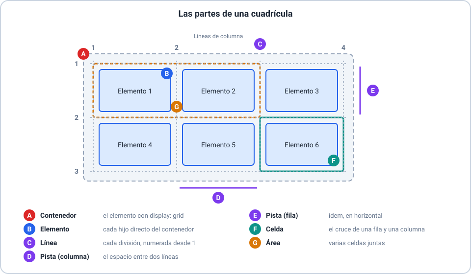
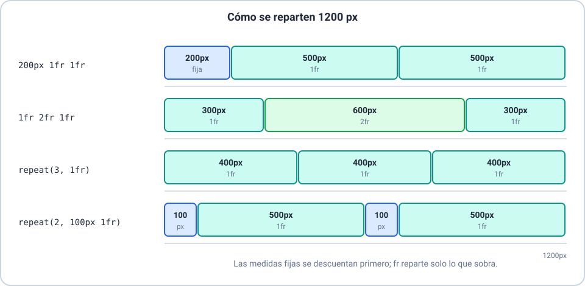
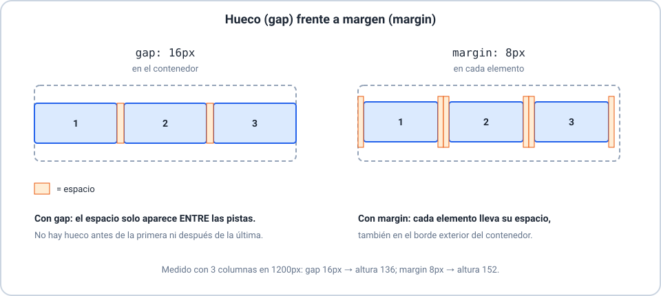

# 🔲 Grid

Curso **HTML y CSS** · Clase 07 · **Sesión 1**

---

## 🎯 Objetivos de la sesión

- 🔹 Explicar qué es Grid y reconocer sus partes.
- 🔹 Definir columnas y filas con `fr`, `repeat()`, `minmax()` y `auto`.
- 🔹 Separar con `gap` y hacer que un elemento ocupe varias pistas.

> 📌 Se recomiendan las Clases 01 a 06.

---

## 🧭 ¿Qué es Grid?

Un sistema de disposición en **dos dimensiones**: filas **y** columnas.

- Se activa en el **contenedor** con `display: grid`.
- Sus **hijos directos** son los **elementos**.
- Sin `display: grid`, `grid-template-columns` no hace nada.

---

## 🧩 Las partes de una cuadrícula



---

## 📐 Columnas: `fr`

`grid-template-columns: 200px 1fr 1fr`

- Primero se descuenta lo fijo (`200px`).
- `fr` reparte **solo lo que sobra**.
- En `1200px`: `200px 500px 500px`.

---

## 🔁 `repeat()` y `minmax()`



---

## 🧮 `repeat()` y `minmax()` en código

```css
.galeria {
  display: grid;
  grid-template-columns: repeat(3, minmax(200px, 1fr));
}
```

- `minmax(200px, 1fr)`: nunca menos de `200px`.
- Con poco espacio, la cuadrícula **se sale** de la ventana.

---

## 📏 Filas y `auto`

- `grid-template-rows: 60px auto 1fr`.
- `auto`: lo que pida el contenido.
- Más elementos que celdas → **filas implícitas**; `grid-auto-rows` fija su altura.

---

## 🧱 Huecos: `gap`



---

## 🧷 Ocupar varias pistas

- `grid-column: 1 / 3`: de la línea 1 a la 3.
- `grid-column: span 2`: dos pistas.
- `grid-column: 1 / -1`: **todas** las columnas.

---

## ⚠️ Errores comunes

- 🚫 Olvidar `display: grid` en el contenedor.
- 🚫 Pensar que `1fr` reparte todo el ancho (reparte lo que **sobra**).
- 🚫 Usar márgenes en lugar de `gap`.
- 🚫 Usar porcentajes con `gap`: se pasan del ancho.

---

## 🛠️ Actividad

**Taller 01 — Armá la maqueta.**

Y los ejercicios **Básico 01** y **Básico 02**, con la ventana en `1200px`.

---

## ✅ Resumen de la sesión

- 🔹 Contenedor, elementos, líneas, pistas, celdas y áreas.
- 🔹 `fr`, `repeat()`, `minmax()`, `auto`.
- 🔹 `gap` separa entre pistas; `span` ocupa varias.
- 🔹 Próxima sesión: la página se adapta al dispositivo.
