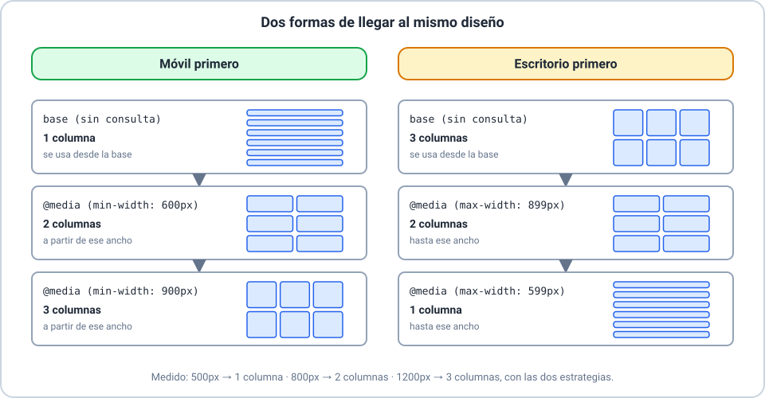
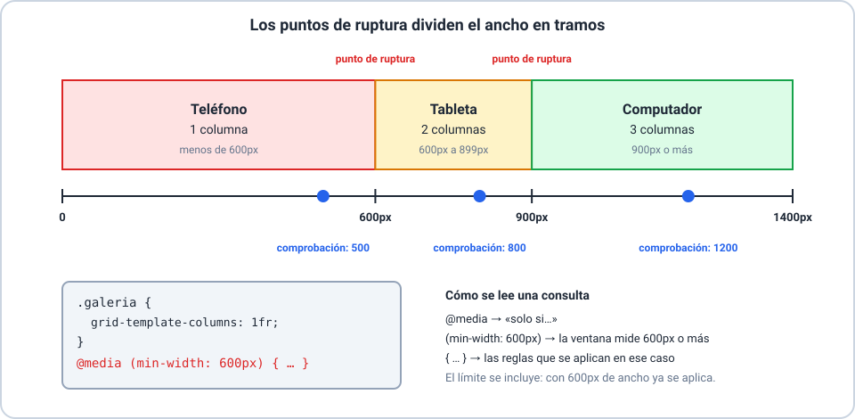

# 📱 Diseño adaptable y consultas de medios

Curso **HTML y CSS** · Clase 07 · **Sesión 2**

---

## 🎯 Objetivos de la sesión

- 🔹 Explicar qué es el diseño adaptable y la ventana de visualización.
- 🔹 Preparar una página para que no se desborde.
- 🔹 Elegir una estrategia y escribir consultas de medios.

> 📌 Se necesita de la sesión 1: `display: grid`, `fr`, `repeat()` y `gap`.

---

## 🌐 ¿Qué es el diseño adaptable?

**Una** página que se acomoda al tamaño del dispositivo.

- Ancho fijo (`960px`) → se sale de una pantalla angosta.
- Ancho flexible (`max-width`) → usa lo que hay.

---

## 🪟 La ventana de visualización


---

## 🧰 Preparación previa

- 🔹 `<meta name="viewport" content="width=device-width, initial-scale=1">`
- 🔹 `* { box-sizing: border-box; }`
- 🔹 `img { max-width: 100%; height: auto; }`

> ⚠️ El efecto de la etiqueta solo se ve en teléfonos y tabletas.

---

## 🧭 Estrategias de diseño



---

## 🧲 La cuadrícula que se acomoda sola

```css
.galeria {
  display: grid;
  grid-template-columns: repeat(auto-fit, minmax(200px, 1fr));
  gap: 16px;
}
```

- En `500px`: 2 columnas · `800px`: 3 · `1200px`: 5.
- Alcanza para tarjetas iguales; para **otra disposición**, una consulta.

---

## ❓ ¿Qué es una consulta de medios?



---

## 🎛️ Condiciones

- `(min-width: 600px)`: 600px **o más**.
- `(min-width: 600px) and (max-width: 899px)`: un tramo.
- `(max-width: 599px), (min-width: 900px)`: **o**.
- `(orientation: landscape)`: ancho mayor que alto.

---

## 🔢 El orden importa

- Si dos consultas coinciden, **gana la que va después**.
- Móvil primero: de **menor a mayor**.
- Revisá que los rangos se **toquen**.

---

## 🧩 Todo junto


---

## ⚠️ Errores comunes

- 🚫 Olvidar la ventana de visualización.
- 🚫 Ancho fijo en `px` en cajas y imágenes.
- 🚫 Consultas de `min-width` de mayor a menor.
- 🚫 Rangos que dejan huecos (`500px` y `700px`).

---

## 🛠️ Actividad

**Taller 02 — Que se adapte.**

Y los ejercicios **Intermedio 01**, **Intermedio 02** y el **Desafío 01**. Probá en `500px`, `800px` y `1200px`.

---

## ✅ Resumen y evaluación

- 🔹 Medidas flexibles + preparación previa.
- 🔹 Móvil primero con `min-width`; `auto-fit` para galerías.
- 🔹 Las consultas cambian la disposición en los puntos de ruptura.
- 🔹 Cierre: **Quiz 01** (10 ítems).
