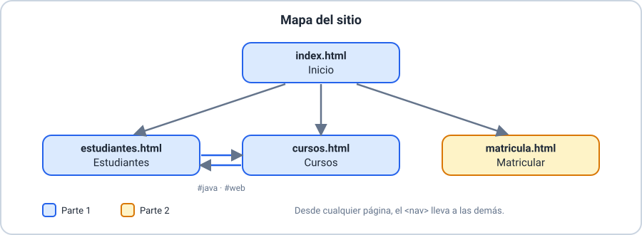
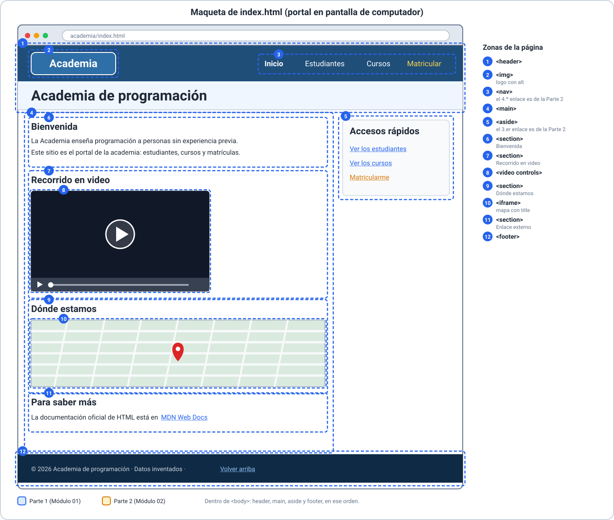
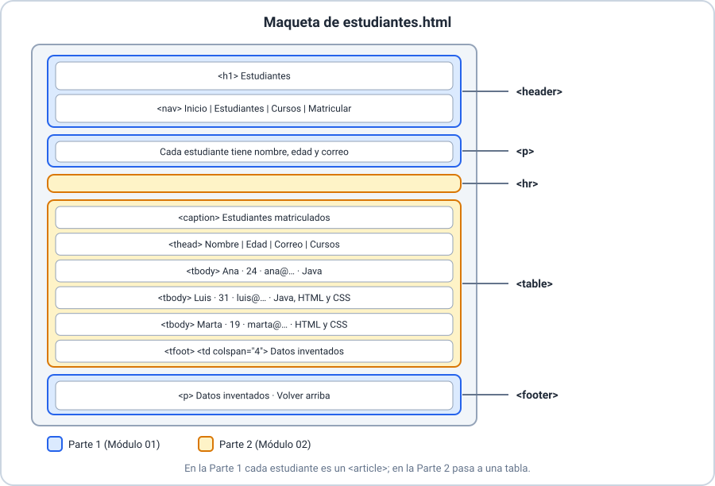
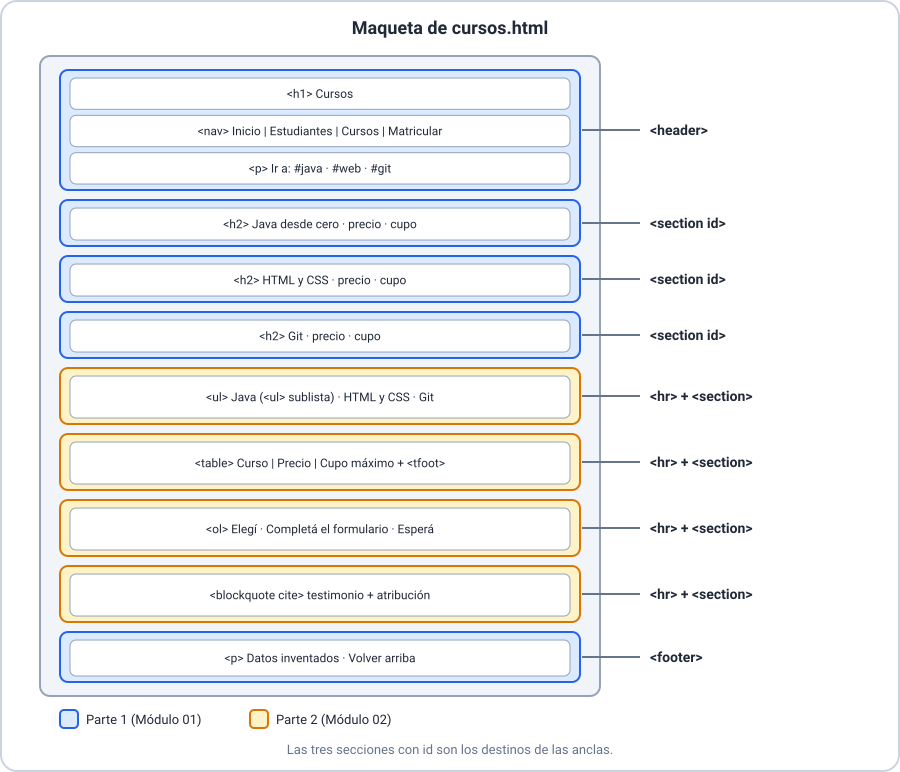
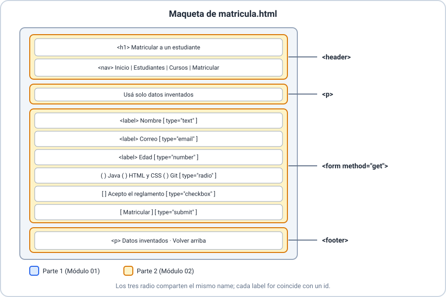

# 🧭 Guía paso a paso — Portal de la Academia (Módulos 01 y 02: HTML)

> 👩‍🏫 **Material docente.** Guía única para construir **junto con los estudiantes**, en vivo, el sitio web de una **academia de programación**: sus **estudiantes**, sus **cursos** y las **matrículas**. Aplica lo visto en el [Módulo 01](../01-Fundamentos-HTML/material/ejemplos/explicacion-conceptual.md) y el [Módulo 02](../02-HTML-para-presentacion/material/ejemplos/explicacion-conceptual.md).
> Contiene código completo: no se entrega a los estudiantes antes de resolver el taller.
>
> 📦 **Proyecto terminado (Partes 1 y 2):** [`academia/`](codigo/academia/) · 🖼️ **Maquetas:** carpeta [`imagenes/`](imagenes/).
>
> ✅ **Verificada.** Las cuatro páginas pasan el validador de HTML del curso (`herramientas/validar_html.py`) sin errores.
>
> 🧭 **Idea central.** Se crean **cuatro archivos HTML, uno detrás de otro**, siguiendo la maqueta. La **Parte 1** (Módulo 01) arma estructura, texto, enlaces, multimedia y semántica; la **Parte 2** (Módulo 02) presenta los datos con **tablas, listas, cita y formulario**. No se necesita saber nada de programación ni de servidores.

<details>
<summary><strong>🎯 Objetivo</strong></summary>

> Construir el sitio de la academia **sin CSS ni JavaScript**, en dos sesiones de 1 h 30 min.
>
> **Parte 1 — Módulo 01.** Al terminar, el estudiante:
>
> - Prepara el entorno y escribe la **estructura mínima** de cada documento.
> - Marca texto con significado y deja **comentarios**.
> - Conecta las páginas con **enlaces**, una dirección externa y **anclas**.
> - Incorpora una **imagen** con `alt`, un **video** con controles y un mapa con `iframe`.
> - Organiza cada página con **etiquetas semánticas** (`header`, `nav`, `main`, `section`, `aside`, `footer`) y sabe cuándo bastaría un `div`.
>
> **Parte 2 — Módulo 02.** Al terminar, el estudiante:
>
> - Separa los temas con `hr` y presenta datos en una **tabla completa** (`caption`, `thead`, `tbody`, `tfoot`, `colspan`).
> - Escribe una lista no enumerada con **sublista** y una lista enumerada.
> - Marca un testimonio con `blockquote` y `cite`.
> - Escribe un **formulario** `method="get"` con cinco tipos de campo, `label`, `name` y `value`, y explica qué datos viajan en la dirección.

</details>

<details>
<summary><strong>📝 Introducción: el problema y sus requerimientos</strong></summary>

> > 🗣️ **Para abrir la sesión.** Se lee el problema y se pregunta: «¿qué información tendría que mostrar la página de una academia?». Cada respuesta del grupo es un trozo de página.
>
> ### 🏫 El problema
>
> La **Academia de programación** quiere un sitio web donde cualquier persona vea quiénes estudian, qué cursos hay, cuánto cuestan y cómo se matricula. El sitio se escribe **a mano**, página por página.
>
> ### 🧩 La información de la academia
>
> | Elemento | Datos | Parte 1 (Módulo 01) | Parte 2 (Módulo 02) |
> |---|---|---|---|
> | **Estudiante** | nombre, edad, correo | Un bloque (`article`) por persona | Una **tabla** con una fila por persona |
> | **Curso** | nombre, precio, cupo máximo | Una sección (`section`) por curso | **Lista** de oferta y **tabla** de precios y cupos |
> | **Matrícula** | quién y en qué curso | Enlaces de cada estudiante a sus cursos | **Formulario** para matricular |
>
> | Si el dato es… | Etiqueta | Ejemplo en el sitio |
> |---|---|---|
> | Un bloque autónomo o un tema | `article` / `section` | Estudiante, curso (Parte 1) |
> | Filas y columnas con el mismo significado | `table` | Estudiantes, cursos |
> | Elementos sin orden / pasos con orden | `ul` / `ol` + `li` | Oferta / cómo te matriculás |
> | Palabras de otra persona | `blockquote` | Testimonio |
> | Datos que escribe el usuario | `form` + `input` | Matrícula |
>
> <details>
> <summary><strong>✅ Requerimientos funcionales — Parte 1</strong></summary>
>
> >
> > | Código | Requerimiento | Página | Contenido |
> > |---|---|---|---|
> > | **RF-1.01** | Presentar la academia con una bienvenida y un video. | `index.html` | Estructura, formato de texto, video |
> > | **RF-1.02** | Mostrar el logo con texto alternativo. | `index.html` | Imagen y `alt` |
> > | **RF-1.03** | Listar los estudiantes con nombre, edad y correo. | `estudiantes.html` | Títulos, párrafos, `mailto:` |
> > | **RF-1.04** | Listar los cursos con precio y cupo máximo. | `cursos.html` | `section` con `id` |
> > | **RF-1.05** | Navegar entre las páginas desde cualquiera. | todas | Enlaces relativos |
> > | **RF-1.06** | Saltar a un curso desde la misma página o desde un estudiante. | `cursos.html`, `estudiantes.html` | Anclas y fragmentos |
> > | **RF-1.07** | Remitir a la documentación oficial en una pestaña nueva. | `index.html` | Enlace externo |
> > | **RF-1.08** | Mostrar un mapa de la sede. | `index.html` | `iframe` con `title` |
> > | **RF-1.09** | Ofrecer accesos rápidos a las demás páginas, aparte del contenido principal. | `index.html` | `aside` |
> >
> </details>
>
> <details>
> <summary><strong>✅ Requerimientos funcionales — Parte 2</strong></summary>
>
> >
> > | Código | Requerimiento | Página | Contenido |
> > |---|---|---|---|
> > | **RF-2.01** | Mostrar los estudiantes en una tabla con nombre, edad, correo y cursos (enlazados). | `estudiantes.html` | Tabla |
> > | **RF-2.02** | Mostrar los cursos con precio y cupo máximo, y una nota al pie. | `cursos.html` | `tfoot` y `colspan` |
> > | **RF-2.03** | Listar la oferta de cursos, con los temas de Java como sublista. | `cursos.html` | `ul` anidada |
> > | **RF-2.04** | Explicar la matrícula en tres pasos. | `cursos.html` | `ol` |
> > | **RF-2.05** | Mostrar un testimonio con su fuente. | `cursos.html` | `blockquote`, `cite` |
> > | **RF-2.06** | Separar los temas de la página. | `cursos.html`, `estudiantes.html` | `hr` |
> > | **RF-2.07** | Pedir nombre, correo, edad, curso y aceptación del reglamento. | `matricula.html` | `form`, `input` |
> >
> </details>
>
> <details>
> <summary><strong>🛠️ Requerimientos no funcionales y restricciones</strong></summary>
>
> >
> > | Código | Requerimiento |
> > |---|---|
> > | **RNF-01** | Solo HTML. **Sin CSS ni JavaScript** (llegan en módulos posteriores). |
> > | **RNF-02** | Todas las etiquetas cerradas y bien anidadas; `lang="es"` y `charset="UTF-8"`. |
> > | **RNF-03** | Toda imagen lleva `alt`; el video lleva `controls`. |
> > | **RNF-04** | Rutas **relativas**; nombres de archivo en minúsculas y sin espacios. |
> > | **RNF-05** | Tipos de `input` permitidos: `text`, `email`, `number`, `radio`, `checkbox` y `submit`. |
> > | **RNF-06** | Formulario con `method="get"` y **sin `action`**: ningún dato sale del equipo. |
> > | **RNF-07** | Cada `label for` coincide con un `id`; cada campo (salvo `submit`) lleva `name`; `radio` y `checkbox` llevan `value`. |
> > | **RNF-08** | Las tablas son para **datos**, no para armar el diseño. |
> > | **RNF-09** | **Solo datos inventados** (correos `@academia.test`). |
> > | **RNF-10** | Duración: 2 sesiones de 1 h 30 min, trabajo individual o en parejas, con VS Code y un navegador. |
> >
> > > 💡 **Alcance.** Quedan fuera: selector, área de texto, validación avanzada, envío a un servidor y todo el estilo (Módulo 03 en adelante).
>
> </details>

</details>

<details>
<summary><strong>🖼️ Maquetado: cómo se ve cada página antes de escribirla</strong></summary>

> > 🗣️ **Se proyectan las maquetas antes de escribir código.** Una **maqueta** es un dibujo de las zonas de la página. Cada bloque de la maqueta es una etiqueta; a la derecha se lee cuál. Quien tiene la maqueta delante sabe qué escribir y en qué orden.
> >
> > **Diseño para computador.** El portal está pensado para la **pantalla de un computador**: las maquetas muestran una ventana de navegador de escritorio con una banda superior (logo y menú), el contenido principal y, en la página de inicio, una columna lateral. Cada zona lleva un **número** que se explica en la lista de la derecha con su etiqueta HTML. El HTML que se escribe en estos dos módulos fija **qué** va en cada zona y en qué orden; **dónde** se coloca (columnas, colores, tarjetas) lo resuelve CSS a partir del Módulo 03. Mientras tanto, el navegador muestra el mismo contenido apilado de arriba hacia abajo.
> >
> > **Colores:** 🟦 azul = lo que se escribe en la **Parte 1**; 🟨 ámbar = lo que se agrega en la **Parte 2**.
>
> <details>
> <summary><strong>🗺️ Mapa del sitio</strong></summary>
>
> > 
> >
> > Son **cuatro archivos** que se crean en este orden: `index.html` → `estudiantes.html` → `cursos.html` → `matricula.html`.
>
> </details>
>
> <details>
> <summary><strong>🏠 Maqueta de index.html</strong></summary>
>
> > 
>
> </details>
>
> <details>
> <summary><strong>👩‍🎓 Maqueta de estudiantes.html</strong></summary>
>
> > 
>
> </details>
>
> <details>
> <summary><strong>📚 Maqueta de cursos.html</strong></summary>
>
> > 
>
> </details>
>
> <details>
> <summary><strong>📝 Maqueta de matricula.html</strong></summary>
>
> > 
>
> </details>

</details>

<details>
<summary><strong>🏗️ Arquitectura: el árbol de archivos (🆕 nuevo · ✏️ cambia en la Parte 2)</strong></summary>

> ```text
> 📁 academia
> ├── 🆕 1. index.html          bienvenida · logo · video · mapa · aside   (✏️ P2: «Matricular» en menú y aside)
> ├── 🆕 2. estudiantes.html    un article por estudiante                    (✏️ P2: pasa a tabla)
> ├── 🆕 3. cursos.html         una section por curso, con id                (✏️ P2: + lista · tabla · pasos · cita)
> ├── 🆕 4. matricula.html      formulario (Parte 2)
> ├── 📁 imagenes
> │   └── 🆕 logo.svg
> └── 📁 video
>     └── 🆕 recorrido.mp4
> ```
>
> > 🧑‍🎓 **Regla de oro para el grupo:** un archivo a la vez. No se pasa al siguiente hasta ver el actual funcionando en el navegador.

</details>

---

<details>
<summary><strong>🅰️ PARTE 1 — Módulo 01: Fundamentos HTML (Pasos 0 a 4)</strong></summary>

> Se crean `index.html`, `estudiantes.html` y `cursos.html`. Todo el código final está en [`codigo/academia/`](codigo/academia/).
>
> > 💡 Los archivos de `codigo/academia/` ya incluyen también los cambios de la Parte 2; lo que cada parte agrega está indicado en los pasos.

</details>

---

<details>
<summary><strong>🚀 Paso 0 — Entorno</strong></summary>

> <details>
> <summary><strong>Paso 0.1 · Carpeta del proyecto</strong></summary>
>
> > 🧑‍🎓 **Indicación al estudiante:**
> >
> > 1. Creá una carpeta llamada `academia`, y dentro de ella dos subcarpetas: `imagenes` y `video`.
> > 2. Abrí la carpeta `academia` en VS Code (`Archivo → Abrir carpeta`).
> > 3. Copiá el logo en `imagenes/logo.svg` y el video en `video/recorrido.mp4` desde [`codigo/academia`](codigo/academia/) (el video es de práctica: se puede cambiar por otro propio).
> >
> > > ✅ **Punto de control.** El explorador de VS Code muestra `academia` con las carpetas `imagenes` y `video` y sus dos archivos. Todavía no hay ninguna página.
>
> </details>
>

</details>

---

<details>
<summary><strong>🏠 Paso 1 — Archivo 1: index.html (la página de inicio)</strong></summary>

> > 🗣️ **Se muestra la [maqueta de index.html](imagenes/maqueta-index.svg).** Se pregunta: ¿cuántas zonas numeradas ve? *(Cabecera, contenido principal con cuatro secciones, lateral y pie.)* Se escribe en el orden de los números, una zona por vez.
>
> <details>
> <summary><strong>Paso 1.1 · Crear el archivo y el esqueleto</strong></summary>
>
> > 🗣️ **Se explica antes de escribir:** `<!DOCTYPE html>` avisa al navegador que es HTML moderno; `html` envuelve todo; `head` lleva lo que **no se ve** (codificación y título); `body` lleva lo que **sí se ve**.
> >
> > 🧑‍🎓 **Indicación al estudiante:** en VS Code, creá el archivo **`index.html`** en la carpeta `academia` y escribí:
> >
> > ```html
> > <!DOCTYPE html>
> > <html lang="es">
> > <head>
> >   <meta charset="UTF-8">
> >   <title>Academia — Inicio</title>
> > </head>
> > <body>
> >   <h1>Academia de programación</h1>
> > </body>
> > </html>
> > ```
> >
> > Guardá y abrí el archivo en el navegador (doble clic, o clic derecho → «Abrir con» el navegador).
> >
> > > ✅ **Punto de control.** La pestaña dice «Academia — Inicio» y la página muestra el título.
> > >
> > > ⚠️ **Error típico.** Olvidar `charset`: «Pérez» se ve «Pérez». Se agrega y se recarga.
>
> </details>
>
> <details>
> <summary><strong>Paso 1.2 · La cabecera: logo y título (RF-1.02)</strong></summary>
>
> > 🧑‍🎓 **Indicación al estudiante:** reemplazá el `h1` del `body` por una **cabecera** (`header`) que lleve el logo y el título:
> >
> > ```html
> >   <header>
> >     
> >     <h1>Academia de programación</h1>
> >   </header>
> > ```
> >
> > > 💡 **`alt`** es lo que lee un lector de pantalla y lo que se muestra si el archivo no carga. Para comprobarlo, cambiá `logo.svg` por `logo-roto.svg`, mirá la página y volvé atrás.
>
> </details>
>
> <details>
> <summary><strong>Paso 1.3 · La navegación (RF-1.05)</strong></summary>
>
> > 🧑‍🎓 **Indicación al estudiante:** dentro del `header`, debajo del `h1`, agregá el menú:
> >
> > ```html
> >     <nav>
> >       <a href="index.html">Inicio</a> |
> >       <a href="estudiantes.html">Estudiantes</a> |
> >       <a href="cursos.html">Cursos</a>
> >     </nav>
> > ```
> >
> > > ⚠️ Los enlaces a `estudiantes.html` y `cursos.html` **todavía no funcionan**: esos archivos no existen. Se prueban en el Paso 4. Es una buena ocasión para ver cómo se comporta un enlace roto.
>
> </details>
>
> <details>
> <summary><strong>Paso 1.4 · El contenido principal: la bienvenida (RF-1.01)</strong></summary>
>
> > 🗣️ **Se pregunta:** ¿qué etiqueta agrupa «lo principal» de la página? *(`main`, y solo uno por página.)* Dentro, cada tema va en una `section` con su título.
> >
> > 🧑‍🎓 **Indicación al estudiante:** debajo del `header`, agregá:
> >
> > ```html
> >   <main>
> >     <section>
> >       <h2>Bienvenida</h2>
> >       <!-- Presentación de la academia: el texto de bienvenida se escribe una sola vez -->
> >       <p>La <strong>Academia</strong> enseña programación a personas <em>sin experiencia previa</em>.
> >       Aquí podés ver quiénes estudian, qué cursos hay y cuánto cuestan.</p>
> >       <p>Este sitio es el <mark>portal</mark> de la academia: estudiantes, cursos y matrículas.</p>
> >     </section>
> >   </main>
> > ```
> >
> > | Etiqueta | Significa | No es |
> > |---|---|---|
> > | `strong` | importancia | «ponerlo en negrita» |
> > | `em` | énfasis | «ponerlo en cursiva» |
> > | `mark` | resaltado | un color de fondo |
> >
> > > 💡 El comentario `<!-- … -->` **no se muestra**, pero sí queda en el código. Se comprueba con `Ctrl+U` (ver código fuente).
>
> </details>
>
> <details>
> <summary><strong>Paso 1.5 · El video (RF-1.01)</strong></summary>
>
> > 🧑‍🎓 **Indicación al estudiante:** dentro de `main`, **debajo** de la sección de bienvenida, agregá una segunda sección:
> >
> > ```html
> >     <section>
> >       <h2>Recorrido en video</h2>
> >       <video src="video/recorrido.mp4" controls width="480">
> >         Tu navegador no reproduce video.
> >       </video>
> >     </section>
> > ```
> >
> > > ⚠️ **Error típico.** Sin `controls` el video no tiene botón de reproducir y parece una imagen.
>
> </details>
>
> <details>
> <summary><strong>Paso 1.6 · El mapa (RF-1.08)</strong></summary>
>
> > 🗣️ **Se explica:** un `iframe` incrusta **otra página** dentro de la nuestra; aquí, un mapa. Necesita conexión a internet y siempre lleva un `title` que dice qué contiene.
> >
> > 🧑‍🎓 **Indicación al estudiante:** dentro de `main`, **debajo** del video, agregá la tercera sección:
> >
> > ```html
> >     <section>
> >       <h2>Dónde estamos</h2>
> >       <iframe title="Mapa de la sede de la Academia" width="480" height="320"
> >         src="https://www.openstreetmap.org/export/embed.html?bbox=-58.42%2C-34.63%2C-58.36%2C-34.59&amp;layer=mapnik"></iframe>
> >     </section>
> > ```
> >
> > > ⚠️ **Error típico.** Sin internet el mapa queda en blanco: no es un error del código. Se revisa la conexión antes de buscar el fallo.
>
> </details>
>
> <details>
> <summary><strong>Paso 1.7 · El enlace externo (RF-1.07)</strong></summary>
>
> > 🧑‍🎓 **Indicación al estudiante:** dentro de `main`, **debajo** del mapa, agregá la cuarta sección:
> >
> > ```html
> >     <section>
> >       <h2>Para saber más</h2>
> >       <p>La documentación oficial de HTML está en
> >       <a href="https://developer.mozilla.org/es/docs/Web/HTML" target="_blank" rel="noopener">MDN Web Docs</a>.</p>
> >     </section>
> > ```
> >
> > `target="_blank"` abre otra pestaña; `rel="noopener"` evita que la pestaña nueva controle a la de origen.
>
> </details>
>
> <details>
> <summary><strong>Paso 1.8 · Los accesos rápidos (RF-1.09)</strong></summary>
>
> > 🗣️ **Se pregunta:** ¿qué etiqueta es para contenido **relacionado pero secundario**, que se puede quitar sin perder el sentido de la página? *(`aside`.)* Va **fuera** de `main`, como lo muestra la maqueta (zona 5).
> >
> > 🧑‍🎓 **Indicación al estudiante:** **debajo** de `</main>` y antes del pie, agregá:
> >
> > ```html
> >   <aside>
> >     <h2>Accesos rápidos</h2>
> >     <p><a href="estudiantes.html">Ver los estudiantes</a></p>
> >     <p><a href="cursos.html">Ver los cursos</a></p>
> >   </aside>
> > ```
> >
> > > 💡 El tercer acceso, «Matricularme», se agrega en la Parte 2 (Paso 5).
>
> </details>
>
> <details>
> <summary><strong>Paso 1.9 · El pie</strong></summary>
>
> > 🧑‍🎓 **Indicación al estudiante:** **debajo** del `aside`, antes de `</body>`, agregá:
> >
> > ```html
> >   <footer>
> >     <p>© 2026 Academia de programación · <a href="#">Volver arriba</a></p>
> >   </footer>
> > ```
> >
> > > ✅ **Punto de control del archivo 1.** Se compara con la [maqueta](imagenes/maqueta-index.svg) y con el [archivo terminado](codigo/academia/index.html): `header` → `main` (4 `section`) → `aside` → `footer`, cada zona en su lugar. La Parte 2 solo le agrega «Matricular» al menú y al `aside`.
> >
> > 🧠 **Para preguntar:** si solo quisiera agrupar dos párrafos sin significado propio, ¿qué etiqueta usaría? *(Un `div`, y se deja un comentario que lo explique.)*
>
> </details>

</details>

---

<details>
<summary><strong>👩‍🎓 Paso 2 — Archivo 2: estudiantes.html</strong></summary>

> > 🗣️ **Se muestra la [maqueta de estudiantes.html](imagenes/maqueta-estudiantes.svg)** (en esta parte solo se escribe lo azul). Se pregunta: ¿qué datos tiene un estudiante? *(Nombre, edad y correo.)* Cada persona es un bloque autónomo: `article`.
>
> <details>
> <summary><strong>Paso 2.1 · Crear el archivo con la cabecera</strong></summary>
>
> > 🧑‍🎓 **Indicación al estudiante:** creá **`estudiantes.html`**. Podés copiar el esqueleto de `index.html` y cambiar el `title` a `Academia — Estudiantes`. Dentro del `body` escribí la cabecera con el mismo menú:
> >
> > ```html
> >   <header>
> >     
> >     <h1>Estudiantes</h1>
> >     <nav>
> >       <a href="index.html">Inicio</a> |
> >       <a href="estudiantes.html">Estudiantes</a> |
> >       <a href="cursos.html">Cursos</a>
> >     </nav>
> >   </header>
> > ```
> >
> > 🧠 **Para preguntar:** ¿por qué cada página lleva su propio `title`? *(Aparece en la pestaña, en el historial y en los buscadores.)*
>
> </details>
>
> <details>
> <summary><strong>Paso 2.2 · Un article por estudiante (RF-1.03)</strong></summary>
>
> > 🧑‍🎓 **Indicación al estudiante:** debajo del `header`, agregá `main` con el primer estudiante:
> >
> > ```html
> >   <main>
> >     <p>Cada estudiante tiene un <strong>nombre</strong>, una <strong>edad</strong> y un <strong>correo</strong> único.</p>
> >
> >     <article>
> >       <h2>Ana Pérez</h2>
> >       <p>Edad: 24 años</p>
> >       <p>Correo: <a href="mailto:ana@academia.test">ana@academia.test</a></p>
> >       <p>Cursos: <a href="cursos.html#java">Java desde cero</a></p>
> >     </article>
> >   </main>
> > ```
> >
> > Dentro de `main`, debajo, repetí el `article` para **Luis Gómez** (31 años, `luis@academia.test`, cursos: Java desde cero y HTML y CSS) y **Marta Ruiz** (19 años, `marta@academia.test`, curso: HTML y CSS). El enlace de cada curso es `cursos.html#java` o `cursos.html#web`.
> >
> > | Parte del enlace | Qué hace |
> > |---|---|
> > | `cursos.html` | Abre la otra página |
> > | `#java` | Baja hasta el elemento con `id="java"` (se crea en el Paso 3) |
> >
> > > ⚠️ Hasta crear `cursos.html` estos enlaces no llevan a ningún lado; es esperable.
>
> </details>
>
> <details>
> <summary><strong>Paso 2.3 · El pie</strong></summary>
>
> > 🧑‍🎓 **Indicación al estudiante:** debajo de `main`, agregá:
> >
> > ```html
> >   <footer>
> >     <p>Datos inventados · <a href="#">Volver arriba</a></p>
> >   </footer>
> > ```
> >
> > > ✅ **Punto de control del archivo 2.** Se ven tres estudiantes, cada uno con su correo como enlace (`mailto:`). Se compara la estructura con la maqueta.
>
> </details>

</details>

---

<details>
<summary><strong>📚 Paso 3 — Archivo 3: cursos.html</strong></summary>

> > 🗣️ **Se muestra la [maqueta de cursos.html](imagenes/maqueta-cursos.svg)** (ahora solo las zonas azules: cabecera, tres secciones y pie). Cada curso es un tema con título propio: `section`, y con un **`id`** para poder saltar a él.
>
> <details>
> <summary><strong>Paso 3.1 · Crear el archivo con la cabecera y los atajos (RF-1.06)</strong></summary>
>
> > 🧑‍🎓 **Indicación al estudiante:** creá **`cursos.html`** con el esqueleto (`title`: `Academia — Cursos`) y esta cabecera. El último párrafo son **atajos** a cada curso dentro de la misma página:
> >
> > ```html
> >   <header>
> >     
> >     <h1>Cursos</h1>
> >     <nav>
> >       <a href="index.html">Inicio</a> |
> >       <a href="estudiantes.html">Estudiantes</a> |
> >       <a href="cursos.html">Cursos</a>
> >     </nav>
> >     <p>Ir a: <a href="#java">Java</a> · <a href="#web">HTML y CSS</a> · <a href="#git">Git</a></p>
> >   </header>
> > ```
>
> </details>
>
> <details>
> <summary><strong>Paso 3.2 · Una section por curso (RF-1.04)</strong></summary>
>
> > 🧑‍🎓 **Indicación al estudiante:** debajo del `header`, agregá `main` con las tres secciones. Cada `id` coincide con un atajo del Paso 3.1:
> >
> > ```html
> >   <main>
> >     <!-- Se usa section porque cada curso es un tema con su propio título -->
> >     <section id="java">
> >       <h2>Java desde cero</h2>
> >       <p>Precio: $180.000 · Cupo máximo: 20 personas</p>
> >       <p>Variables, condicionales, ciclos y clases.</p>
> >     </section>
> >
> >     <section id="web">
> >       <h2>HTML y CSS</h2>
> >       <p>Precio: $150.000 · Cupo máximo: 25 personas</p>
> >       <p>Páginas con <code>HTML</code> semántico y estilo con <code>CSS</code>.</p>
> >     </section>
> >
> >     <section id="git">
> >       <h2>Git</h2>
> >       <p>Precio: $90.000 · Cupo máximo: 30 personas</p>
> >       <p>Control de versiones: guardar, comparar y compartir cambios.</p>
> >     </section>
> >   </main>
> > ```
> >
> > > ⚠️ **Error típico.** Dos elementos con el mismo `id`. Cada `id` es único en la página.
>
> </details>
>
> <details>
> <summary><strong>Paso 3.3 · El pie</strong></summary>
>
> > 🧑‍🎓 **Indicación al estudiante:** debajo de `main`, el mismo pie de `estudiantes.html`:
> >
> > ```html
> >   <footer>
> >     <p>Datos inventados · <a href="#">Volver arriba</a></p>
> >   </footer>
> > ```
> >
> > > ✅ **Punto de control del archivo 3.** Los tres atajos del encabezado bajan al curso correcto. Si uno no baja, se compara el `id` con el `#` letra por letra.
>
> </details>

</details>

---

<details>
<summary><strong>✅ Paso 4 — Probar y revisar la Parte 1</strong></summary>

> <details>
> <summary><strong>Paso 4.1 · Recorrer el sitio</strong></summary>
>
> > 🧑‍🎓 **Indicación al estudiante:** desde `index.html`, seguí el menú hasta las otras dos páginas y volvé. Luego entrá a `estudiantes.html` y hacé clic en el nombre de un curso: debería abrir `cursos.html` y bajar a ese curso. Compará tu sitio con el [mapa del sitio](imagenes/mapa-del-sitio.svg).
>
> </details>
>
> <details>
> <summary><strong>Paso 4.2 · Lista de verificación</strong></summary>
>
> > - [ ] Las tres páginas abren sin errores y cada una tiene su `title`.
> > - [ ] La navegación funciona en ambos sentidos.
> > - [ ] Los tres atajos de `cursos.html` y los enlaces de los estudiantes saltan al curso correcto.
> > - [ ] El logo se ve, tiene `alt` y el video se reproduce.
> > - [ ] El enlace externo abre una pestaña nueva.
> > - [ ] Hay al menos un comentario y ningún `id` repetido.
> > - [ ] Cada página usa `header`, `main` y `footer`.
> > - [ ] No hay CSS ni JavaScript.
>
> </details>

</details>

---

<details>
<summary><strong>🅱️ PARTE 2 — Módulo 02: HTML para presentación (Pasos 5 a 10)</strong></summary>

> Se sigue en **la misma carpeta `academia`**, partiendo de lo terminado en la Parte 1. Se modifican `estudiantes.html` y `cursos.html`, y se crea `matricula.html`.

</details>

---

<details>
<summary><strong>🔗 Paso 5 — Una opción más en el menú</strong></summary>

> <details>
> <summary><strong>Paso 5.1 · Agregar «Matricular»</strong></summary>
>
> > 🧑‍🎓 **Indicación al estudiante:** en **las tres páginas** (`index.html`, `estudiantes.html` y `cursos.html`), reemplazá el `nav` por este:
> >
> > ```html
> >     <nav>
> >       <a href="index.html">Inicio</a> |
> >       <a href="estudiantes.html">Estudiantes</a> |
> >       <a href="cursos.html">Cursos</a> |
> >       <a href="matricula.html">Matricular</a>
> >     </nav>
> > ```
> >
> > Y en `index.html`, dentro del `aside`, agregá el tercer acceso rápido:
> >
> > ```html
> >     <p><a href="matricula.html">Matricularme</a></p>
> > ```
> >
> > > ⚠️ Los enlaces a `matricula.html` quedan rotos hasta el Paso 8; es normal. Todo lo de la Parte 1 (logo, video, mapa, anclas, enlace externo) se conserva.
>
> </details>

</details>

---

<details>
<summary><strong>📊 Paso 6 — estudiantes.html: de los article a una tabla (RF-2.01, RF-2.06)</strong></summary>

> > 🗣️ **Se muestra la [maqueta de estudiantes.html](imagenes/maqueta-estudiantes.svg)** completa (ahora también lo ámbar). Se pregunta: ¿qué tienen en común Ana, Luis y Marta? *(Los mismos campos.)* Datos con las mismas columnas piden una tabla.
>
> <details>
> <summary><strong>Paso 6.1 · Reemplazar el contenido de main</strong></summary>
>
> > 🧑‍🎓 **Indicación al estudiante:** en `estudiantes.html`, **borrá** los tres `article` y dejá en `main` esto (primero el párrafo, luego un separador `hr` y la tabla):
> >
> > ```html
> >   <main>
> >     <p>Cada estudiante tiene un <strong>nombre</strong>, una <strong>edad</strong> y un <strong>correo</strong> único.</p>
> >
> >     <hr>
> >
> >     <table>
> >       <caption>Estudiantes matriculados</caption>
> >       <thead>
> >         <tr>
> >           <th>Nombre</th>
> >           <th>Edad</th>
> >           <th>Correo</th>
> >           <th>Cursos</th>
> >         </tr>
> >       </thead>
> >       <tbody>
> >         <tr>
> >           <td>Ana Pérez</td>
> >           <td>24</td>
> >           <td><a href="mailto:ana@academia.test">ana@academia.test</a></td>
> >           <td><a href="cursos.html#java">Java desde cero</a></td>
> >         </tr>
> >         <!-- Luis Gómez y Marta Ruiz: una fila <tr> más por cada uno -->
> >       </tbody>
> >       <tfoot>
> >         <tr>
> >           <td colspan="4">Datos inventados. Un estudiante puede estar en varios cursos.</td>
> >         </tr>
> >       </tfoot>
> >     </table>
> >   </main>
> > ```
> >
> > Luego agregá, dentro de `tbody`, las filas de **Luis** (31, `luis@academia.test`, enlaces a `#java` y `#web`) y **Marta** (19, `marta@academia.test`, enlace a `#web`). Se completa con el [archivo terminado](codigo/academia/estudiantes.html).
> >
> > | Pieza | Para qué |
> > |---|---|
> > | `caption` | Título de la tabla |
> > | `thead` / `th` | Encabezados |
> > | `tbody` / `td` | Filas de datos |
> > | `tfoot` + `colspan="4"` | Nota que ocupa **las cuatro** columnas |
> >
> > > ⚠️ **Error típico.** Una fila con tres `td` en una tabla de cuatro columnas: la tabla se «descuadra». Se cuenta por fila.
> >
> > > ✅ **Punto de control.** La tabla muestra tres filas y la nota al pie ocupa todo el ancho.
>
> </details>

</details>

---

<details>
<summary><strong>📚 Paso 7 — cursos.html: lista, tabla, pasos y cita (RF-2.02 a RF-2.06)</strong></summary>

> > 🗣️ **Se muestra la [maqueta de cursos.html](imagenes/maqueta-cursos.svg)** completa. Las tres secciones con `id` **se conservan**; las cuatro zonas ámbar se agregan **debajo, dentro de `main`**, cada una precedida por un `hr`.
>
> <details>
> <summary><strong>Paso 7.1 · Oferta con sublista</strong></summary>
>
> > 🧑‍🎓 **Indicación al estudiante:** en `cursos.html`, debajo de la sección `git` y antes de `</main>`, agregá:
> >
> > ```html
> >     <hr>
> >
> >     <section>
> >       <h2>Oferta de cursos</h2>
> >       <ul>
> >         <li>Java desde cero
> >           <ul>
> >             <li>Variables y condicionales</li>
> >             <li>Ciclos y clases</li>
> >           </ul>
> >         </li>
> >         <li>HTML y CSS</li>
> >         <li>Git</li>
> >       </ul>
> >     </section>
> > ```
> >
> > > 💡 **Regla.** La sublista va **dentro** del `li` al que pertenece, no como hermana del `li`.
>
> </details>
>
> <details>
> <summary><strong>Paso 7.2 · Precios y cupos</strong></summary>
>
> > 🧑‍🎓 **Indicación al estudiante:** debajo de la sección anterior, agregá:
> >
> > ```html
> >     <hr>
> >
> >     <section>
> >       <h2>Precios y cupos</h2>
> >       <table>
> >         <caption>Cursos de la Academia</caption>
> >         <thead>
> >           <tr><th>Curso</th><th>Precio</th><th>Cupo máximo</th></tr>
> >         </thead>
> >         <tbody>
> >           <tr><td>Java desde cero</td><td>$180.000</td><td>20</td></tr>
> >           <tr><td>HTML y CSS</td><td>$150.000</td><td>25</td></tr>
> >           <tr><td>Git</td><td>$90.000</td><td>30</td></tr>
> >         </tbody>
> >         <tfoot>
> >           <tr><td colspan="3">Precios en pesos. El cupo máximo es el tope de matriculados.</td></tr>
> >         </tfoot>
> >       </table>
> >     </section>
> > ```
> >
> > (En el [archivo terminado](codigo/academia/cursos.html) cada celda va en su propia línea, igual que en el Paso 6.)
>
> </details>
>
> <details>
> <summary><strong>Paso 7.3 · Pasos de matrícula (RF-2.04)</strong></summary>
>
> > 🧑‍🎓 **Indicación al estudiante:** debajo, agregá:
> >
> > ```html
> >     <hr>
> >
> >     <section>
> >       <h2>Cómo te matriculás</h2>
> >       <ol>
> >         <li>Elegí un curso de la tabla.</li>
> >         <li>Completá el <a href="matricula.html">formulario de matrícula</a>.</li>
> >         <li>Esperá la confirmación de la Academia.</li>
> >       </ol>
> >     </section>
> > ```
> >
> > > 🧠 **Para preguntar:** ¿por qué acá `ol` y en la oferta `ul`? *(Los pasos tienen orden; los cursos no.)*
>
> </details>
>
> <details>
> <summary><strong>Paso 7.4 · Cita con fuente (RF-2.05)</strong></summary>
>
> > 🧑‍🎓 **Indicación al estudiante:** debajo, y antes de `</main>`, agregá:
> >
> > ```html
> >     <hr>
> >
> >     <section>
> >       <h2>Lo que dicen</h2>
> >       <blockquote cite="https://academia.test/opiniones/ana">
> >         <p>Entré sin saber qué era una variable y salí armando mi primera página.</p>
> >       </blockquote>
> >       <p>— Ana Pérez, estudiante de Java desde cero</p>
> >     </section>
> > ```
> >
> > > ⚠️ **Error típico.** Poner el nombre de la persona dentro de `<cite>`: esa etiqueta es para el **título de una obra**. La atribución va fuera del `blockquote`, y la dirección de la fuente, en el atributo `cite`.
> >
> > > ✅ **Punto de control del archivo 3 completo.** Se compara con la maqueta: tres secciones con `id`, y debajo lista, tabla, pasos y cita separadas por `hr`.
>
> </details>

</details>

---

<details>
<summary><strong>📝 Paso 8 — Archivo 4: matricula.html (el formulario) (RF-2.07)</strong></summary>

> > 🗣️ **Se muestra la [maqueta de matricula.html](imagenes/maqueta-matricula.svg).** Se pregunta: para matricular a alguien, ¿qué hay que saber? *(Quién es y en qué curso.)* El formulario pide justo eso.
>
> <details>
> <summary><strong>Paso 8.1 · Qué campo para qué dato</strong></summary>
>
> > | Campo del formulario | Tipo | `name` | Valor que viaja |
> > |---|---|---|---|
> > | Nombre | `text` | `nombre` | lo escrito |
> > | Correo | `email` | `correo` | lo escrito |
> > | Edad | `number` | `edad` | lo escrito |
> > | Curso | `radio` | `curso` | `java`, `web` o `git` |
> > | Reglamento | `checkbox` | `acepta` | `si` (solo si está marcada) |
> > | — | `submit` | — | — |
>
> </details>
>
> <details>
> <summary><strong>Paso 8.2 · Crear el archivo y la cabecera</strong></summary>
>
> > 🧑‍🎓 **Indicación al estudiante:** creá **`matricula.html`** con el esqueleto (`title`: `Academia — Matrícula`) y esta cabecera:
> >
> > ```html
> >   <header>
> >     
> >     <h1>Matricular a un estudiante</h1>
> >     <nav>
> >       <a href="index.html">Inicio</a> |
> >       <a href="estudiantes.html">Estudiantes</a> |
> >       <a href="cursos.html">Cursos</a> |
> >       <a href="matricula.html">Matricular</a>
> >     </nav>
> >   </header>
> > ```
>
> </details>
>
> <details>
> <summary><strong>Paso 8.3 · El formulario</strong></summary>
>
> > 🧑‍🎓 **Indicación al estudiante:** debajo del `header`, escribí `main` con el formulario, **campo por campo**, verificando en el navegador cada vez que agregues uno:
> >
> > ```html
> >   <main>
> >     <p>Usá <strong>solo datos inventados</strong>: el formulario no se envía a ningún servidor.</p>
> >
> >     <form method="get">
> >       <p>
> >         <label for="nombre">Nombre:</label>
> >         <input type="text" id="nombre" name="nombre" value="Ana Pérez">
> >       </p>
> >       <p>
> >         <label for="correo">Correo:</label>
> >         <input type="email" id="correo" name="correo">
> >       </p>
> >       <p>
> >         <label for="edad">Edad:</label>
> >         <input type="number" id="edad" name="edad">
> >       </p>
> >
> >       <p>Curso:</p>
> >       <p>
> >         <input type="radio" id="java" name="curso" value="java">
> >         <label for="java">Java desde cero</label>
> >         <input type="radio" id="web" name="curso" value="web">
> >         <label for="web">HTML y CSS</label>
> >         <input type="radio" id="git" name="curso" value="git">
> >         <label for="git">Git</label>
> >       </p>
> >
> >       <p>
> >         <input type="checkbox" id="acepta" name="acepta" value="si">
> >         <label for="acepta">Acepto el reglamento de la Academia</label>
> >       </p>
> >
> >       <p><input type="submit" value="Matricular"></p>
> >     </form>
> >   </main>
> > ```
> >
> > | Detalle | Por qué |
> > |---|---|
> > | `label for="x"` + `id="x"` | Al hacer clic en el texto se activa el campo |
> > | Los tres `radio` con el **mismo `name`** | Solo se elige uno |
> > | `value="Ana Pérez"` en el nombre | Valor inicial que se puede cambiar |
> > | Sin `action` | No sale ningún dato del equipo |
>
> </details>
>
> <details>
> <summary><strong>Paso 8.4 · El pie</strong></summary>
>
> > 🧑‍🎓 **Indicación al estudiante:** debajo de `main`, el mismo pie de las otras páginas. Si querés ver todo junto, compará con [`matricula.html`](codigo/academia/matricula.html).
> >
> > ```html
> >   <footer>
> >     <p>Datos inventados · <a href="#">Volver arriba</a></p>
> >   </footer>
> > ```
> >
> > > ✅ **Punto de control del archivo 4.** El formulario se ve completo y el enlace «Matricular» del menú, que estaba roto desde el Paso 5, ya funciona.
>
> </details>

</details>

---

<details>
<summary><strong>🧪 Paso 9 — Probar el formulario y leer la dirección</strong></summary>

> <details>
> <summary><strong>Paso 9.1 · Primer envío</strong></summary>
>
> > 🧑‍🎓 **Indicación al estudiante:** completá con `Luis Gómez`, `luis@academia.test`, `31`, curso **HTML y CSS**, reglamento **marcado**, y pulsá **Matricular**. Mirá la barra de direcciones: debería ser algo como
> >
> > ```text
> > matricula.html?nombre=Luis+G%C3%B3mez&correo=luis%40academia.test&edad=31&curso=web&acepta=si
> > ```
> >
> > | Parte | Significado |
> > |---|---|
> > | `?` | Aquí empiezan los datos |
> > | `nombre=…` | `name` del campo = valor |
> > | `&` | Separa un dato del siguiente |
> > | `+` y `%C3%B3` | Espacio y «ó» codificados para que viajen en la dirección |
> >
> > 📝 **Anotá la dirección**: es parte del entregable.
>
> </details>
>
> <details>
> <summary><strong>Paso 9.2 · Segundo envío, sin marcar la casilla</strong></summary>
>
> > 🧑‍🎓 **Indicación al estudiante:** repetí sin marcar el reglamento y anotá la nueva dirección. Queda **sin** `&acepta=si`:
> >
> > ```text
> > matricula.html?nombre=Luis+G%C3%B3mez&correo=luis%40academia.test&edad=31&curso=web
> > ```
> >
> > 🧠 **Para preguntar:** ¿por qué falta ese dato? *(Una casilla desmarcada no envía nada: el navegador solo manda los campos activos. Lo mismo pasa con un `radio` sin elegir.)*
>
> </details>

</details>

---

<details>
<summary><strong>🏁 Paso 10 — Revisión final</strong></summary>

> <details>
> <summary><strong>Paso 10.1 · Lista de verificación</strong></summary>
>
> > - [ ] Las cuatro páginas abren y el menú lleva de cualquiera a las demás.
> > - [ ] Las dos tablas tienen `caption`, `thead`, `tbody` y `tfoot`, y el `colspan` coincide con el número de columnas.
> > - [ ] La sublista está **dentro** de un `li`.
> > - [ ] Hay una lista enumerada y los temas de `cursos.html` están separados con `hr`.
> > - [ ] El `blockquote` tiene `cite` y la atribución está fuera.
> > - [ ] El formulario usa `method="get"`, sin `action`, con cinco tipos de campo.
> > - [ ] Cada `label for` coincide con un `id`; cada campo tiene `name`.
> > - [ ] Las dos direcciones están anotadas y la explicación del Paso 9.2 es correcta.
> > - [ ] No hay CSS ni JavaScript.
> >
> > **Verificación automática (docente):**
> >
> > ```bash
> > python3 herramientas/validar_html.py curso-html-css/guias/codigo/academia
> > # 4 archivo(s), 0 error(es)
> > ```
>
> </details>

</details>

---

<details>
<summary><strong>🏁 Estructura final esperada</strong></summary>

> Así debe quedar la carpeta al terminar el Paso 10. Los archivos son **idénticos** a los de [`codigo/academia/`](codigo/academia/).
>
> ```text
> 📁 academia
> ├── 📄 index.html
> ├── 📄 estudiantes.html
> ├── 📄 cursos.html
> ├── 📄 matricula.html
> ├── 📁 imagenes
> │   └── 🖼️ logo.svg
> └── 📁 video
>     └── 🎬 recorrido.mp4
> ```
>
> | Archivo | Se crea en | Contenido final |
> |---|---|---|
> | `index.html` | Paso 1 (menú y acceso: Paso 5) | Logo, bienvenida, video, mapa, enlace externo, accesos rápidos |
> | `estudiantes.html` | Paso 2 (tabla: Paso 6) | Tabla de estudiantes con cursos enlazados |
> | `cursos.html` | Paso 3 (Paso 7) | Tres cursos con `id`, oferta, tabla, pasos y cita |
> | `matricula.html` | Paso 8 | Formulario de matrícula |
> | `imagenes/logo.svg`, `video/recorrido.mp4` | Paso 0 | Recursos de práctica |

>
> <details>
> <summary><strong>📄 index.html</strong> <em>(Parte 1 + menú y acceso de la Parte 2)</em></summary>
>
> **Ruta:** `academia/index.html`
>
> ```html
> <!DOCTYPE html>
> <html lang="es">
> <head>
>   <meta charset="UTF-8">
>   <title>Academia — Inicio</title>
> </head>
> <body>
>   <header>
>     
>     <h1>Academia de programación</h1>
>     <nav>
>       <a href="index.html">Inicio</a> |
>       <a href="estudiantes.html">Estudiantes</a> |
>       <a href="cursos.html">Cursos</a> |
>       <a href="matricula.html">Matricular</a>
>     </nav>
>   </header>
>
>   <main>
>     <section>
>       <h2>Bienvenida</h2>
>       <!-- Presentación de la academia: el texto de bienvenida se escribe una sola vez -->
>       <p>La <strong>Academia</strong> enseña programación a personas <em>sin experiencia previa</em>.
>       Aquí podés ver quiénes estudian, qué cursos hay y cuánto cuestan.</p>
>       <p>Este sitio es el <mark>portal</mark> de la academia: estudiantes, cursos y matrículas.</p>
>     </section>
>
>     <section>
>       <h2>Recorrido en video</h2>
>       <video src="video/recorrido.mp4" controls width="480">
>         Tu navegador no reproduce video.
>       </video>
>     </section>
>
>     <section>
>       <h2>Dónde estamos</h2>
>       <iframe title="Mapa de la sede de la Academia" width="480" height="320"
>         src="https://www.openstreetmap.org/export/embed.html?bbox=-58.42%2C-34.63%2C-58.36%2C-34.59&amp;layer=mapnik"></iframe>
>     </section>
>
>     <section>
>       <h2>Para saber más</h2>
>       <p>La documentación oficial de HTML está en
>       <a href="https://developer.mozilla.org/es/docs/Web/HTML" target="_blank" rel="noopener">MDN Web Docs</a>.</p>
>     </section>
>   </main>
>
>   <aside>
>     <h2>Accesos rápidos</h2>
>     <p><a href="estudiantes.html">Ver los estudiantes</a></p>
>     <p><a href="cursos.html">Ver los cursos</a></p>
>     <p><a href="matricula.html">Matricularme</a></p>
>   </aside>
>
>   <footer>
>     <p>© 2026 Academia de programación · <a href="#">Volver arriba</a></p>
>   </footer>
> </body>
> </html>
> ```
>
> </details>
>
> <details>
> <summary><strong>📄 estudiantes.html</strong> <em>(Parte 1 → tabla de la Parte 2)</em></summary>
>
> **Ruta:** `academia/estudiantes.html`
>
> ```html
> <!DOCTYPE html>
> <html lang="es">
> <head>
>   <meta charset="UTF-8">
>   <title>Academia — Estudiantes</title>
> </head>
> <body>
>   <header>
>     
>     <h1>Estudiantes</h1>
>     <nav>
>       <a href="index.html">Inicio</a> |
>       <a href="estudiantes.html">Estudiantes</a> |
>       <a href="cursos.html">Cursos</a> |
>       <a href="matricula.html">Matricular</a>
>     </nav>
>   </header>
>
>   <main>
>     <p>Cada estudiante tiene un <strong>nombre</strong>, una <strong>edad</strong> y un <strong>correo</strong> único.</p>
>
>     <hr>
>
>     <table>
>       <caption>Estudiantes matriculados</caption>
>       <thead>
>         <tr>
>           <th>Nombre</th>
>           <th>Edad</th>
>           <th>Correo</th>
>           <th>Cursos</th>
>         </tr>
>       </thead>
>       <tbody>
>         <tr>
>           <td>Ana Pérez</td>
>           <td>24</td>
>           <td><a href="mailto:ana@academia.test">ana@academia.test</a></td>
>           <td><a href="cursos.html#java">Java desde cero</a></td>
>         </tr>
>         <tr>
>           <td>Luis Gómez</td>
>           <td>31</td>
>           <td><a href="mailto:luis@academia.test">luis@academia.test</a></td>
>           <td><a href="cursos.html#java">Java desde cero</a>, <a href="cursos.html#web">HTML y CSS</a></td>
>         </tr>
>         <tr>
>           <td>Marta Ruiz</td>
>           <td>19</td>
>           <td><a href="mailto:marta@academia.test">marta@academia.test</a></td>
>           <td><a href="cursos.html#web">HTML y CSS</a></td>
>         </tr>
>       </tbody>
>       <tfoot>
>         <tr>
>           <td colspan="4">Datos inventados. Un estudiante puede estar en varios cursos.</td>
>         </tr>
>       </tfoot>
>     </table>
>   </main>
>
>   <footer>
>     <p>Datos inventados · <a href="#">Volver arriba</a></p>
>   </footer>
> </body>
> </html>
> ```
>
> </details>
>
> <details>
> <summary><strong>📄 cursos.html</strong> <em>(Parte 1 + bloques de la Parte 2)</em></summary>
>
> **Ruta:** `academia/cursos.html`
>
> ```html
> <!DOCTYPE html>
> <html lang="es">
> <head>
>   <meta charset="UTF-8">
>   <title>Academia — Cursos</title>
> </head>
> <body>
>   <header>
>     
>     <h1>Cursos</h1>
>     <nav>
>       <a href="index.html">Inicio</a> |
>       <a href="estudiantes.html">Estudiantes</a> |
>       <a href="cursos.html">Cursos</a> |
>       <a href="matricula.html">Matricular</a>
>     </nav>
>     <p>Ir a: <a href="#java">Java</a> · <a href="#web">HTML y CSS</a> · <a href="#git">Git</a></p>
>   </header>
>
>   <main>
>     <!-- Se usa section porque cada curso es un tema con su propio título -->
>     <section id="java">
>       <h2>Java desde cero</h2>
>       <p>Precio: $180.000 · Cupo máximo: 20 personas</p>
>       <p>Variables, condicionales, ciclos y clases.</p>
>     </section>
>
>     <section id="web">
>       <h2>HTML y CSS</h2>
>       <p>Precio: $150.000 · Cupo máximo: 25 personas</p>
>       <p>Páginas con <code>HTML</code> semántico y estilo con <code>CSS</code>.</p>
>     </section>
>
>     <section id="git">
>       <h2>Git</h2>
>       <p>Precio: $90.000 · Cupo máximo: 30 personas</p>
>       <p>Control de versiones: guardar, comparar y compartir cambios.</p>
>     </section>
>
>     <hr>
>
>     <section>
>       <h2>Oferta de cursos</h2>
>       <ul>
>         <li>Java desde cero
>           <ul>
>             <li>Variables y condicionales</li>
>             <li>Ciclos y clases</li>
>           </ul>
>         </li>
>         <li>HTML y CSS</li>
>         <li>Git</li>
>       </ul>
>     </section>
>
>     <hr>
>
>     <section>
>       <h2>Precios y cupos</h2>
>       <table>
>         <caption>Cursos de la Academia</caption>
>         <thead>
>           <tr>
>             <th>Curso</th>
>             <th>Precio</th>
>             <th>Cupo máximo</th>
>           </tr>
>         </thead>
>         <tbody>
>           <tr>
>             <td>Java desde cero</td>
>             <td>$180.000</td>
>             <td>20</td>
>           </tr>
>           <tr>
>             <td>HTML y CSS</td>
>             <td>$150.000</td>
>             <td>25</td>
>           </tr>
>           <tr>
>             <td>Git</td>
>             <td>$90.000</td>
>             <td>30</td>
>           </tr>
>         </tbody>
>         <tfoot>
>           <tr>
>             <td colspan="3">Precios en pesos. El cupo máximo es el tope de matriculados.</td>
>           </tr>
>         </tfoot>
>       </table>
>     </section>
>
>     <hr>
>
>     <section>
>       <h2>Cómo te matriculás</h2>
>       <ol>
>         <li>Elegí un curso de la tabla.</li>
>         <li>Completá el <a href="matricula.html">formulario de matrícula</a>.</li>
>         <li>Esperá la confirmación de la Academia.</li>
>       </ol>
>     </section>
>
>     <hr>
>
>     <section>
>       <h2>Lo que dicen</h2>
>       <blockquote cite="https://academia.test/opiniones/ana">
>         <p>Entré sin saber qué era una variable y salí armando mi primera página.</p>
>       </blockquote>
>       <p>— Ana Pérez, estudiante de Java desde cero</p>
>     </section>
>   </main>
>
>   <footer>
>     <p>Datos inventados · <a href="#">Volver arriba</a></p>
>   </footer>
> </body>
> </html>
> ```
>
> </details>
>
> <details>
> <summary><strong>📄 matricula.html</strong> <em>(Parte 2)</em></summary>
>
> **Ruta:** `academia/matricula.html`
>
> ```html
> <!DOCTYPE html>
> <html lang="es">
> <head>
>   <meta charset="UTF-8">
>   <title>Academia — Matrícula</title>
> </head>
> <body>
>   <header>
>     
>     <h1>Matricular a un estudiante</h1>
>     <nav>
>       <a href="index.html">Inicio</a> |
>       <a href="estudiantes.html">Estudiantes</a> |
>       <a href="cursos.html">Cursos</a> |
>       <a href="matricula.html">Matricular</a>
>     </nav>
>   </header>
>
>   <main>
>     <p>Usá <strong>solo datos inventados</strong>: el formulario no se envía a ningún servidor.</p>
>
>     <form method="get">
>       <p>
>         <label for="nombre">Nombre:</label>
>         <input type="text" id="nombre" name="nombre" value="Ana Pérez">
>       </p>
>       <p>
>         <label for="correo">Correo:</label>
>         <input type="email" id="correo" name="correo">
>       </p>
>       <p>
>         <label for="edad">Edad:</label>
>         <input type="number" id="edad" name="edad">
>       </p>
>
>       <p>Curso:</p>
>       <p>
>         <input type="radio" id="java" name="curso" value="java">
>         <label for="java">Java desde cero</label>
>         <input type="radio" id="web" name="curso" value="web">
>         <label for="web">HTML y CSS</label>
>         <input type="radio" id="git" name="curso" value="git">
>         <label for="git">Git</label>
>       </p>
>
>       <p>
>         <input type="checkbox" id="acepta" name="acepta" value="si">
>         <label for="acepta">Acepto el reglamento de la Academia</label>
>       </p>
>
>       <p><input type="submit" value="Matricular"></p>
>     </form>
>   </main>
>
>   <footer>
>     <p>Datos inventados · <a href="#">Volver arriba</a></p>
>   </footer>
> </body>
> </html>
> ```
>
> </details>
>
>
> <details>
> <summary><strong>🖼️ imagenes/logo.svg</strong> <em>(recurso)</em></summary>
>
> **Ruta:** `academia/imagenes/logo.svg`
>
> ```xml
> <svg xmlns="http://www.w3.org/2000/svg" width="240" height="80" viewBox="0 0 240 80" role="img" aria-label="Logo de la Academia">
>   <rect x="2" y="2" width="236" height="76" rx="12" fill="#2f6fa8" stroke="#ffffff" stroke-width="3"/>
>   <text x="120" y="50" font-family="sans-serif" font-size="28" font-weight="bold" fill="#ffffff" text-anchor="middle">Academia</text>
> </svg>
> ```
>
> </details>

</details>

---

<details>
<summary><strong>🚧 Errores frecuentes y cómo se ven</strong></summary>

> | Síntoma | Causa probable | Arreglo |
> |---|---|---|
> | «Pérez» se ve «Pérez» | Falta `<meta charset="UTF-8">` o el archivo no está en UTF-8 | Agregarlo y guardar en UTF-8 |
> | Todo aparece en un párrafo | Faltan `</p>` o hay una etiqueta sin cerrar | Revisar el cierre de cada etiqueta |
> | El enlace «no hace nada» | Mayúsculas o nombre mal escrito en `href` | Copiar el nombre exacto del archivo |
> | El ancla no baja | El `id` no coincide con el `#` | Comparar letra por letra |
> | La imagen no se ve | Ruta equivocada | Revisar `imagenes/logo.svg` y las mayúsculas |
> | El mapa queda en blanco | Sin conexión a internet o dirección mal copiada | Revisar la conexión y el `src` |
> | La tabla se ve corrida | Filas con distinta cantidad de celdas | Contar `td` por fila; ajustar `colspan` |
> | La sublista sale al nivel de la principal | `ul` hija fuera del `li` | Moverla dentro del `li` |
> | Se pueden marcar los tres cursos | Los `radio` tienen `name` distinto | Mismo `name` en los tres |
> | Hacer clic en el texto no activa el campo | `for` e `id` no coinciden | Igualarlos |
> | La dirección no trae un campo | Falta su `name` o la casilla no está marcada | Revisar `name` y el estado |

</details>

<details>
<summary><strong>🔭 Qué sigue</strong></summary>

> En el Módulo 03 el mismo sitio recibe su **primer CSS**, sin cambiar el HTML. Las tablas y el formulario de esta guía son los que se estilizarán en los módulos 04 y 05.

</details>
