# 🎨 Guía paso a paso — Portal de la Academia (Módulos 01 a 05: de HTML a CSS)

> 👩‍🏫 **Material docente.** Guía única para construir **junto con los estudiantes**, en vivo, el portal de una **academia de programación** (estudiantes, cursos y matrículas) y **darle estilo**. Aplica lo visto en los Módulos [01](../01-Fundamentos-HTML/material/ejemplos/explicacion-conceptual.md), [02](../02-HTML-para-presentacion/material/ejemplos/explicacion-conceptual.md), [03](../03-Introduccion-CSS/material/ejemplos/explicacion-conceptual.md), [04](../04-Selectores-y-reglas/material/ejemplos/explicacion-conceptual.md) y [05](../05-Tipografia-y-presentacion-de-datos/material/ejemplos/explicacion-conceptual.md).
> Contiene código completo: no se entrega a los estudiantes antes de resolver los talleres.
>
> 📦 **Proyecto terminado:** [`codigo/academia-css/`](codigo/academia-css/) (HTML + 4 hojas de estilo) · 🧱 **Punto de partida (Partes 1 y 2, sin estilo):** [`codigo/academia/`](codigo/academia/) · 📖 **Paso a paso detallado del HTML:** [guía de los Módulos 01 y 02](guia-academia-modulos-01-02.md).
>
> ✅ **Verificada.** Las cuatro páginas pasan `validar_html.py` y las cuatro hojas pasan `validar_css.py --nivel 4` (juntas, porque comparten variables) sin errores. Las capturas de esta guía son del proyecto real, tomadas con Chrome a 1000 px de ancho.
>
> 🧭 **Idea central.** El contenido (HTML) y la presentación (CSS) van **separados**. Primero se parte de las cuatro páginas sin estilo y después se agrega **una hoja de estilo por módulo**: `base.css` (M03), `componentes.css` (M04), `tipografia.css` y `cajas.css` (M05). Después de cada hoja el sitio **cambia a la vista**: así cada concepto se ve y se comprueba.

<details>
<summary><strong>🎯 Objetivo</strong></summary>

> Al terminar las cinco partes, el estudiante:
>
> - **P1–P2 (HTML).** Arma páginas con estructura, texto, enlaces, multimedia, semántica, tablas, listas, cita y formulario.
> - **P3 (M03).** Enlaza una hoja externa, escribe reglas (`selector { propiedad: valor; }`), usa **variables**, **colores** (hex y `rgba`), **gradiente**, **imagen de fondo** y **opacidad**, inspecciona con las **herramientas del navegador** y explica **herencia** y **cascada**.
> - **P4 (M04).** Elige con precisión: **clases y BEM**, **atributos**, **combinadores**, `:is()`, `:not()`, `:has()`, **pseudoclases** de estado y de estructura; ordena sus reglas.
> - **P5 (M05).** Da forma al contenido: **tipografía**, alineación, decoración, **tablas y listas con estilo**, **bordes**, **bordes redondeados**, **modelo de cajas**, **márgenes y rellenos**.

</details>

<details>
<summary><strong>📝 El problema y qué se agrega en cada parte</strong></summary>

> 🏫 La **Academia de programación** ya tiene su sitio escrito a mano (Partes 1 y 2), pero **se ve como un documento de texto**. Quiere un portal con identidad propia: colores de marca, menú claro, tarjetas de cursos, tablas legibles y un formulario cuidado.
>
> | Parte | Módulo | Archivo que se agrega | Qué cambia en el sitio |
> |---|---|---|---|
> | 1 | 01 Fundamentos HTML | `index.html`, `estudiantes.html`, `cursos.html` | Contenido y estructura (ya hecho) |
> | 2 | 02 HTML para presentación | `matricula.html` + tablas, listas, cita | Datos y formulario (ya hecho) |
> | **3** | 03 Introducción a CSS | `css/base.css` | Colores, gradiente en la cabecera, fondo con trama |
> | **4** | 04 Selectores y reglas | `css/componentes.css` | Menú, tarjetas de curso, estados `hover` y `focus`, filas alternas |
> | **5** | 05 Tipografía y datos | `css/tipografia.css` y `css/cajas.css` | Letra, tablas, listas, bordes, espacios y página centrada |
>
> | Requerimiento | Código | Parte |
> |---|---|---|
> | Paleta de la academia definida una sola vez | **RF-3.01** | 3 |
> | Cabecera con gradiente y pie oscuro | **RF-3.02** | 3 |
> | Menú con la página actual y «Matricular» destacados | **RF-4.01** | 4 |
> | Tarjetas de curso con un curso destacado | **RF-4.02** | 4 |
> | Respuesta visual al pasar el cursor y al enfocar | **RF-4.03** | 4 |
> | Filas alternas en las tablas | **RF-4.04** | 4 |
> | Texto legible: familia, tamaño y altura de línea | **RF-5.01** | 5 |
> | Tablas y listas con estilo | **RF-5.02** | 5 |
> | Página centrada, con tarjetas con borde y esquinas redondeadas | **RF-5.03** | 5 |
>
> | Restricción | Detalle |
> |---|---|
> | **RNF-01** | Solo **HTML y CSS**. Sin JavaScript. |
> | **RNF-02** | Todo el estilo está en **hojas externas** (`css/`). Nada de `style=""` ni de `<style>` en las páginas. |
> | **RNF-03** | Colores **solo con variables** (`var(--color-…)`), definidas en `base.css`. |
> | **RNF-04** | Medidas en **píxeles** (las unidades relativas llegan en el Módulo 06). |
> | **RNF-05** | Sin Flexbox ni Grid (Módulos 07 en adelante): las secciones se **apilan** y se centra con `margin: 0 auto`. |
> | **RNF-06** | Solo datos inventados. |
> | **RNF-07** | Duración sugerida: 4 sesiones de 1 h 30 min (una por Parte 3 y 4; dos por la Parte 5). |

</details>

<details>
<summary><strong>🏗️ Arquitectura: el árbol de archivos (🆕 nuevo · ✏️ cambia)</strong></summary>

> ```text
> 📁 academia-css
> ├── ✏️ index.html          + <link> a las hojas · clases `bienvenida`, `accesos`, `cabecera`, `menu`, `pie`
> ├── ✏️ estudiantes.html    + <link> · tabla con clase `tabla` dentro de un `div.tabla-contenedor`
> ├── ✏️ cursos.html         + <link> · `section.curso` (BEM) · tabla con clase `tabla`
> ├── ✏️ matricula.html      + <link> · `form.formulario` · `input.boton`
> ├── 📁 css
> │   ├── 🆕 base.css         Parte 3 — variables, colores, gradiente, trama, opacidad
> │   ├── 🆕 componentes.css  Parte 4 — selectores, BEM, pseudoclases
> │   ├── 🆕 tipografia.css   Parte 5 (sesión 1) — texto, tablas, listas
> │   └── 🆕 cajas.css        Parte 5 (sesión 2) — bordes, cajas, márgenes, rellenos
> ├── 📁 imagenes
> │   ├── logo.svg
> │   └── 🆕 trama.svg        (fondo que se repite)
> └── 📁 video
>     └── recorrido.mp4
> ```
>
> > 🧑‍🎓 **Regla de oro:** una hoja a la vez. Se guarda, se recarga el navegador (`F5`) y se mira el resultado **antes** de seguir.
>
> > 🔗 **Orden de las hojas.** Las páginas las enlazan en este orden: `base` → `componentes` → `tipografia` → `cajas`. Con **igual especificidad gana la última** (cascada), y `base.css` va primero porque define las variables que usan las demás.

</details>

<details>
<summary><strong>📐 Maquetación: cómo queda cada página (wireframes)</strong></summary>

> Cada bloque lleva una etiqueta con su **clase o selector** y el **color de la hoja** que lo estiliza: 🔵 `base.css` · 🟢 `componentes.css` · 🟠 `tipografia.css` · 🟣 `cajas.css`. Todo va **apilado** y centrado en un contenedor de 960 px (RNF-05: sin Flexbox ni Grid).
>
> **`index.html`**
>
> 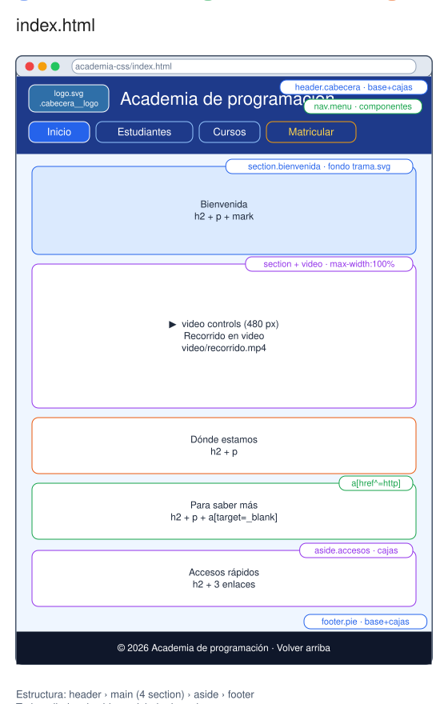
>
> **`estudiantes.html`**
>
> 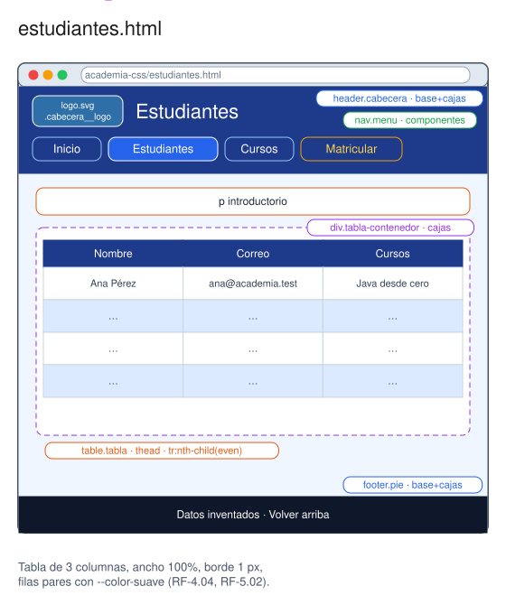
>
> **`cursos.html`**
>
> 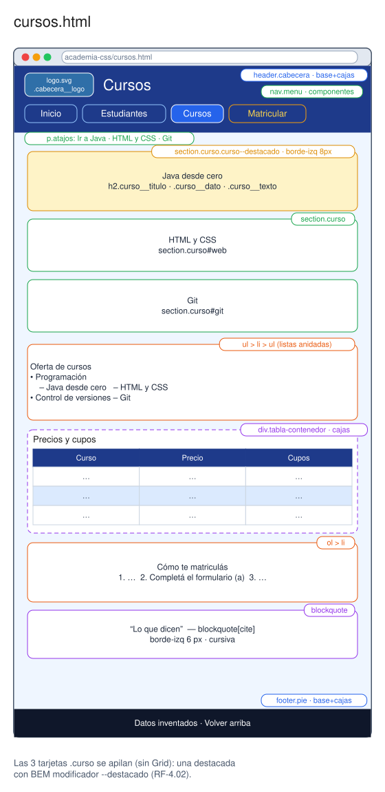
>
> **`matricula.html`**
>
> 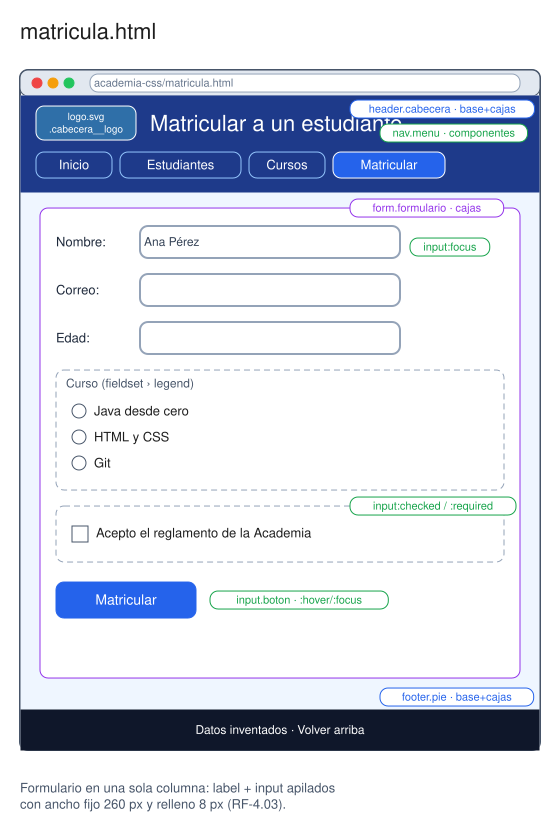
>
> **Modelo de cajas, orden de las hojas y paleta**
>
> 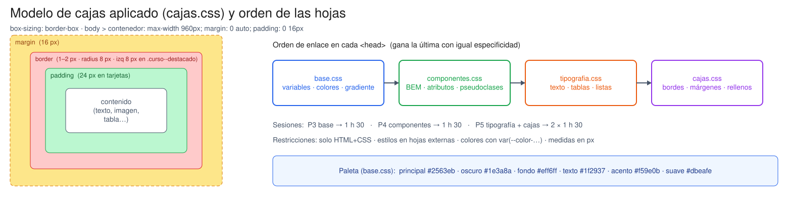
>
> 🧰 Fuente editable: [`imagenes/maquetacion-academia.excalidraw`](imagenes/maquetacion-academia.excalidraw) (se abre en [excalidraw.com](https://excalidraw.com)).

</details>

---

## 🧱 PARTES 1 y 2 — El HTML (Módulos 01 y 02)

Estas dos partes **ya están resueltas** en la guía [guia-academia-modulos-01-02.md](guia-academia-modulos-01-02.md) paso a paso. Para practicar CSS se parte de su resultado.

### Paso 0 — Preparar el proyecto

🧑‍🎓 **Indicación al estudiante:**

1. Copiá la carpeta [`codigo/academia/`](codigo/academia/) (las cuatro páginas ya escritas, el logo y el video) con el nombre **`academia-css`**. Si hiciste el taller de los Módulos 01 y 02, podés usar **tu propio** proyecto.
2. Dentro de `academia-css` creá la carpeta **`css`** (vacía por ahora).
3. Abrí la carpeta en VS Code y abrí `cursos.html` en el navegador.

> ✅ **Punto de control.** El sitio funciona, pero se ve así: texto negro sobre blanco, tabla sin bordes, menú con barras `|`.
>
> 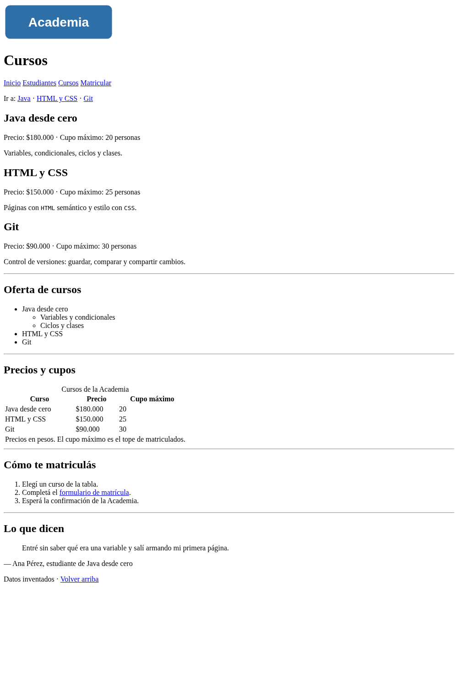
>
> 🗣️ **Se pregunta:** ¿qué le falta para parecer el sitio de una academia? Se anotan las respuestas en la pizarra: *color, letra, espacios, menú…* Cada respuesta es un tema de las Partes 3 a 5.

### Cambio previo en el HTML: clases y envoltorios

Para poder dar estilo hace falta **nombrar** algunas partes del HTML. Son cambios chicos que se hacen **una vez**, al comienzo (cada uno se explica en la parte donde se usa):

| Página | Cambio | Se usa en |
|---|---|---|
| Las cuatro | `<header class="cabecera">` · `<nav class="menu">` con `<a class="menu__enlace">` (sin las barras `|`) · `<footer class="pie">` · el logo lleva `class="cabecera__logo"` | P4 y P5 |
| `index.html` | `<section class="bienvenida">` y `<aside class="accesos">` | P3 y P5 |
| `cursos.html` | `<section class="curso">` (la de Java suma `curso--destacado`) con `curso__titulo`, `curso__dato`, `curso__texto` | P4 |
| `estudiantes.html`, `cursos.html` | `<table class="tabla">` dentro de `<div class="tabla-contenedor">` | P5 |
| `matricula.html` | `<form class="formulario">` · `<input class="boton" type="submit">` | P4 y P5 |

> 💡 **Cómo se ve en el menú** (igual en las cuatro páginas; en cada una, `menu__enlace--actual` va en **su** enlace):
>
> ```html
> <nav class="menu">
>   <a class="menu__enlace menu__enlace--actual" href="index.html">Inicio</a>
>   <a class="menu__enlace" href="estudiantes.html">Estudiantes</a>
>   <a class="menu__enlace" href="cursos.html">Cursos</a>
>   <a class="menu__enlace" href="matricula.html">Matricular</a>
> </nav>
> ```
>
> 🧑‍🎓 Lo más rápido es copiar los archivos finales de [`codigo/academia-css/`](codigo/academia-css/) y **leer las diferencias** con los de `academia/`.

---

## 🅲 PARTE 3 — Módulo 03: Introducción a CSS (`css/base.css`)

> 🗣️ **Se muestra la idea.** *Un documento HTML dice **qué** es cada cosa; una hoja CSS dice **cómo se ve**. Se separan para cambiar el aspecto sin tocar el contenido.*

### Paso 3.1 · Crear la hoja y enlazarla (RF-3.01)

🧑‍🎓 **Indicación al estudiante:**

1. Creá el archivo **`css/base.css`** (vacío por ahora).
2. En el `<head>` de **cada una de las cuatro páginas**, debajo de `<title>`, agregá:

```html
  <link rel="stylesheet" href="css/base.css">
```

3. En `base.css` escribí tu primera regla, para ver que el enlace funciona:

```css
body {
  background-color: #eff6ff;
}
```

> ✅ **Punto de control.** Al recargar, el fondo de las cuatro páginas es azul muy claro. Si no cambia: revisá la ruta (`css/base.css`, en minúsculas) y que el archivo esté guardado.
>
> ⚠️ **Error típico.** Escribir `href="css\base.css"` o `href="/css/base.css"`: la ruta es **relativa** y con `/`.

> 🔗 **Ejemplos del curso:** [01 · Qué es CSS y cómo enlazarlo](../03-Introduccion-CSS/material/ejemplos/01-que-es-css-y-como-enlazarlo.md) · [02 · Sintaxis y documento CSS](../03-Introduccion-CSS/material/ejemplos/02-sintaxis-y-documento-css.md).

### Paso 3.2 · Variables CSS: la paleta de la academia (RF-3.01)

🗣️ **Se pregunta:** si mañana la academia cambia de azul, ¿en cuántos lugares habría que cambiarlo? Con **variables** se define una vez y se usa en todos lados.

🧑‍🎓 **Indicación al estudiante:** **reemplazá** la regla de prueba por la paleta y el estilo general:

```css
/* Variables: cada color se define una sola vez */
:root {
  --color-principal: #2563eb;
  --color-oscuro: #1e3a8a;
  --color-fondo: #eff6ff;
  --color-texto: #1f2937;
  --color-acento: #f59e0b;
  --color-suave: #dbeafe;
  --color-blanco: #ffffff;
}

/* Estilos generales: se heredan a casi todo el contenido */
body {
  color: var(--color-texto);
  background-color: var(--color-fondo);
}
```

> 💡 `:root` es el elemento raíz (`html`): las variables definidas ahí **están disponibles en toda la página**. `var(--color-fondo)` lee el valor.
>
> 💡 **Herencia.** `color` en `body` lo heredan párrafos, listas y tablas sin tocarlos uno por uno. (No todo se hereda: el borde o el fondo no.)

> ✅ **Punto de control.** El texto pasa de negro a gris azulado oscuro (`#1f2937`) y el fondo es azul claro.

> 🔗 [06 · Variables CSS](../03-Introduccion-CSS/material/ejemplos/06-variables-css.md) · [04 · Herencia](../03-Introduccion-CSS/material/ejemplos/04-herencia.md).

### Paso 3.3 · La cabecera: color y gradiente (RF-3.02)

🧑‍🎓 **Indicación al estudiante:** debajo de lo anterior, agregá:

```css
/* La cabecera lleva un gradiente lineal y letra blanca (se hereda al h1 y al texto) */
header {
  color: var(--color-blanco);
  background-color: var(--color-oscuro);
  background-image: linear-gradient(90deg, var(--color-oscuro), var(--color-principal));
}

h1 {
  color: var(--color-blanco);
}

h2 {
  color: var(--color-oscuro);
}
```

> 💡 `linear-gradient(90deg, A, B)` pinta una transición de A a B de izquierda a derecha. Se usa en `background-image`, **no** en `background-color`. Se deja un `background-color` de respaldo por si el gradiente no se aplica.
>
> 💡 **Colores.** Acá se usan variables (hex por debajo). Los formatos `#rrggbb`, `rgb()` y `rgba()` son equivalentes; `rgba` agrega **transparencia** (se usa en la Parte 4).

> ✅ **Punto de control.** La cabecera tiene fondo azul degradado y el título es blanco.
>
> ⚠️ **Se ve un problema (a propósito).** Los enlaces del menú quedan **azules sobre azul**: casi no se leen. El paso siguiente lo corrige y es un buen ejemplo de **cascada**.

> 🔗 [07 · Colores y transparencia](../03-Introduccion-CSS/material/ejemplos/07-colores-y-transparencia.md) · [08 · Gradientes, imágenes y opacidad](../03-Introduccion-CSS/material/ejemplos/08-gradientes-imagenes-y-opacidad.md).

### Paso 3.4 · Enlaces, `mark` y cascada

```css
/* Enlaces */
a {
  color: var(--color-principal);
}

/* El enlace de la cabecera hereda el blanco de header en vez del azul */
header a {
  color: var(--color-blanco);
}

/* El resaltado de mark usa el color de acento */
mark {
  background-color: var(--color-acento);
  color: var(--color-texto);
}
```

> 🗣️ **Se pregunta:** `a` y `header a` apuntan al mismo enlace del menú, y piden colores distintos. ¿Cuál gana? *`header a`: es **más específico** (elemento + elemento). Si dos reglas empatan, gana la que está **más abajo**.*
>
> 🧑‍🎓 **Prueba:** movela **antes** de la regla `a` y comprobá que el enlace **sigue** blanco. Después movela de nuevo: es la forma de ver que **la especificidad pesa más que el orden**.

> 🔗 [05 · Cascada](../03-Introduccion-CSS/material/ejemplos/05-cascada.md).

### Paso 3.5 · Fondo con imagen, pie y opacidad

🧑‍🎓 **Indicación al estudiante:**

1. Creá el archivo **`imagenes/trama.svg`** (o copialo de [`codigo/academia-css/imagenes/`](codigo/academia-css/imagenes/trama.svg)): un cuadrito de 24 × 24 px con un punto.
2. En `index.html` ya existe `<section class="bienvenida">`. Agregá en `base.css`:

```css
/* Bienvenida: fondo con una imagen que se repite y una capa de color translúcido encima */
.bienvenida {
  background-color: var(--color-suave);
  background-image: url("../imagenes/trama.svg");
  background-repeat: repeat;
}

/* Pie de página */
footer {
  color: var(--color-blanco);
  background-color: #0f2a44;
}

footer a {
  color: #93c5fd;
}

/* El logo se ve un poco atenuado con opacity */
header img {
  opacity: 0.9;
}
```

> ✅ **Punto de control.** La bienvenida tiene un fondo de puntitos que se repite; el pie es azul marino con letra blanca; el logo se ve apenas atenuado (`opacity: 0.9` hace transparente **todo** el elemento, no solo el fondo).
>
> 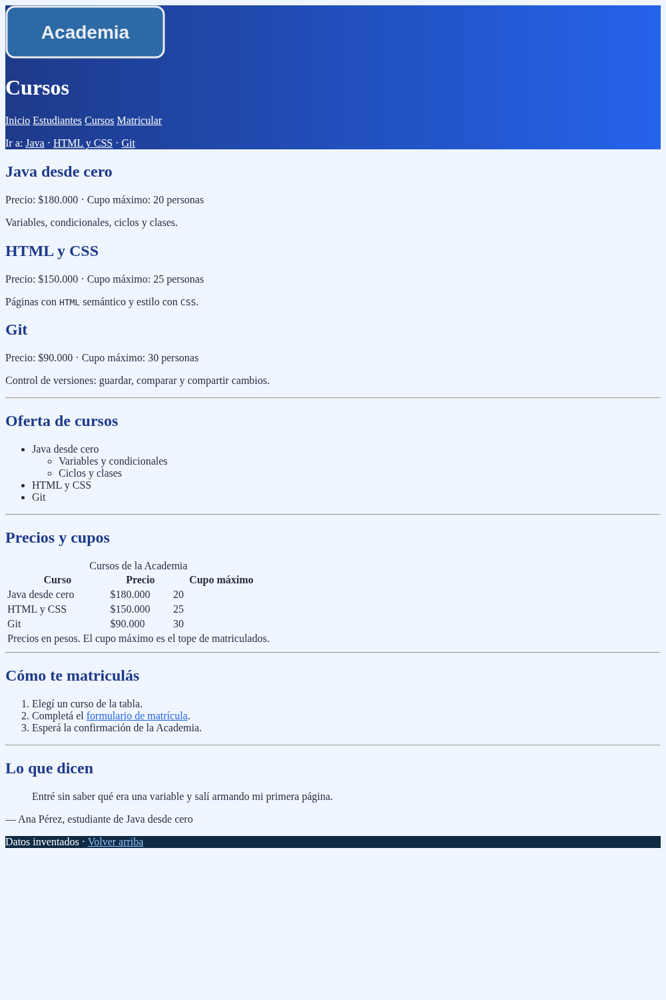
>
> 💡 `url("../imagenes/trama.svg")` es relativa **al archivo CSS** (está en `css/`, por eso sube un nivel con `../`).

### Paso 3.6 · Herramientas del navegador (inspeccionar)

🧑‍🎓 **Indicación al estudiante:**

1. Con la página abierta, tocá `F12` (o clic derecho → **Inspeccionar**).
2. Elegí un enlace del menú: en el panel **Estilos** vas a ver las reglas `a` y `header a`; la perdedora aparece **tachada**.
3. Cambiá un color en el panel (por ejemplo, `--color-oscuro`) y mirá la página cambiar **en vivo**. Al recargar se pierde: los cambios en el navegador **no se guardan** en el archivo.

> 🗣️ **Pregunta de cierre:** ¿qué ventaja tuvo definir la paleta con variables? *Probamos otro azul cambiando una sola línea.*

> 🔗 [03 · Herramientas del navegador](../03-Introduccion-CSS/material/ejemplos/03-herramientas-del-navegador.md).

---

## 🅳 PARTE 4 — Módulo 04: Selectores y reglas (`css/componentes.css`)

🧑‍🎓 **Indicación al estudiante:** creá **`css/componentes.css`** y enlazalo **debajo** de `base.css` en las cuatro páginas:

```html
  <link rel="stylesheet" href="css/componentes.css">
```

> 🗣️ **Se explica.** Hasta ahora las reglas apuntaban a **todos** los `a` o **todos** los `h2`. Un **selector** permite elegir **solo** lo que se necesita. En esta hoja cada bloque tiene su comentario: es la forma de **organizar reglas**.

### Paso 4.1 · El menú con BEM (RF-4.01)

> 💡 **BEM** nombra cada clase con *bloque* (`menu`), *elemento* (`menu__enlace`: una parte del bloque) y *modificador* (`menu__enlace--actual`: una variante). Así, al leer el CSS se sabe a qué componente pertenece cada clase.

```css
/* ===== Menú (BEM: bloque menu, elemento menu__enlace, modificador --actual) ===== */
.menu__enlace {
  color: var(--color-blanco);
  background-color: rgba(255, 255, 255, 0.15);
}

.menu__enlace--actual {
  color: var(--color-oscuro);
  background-color: var(--color-blanco);
}

/* Selector de atributo: el enlace a la matrícula se destaca por su href */
.menu__enlace[href="matricula.html"] {
  color: var(--color-texto);
  background-color: var(--color-acento);
}

/* Pseudoclase de estado, pero solo para los enlaces que NO son la página actual */
.menu__enlace:not(.menu__enlace--actual):hover {
  background-color: rgba(255, 255, 255, 0.35);
}

.menu__enlace:focus {
  outline-style: solid;
  outline-width: 3px;
  outline-color: var(--color-acento);
}
```

> 💡 **Atributo.** `.menu__enlace[href="matricula.html"]` elige solo el enlace cuyo `href` vale eso: el de «Matricular» pasa a color de acento sin agregarle otra clase.
>
> 💡 **Lógico.** `:not(.menu__enlace--actual)` excluye la página actual: el enlace de la página donde estás **no** cambia al pasar el cursor.
>
> 💡 **Estados.** `:hover` (cursor encima) y `:focus` (con el teclado, `Tab`) merecen estilo **los dos**: quien navega con teclado también tiene que ver dónde está.

```css
/* Dos componentes distintos comparten una regla con :is() */
:is(.menu__enlace, .boton) {
  cursor: pointer;
}
```

> 🗣️ `:is(A, B)` agrupa selectores distintos en una regla. Acá el menú y el botón comparten la manito del cursor.

> ✅ **Punto de control.** Menú en cápsulas semitransparentes; la página actual en blanco; «Matricular» en ámbar. Al pasar el cursor se aclara; con `Tab` se ve un contorno ámbar.

> 🔗 [03 · Metodología BEM](../04-Selectores-y-reglas/material/ejemplos/03-metodologia-bem.md) · [02 · Selectores de atributos](../04-Selectores-y-reglas/material/ejemplos/02-selectores-de-atributos.md) · [05 · Selectores lógicos](../04-Selectores-y-reglas/material/ejemplos/05-selectores-logicos.md) · [06 · Pseudoclases de estado](../04-Selectores-y-reglas/material/ejemplos/06-pseudoclases-de-estado.md).

### Paso 4.2 · Enlaces según su tipo (selectores de atributos)

```css
/* ===== Enlaces según su tipo (selectores de atributos) ===== */
a[href^="mailto:"] {
  color: var(--color-oscuro);
}

a[target="_blank"] {
  color: var(--color-principal);
  text-decoration-style: dashed;
}

/* Un enlace de contenido cambia al pasar el cursor */
main a:hover {
  color: var(--color-acento);
}

a:visited {
  color: #6d28d9;
}

header a:visited {
  color: var(--color-blanco);
}
```

> 💡 `[href^="mailto:"]` = «empieza con». Hay también `$=` (termina con) y `*=` (contiene). `[target="_blank"]` elige los enlaces externos que se abren en otra pestaña.
>
> ⚠️ **Orden de `:visited`.** Los enlaces de la cabecera ya visitados se pondrían violeta: por eso `header a:visited` los vuelve a blanco. (Orden recomendado de estados: `:visited`, `:focus`, `:hover`, `:active`.)

### Paso 4.3 · Secciones con combinadores (RF-4.04 en parte)

```css
/* ===== Secciones de contenido (combinador de hijo directo) ===== */
main > section {
  background-color: var(--color-blanco);
}

/* El primer párrafo después de un h2 es una entradilla (combinador adyacente) */
h2 + p {
  color: var(--color-oscuro);
}
```

> | Combinador | Significa | En el sitio |
> |---|---|---|
> | `A B` (espacio) | B **dentro** de A, a cualquier nivel | `header a`, `.pie a:hover` |
> | `A > B` | B **hijo directo** de A | `main > section`: solo las secciones de primer nivel, no las que estén dentro de otras |
> | `A + B` | B **justo después** de A | `h2 + p`: el párrafo que sigue al título |
> | `A ~ B` | cualquier B hermano **posterior** de A | No se usa en el portal: probalo con `h2 ~ p` |

> 🔗 [04 · Combinadores](../04-Selectores-y-reglas/material/ejemplos/04-combinadores.md).

### Paso 4.4 · Las tarjetas de curso (RF-4.02)

🧑‍🎓 **Indicación al estudiante:** en `cursos.html` cada curso ya es una `section`. Dale `class="curso"` (al de Java, también `curso--destacado`) y nombrá sus partes:

```html
    <section class="curso curso--destacado" id="java">
      <h2 class="curso__titulo">Java desde cero</h2>
      <p class="curso__dato">Precio: $180.000 · Cupo máximo: 20 personas</p>
      <p class="curso__texto">Variables, condicionales, ciclos y clases.</p>
    </section>
```

Repetí lo mismo (sin `curso--destacado`) para `web` y `git`. Después, en `componentes.css`:

```css
/* ===== Tarjeta de curso (BEM: bloque curso) ===== */
.curso {
  border-color: var(--color-suave);
  background-color: var(--color-blanco);
}

.curso__titulo {
  color: var(--color-oscuro);
}

.curso__dato {
  color: var(--color-principal);
}

.curso__texto {
  color: var(--color-texto);
}

/* Modificador: el curso destacado cambia su fondo */
.curso--destacado {
  background-color: #fffbeb;
  border-color: var(--color-acento);
}

/* Un curso con enlaces adentro (:has) se subraya en su título */
.curso:has(a) .curso__titulo {
  text-decoration-line: underline;
}

/* Resalta el curso al que se llegó con un enlace #java, #web… */
.curso:hover {
  background-color: var(--color-fondo);
}
```

> 💡 `:has(a)` elige el **padre** que contiene un enlace. Es el único selector del curso que «mira hacia adentro». Se pregunta: ¿qué cursos se subrayan? *Ninguno todavía: ningún curso tiene enlaces. Agregá un `<a>` dentro de uno y mirá.*
>
> ⚠️ **Error típico.** Poner `class="curso--destacado"` **solo** (sin `curso`): el modificador cambia una variante, necesita al **bloque** también.

### Paso 4.5 · Tablas y listas: pseudoclases de estructura (RF-4.04)

```css
/* ===== Datos: tablas y listas (pseudoclases de estructura) ===== */
tbody tr:nth-child(even) {
  background-color: var(--color-fondo);
}

tbody tr:hover {
  background-color: var(--color-suave);
}

tbody td:first-child {
  color: var(--color-oscuro);
}

/* El último paso de la lista enumerada se destaca */
ol li:last-child {
  color: var(--color-oscuro);
}
```

> 💡 `:nth-child(even)` elige las filas **pares** (2.ª, 4.ª…): es el «cebra» de las tablas. `td:first-child` elige la primera celda de cada fila. `ol li:last-child` elige el último paso de la lista **enumerada**.

> 🔗 [07 · Pseudoclases de estructura](../04-Selectores-y-reglas/material/ejemplos/07-pseudoclases-de-estructura.md).

### Paso 4.6 · Formulario, cita y accesos (RF-4.03)

🧑‍🎓 **Indicación al estudiante:** en `matricula.html`, dale `class="formulario"` al `form` y `class="boton"` al `input type="submit"`. Después:

```css
/* ===== Formulario ===== */
input[type="text"],
input[type="email"],
input[type="number"] {
  border-color: #94a3b8;
}

input:focus {
  outline-style: solid;
  outline-width: 3px;
  outline-color: var(--color-principal);
}

/* El texto de la opción marcada se destaca (hermano que sigue a un input marcado) */
input:checked + label {
  color: var(--color-oscuro);
  font-weight: bold;
}

.boton {
  color: var(--color-blanco);
  background-color: var(--color-principal);
}

.boton:hover {
  background-color: var(--color-oscuro);
}

.boton:active {
  background-color: var(--color-acento);
}

/* ===== Cita y accesos ===== */
blockquote > p {
  color: var(--color-oscuro);
}

.accesos {
  background-color: var(--color-suave);
}

.pie a:hover {
  color: var(--color-blanco);
}
```

> 💡 `input:checked + label`: la etiqueta **que sigue** a un campo marcado. Al elegir un curso, su texto se pone en negrita. Es CSS que **reacciona a una acción** del usuario, sin JavaScript.
>
> 💡 `.boton:active` es el instante **del clic**: se ve un momento, por eso conviene probarlo manteniendo el botón apretado.

> ✅ **Punto de control de la Parte 4.** Las tarjetas aún no tienen bordes ni espacios (Parte 5), pero el sitio **reacciona**: menú, filas, enlaces y botón cambian con el cursor; el curso destacado es amarillo claro.
>
> 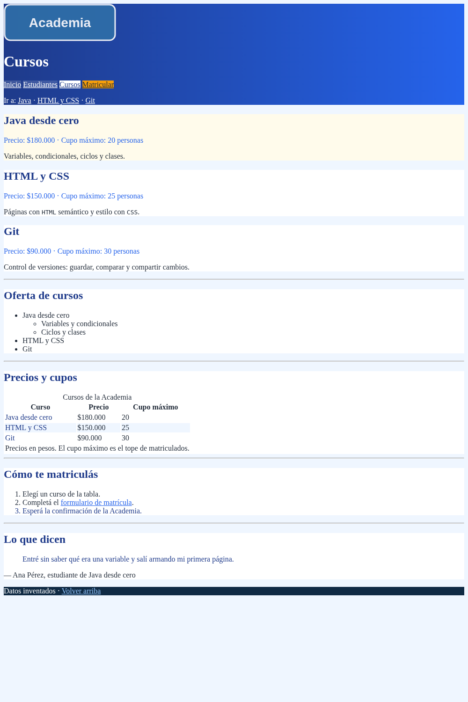

### Paso 4.7 · Organizar las reglas

🗣️ **Se repasa el archivo completo** `componentes.css` y se pregunta por qué está ordenado así:

- Un **comentario** por bloque (`===== Menú =====`).
- De lo **general a lo particular** dentro de cada bloque: `.menu__enlace`, luego su modificador, luego sus estados.
- **Una declaración por línea**, `propiedad: valor;` y llaves alineadas.
- **Sin repetir**: lo común se agrupa con coma o con `:is()`.

> 🔗 [08 · Escribir y organizar reglas](../04-Selectores-y-reglas/material/ejemplos/08-escribir-y-organizar-reglas.md).

---

## 🅴 PARTE 5 — Módulo 05: Tipografía y presentación de datos

### 🕐 Sesión 1 — Texto y datos (`css/tipografia.css`)

🧑‍🎓 **Indicación al estudiante:** creá **`css/tipografia.css`** y enlazalo **debajo** de `componentes.css`:

```html
  <link rel="stylesheet" href="css/tipografia.css">
```

### Paso 5.1 · Familia, tamaño, peso y altura de línea (RF-5.01)

```css
/* ===== Tipografía: familia con alternativas, tamaño, peso y altura de línea ===== */
body {
  font-family: "Segoe UI", Roboto, Arial, sans-serif;
  font-size: 18px;
  line-height: 1.6;
}

h1 {
  font-size: 36px;
  font-weight: 700;
  line-height: 1.2;
}

h2 {
  font-size: 26px;
  line-height: 1.3;
}

code {
  font-family: "Courier New", monospace;
  background-color: var(--color-fondo);
}
```

> 💡 **Familia con alternativas.** El navegador prueba cada fuente en orden y usa la primera que el equipo tenga; la última (`sans-serif`) es la **genérica**, que siempre existe. Si el nombre tiene espacios, va entre comillas.
>
> 💡 **`line-height: 1.6`** sin unidad = 1,6 veces el tamaño de la letra. Un valor entre 1,4 y 1,7 hace cómodo un texto largo.
>
> 💡 Los tamaños están en **px** (RNF-04). El Módulo 06 los reemplaza por unidades relativas.

> 🔗 [01 · Tipografías en CSS](../05-Tipografia-y-presentacion-de-datos/material/ejemplos/01-tipografias-en-css.md).

### Paso 5.2 · Texto, alineación y decoración

```css
/* ===== Texto: alineación, espaciado y mayúsculas ===== */
.menu__enlace {
  font-size: 16px;
  font-weight: 700;
  text-transform: uppercase;
  letter-spacing: 1px;
  text-decoration: none;
}

.curso__dato {
  font-weight: 700;
  font-style: italic;
}

blockquote > p {
  font-size: 22px;
  font-style: italic;
}

.cita-autor {
  text-align: right;
  font-size: 16px;
}

.pie {
  text-align: center;
  font-size: 14px;
}

.atajos {
  font-size: 15px;
}

/* ===== Decoraciones de texto ===== */
a {
  text-decoration-line: underline;
  text-decoration-thickness: 1px;
}

.menu__enlace:hover {
  text-decoration: underline;
}

h1 {
  text-shadow: 2px 2px 4px rgba(0, 0, 0, 0.4);
}
```

> 💡 `text-transform: uppercase` cambia cómo **se ve**, no lo que **está escrito** en el HTML (un lector de pantalla sigue leyendo «Inicio»). `text-decoration: none` quita el subrayado del menú; al pasar el cursor vuelve (`:hover`).
>
> 💡 `a { text-decoration-line: underline }` repite lo que el navegador ya hace; se escribe para fijar el grosor (`thickness`). Se pregunta por qué el menú **no** queda subrayado: *`.menu__enlace` es más específico que `a`.*

> 🔗 [02 · Textos y alineaciones](../05-Tipografia-y-presentacion-de-datos/material/ejemplos/02-textos-y-alineaciones.md) · [03 · Decoraciones de texto](../05-Tipografia-y-presentacion-de-datos/material/ejemplos/03-decoraciones-de-texto.md).

### Paso 5.3 · Tablas con estilo (RF-5.02)

```css
/* ===== Tablas con estilo ===== */
.tabla {
  border-collapse: collapse;
}

.tabla caption {
  caption-side: bottom;
  font-style: italic;
  font-size: 15px;
}

.tabla th {
  color: var(--color-blanco);
  background-color: var(--color-oscuro);
  text-align: left;
  text-transform: uppercase;
  font-size: 15px;
  letter-spacing: 1px;
}

.tabla td:nth-child(2),
.tabla td:nth-child(3) {
  text-align: right;
}

.tabla tfoot td {
  font-size: 15px;
  font-style: italic;
  text-align: left;
}
```

> 💡 **`border-collapse: collapse`**: las celdas **comparten** el borde (sin él, cada celda dibuja el suyo y se ve doble). **`caption-side: bottom`** lleva el título abajo. Precios y cupos se alinean a la **derecha** (son números); el resto, a la izquierda.

> 🔗 [04 · Tablas con estilo](../05-Tipografia-y-presentacion-de-datos/material/ejemplos/04-tablas-con-estilo.md).

### Paso 5.4 · Listas con estilo

```css
/* ===== Listas con estilo ===== */
ul {
  list-style-type: square;
}

ul ul {
  list-style-type: circle;
}

ol {
  list-style-type: decimal-leading-zero;
  list-style-position: inside;
}
```

> ✅ **Punto de control de la sesión 1.** Letra sans-serif legible, menú en mayúsculas, tabla con encabezado oscuro, viñetas cuadradas con sublista de círculos y pasos numerados `01.`, `02.`… Falta el **espacio** entre elementos.
>
> 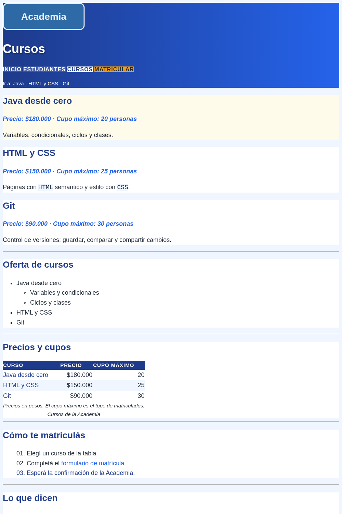

> 🔗 [05 · Listas con estilo](../05-Tipografia-y-presentacion-de-datos/material/ejemplos/05-listas-con-estilo.md).

### 🕑 Sesión 2 — Cajas (`css/cajas.css`)

🧑‍🎓 **Indicación al estudiante:** creá **`css/cajas.css`** y enlazalo **último**:

```html
  <link rel="stylesheet" href="css/cajas.css">
```

🗣️ **Se explica.** Todo elemento es una **caja**: contenido → **relleno** (`padding`, adentro) → **borde** → **margen** (`margin`, afuera). Se dibuja en el navegador con `F12` → pestaña de **Diseño/Computed**.

### Paso 5.5 · `box-sizing` y página centrada (RF-5.03)

```css
/* ===== Modelo de cajas: el ancho incluye relleno y borde ===== */
* {
  box-sizing: border-box;
}

/* ===== La página: ancho máximo y centrada con márgenes automáticos ===== */
body {
  max-width: 960px;
  margin: 0 auto;
  padding: 0 16px;
}
```

> 💡 **`box-sizing: border-box`**: el `width` incluye relleno y borde. Sin esta línea, una caja de `width: 100%` con relleno **se sale** de su contenedor.
>
> 💡 **Centrar:** ancho máximo + `margin: 0 auto` (los márgenes laterales automáticos reparten el sobrante). Con `max-width`, en pantallas chicas la página **se achica** en vez de desbordar.

> 🔗 [08 · Modelo de cajas](../05-Tipografia-y-presentacion-de-datos/material/ejemplos/08-modelo-de-cajas.md) · [10 · Márgenes y rellenos](../05-Tipografia-y-presentacion-de-datos/material/ejemplos/10-margenes-y-rellenos.md).

### Paso 5.6 · Cabecera: relleno, bordes y esquinas

```css
/* ===== Cabecera ===== */
header {
  padding: 24px;
  margin-top: 16px;
  border-top-left-radius: 16px;
  border-top-right-radius: 16px;
}

h1 {
  margin-top: 8px;
  margin-bottom: 16px;
}

.cabecera__logo {
  border-style: solid;
  border-width: 2px;
  border-color: var(--color-blanco);
  border-radius: 12px;
}

.menu__enlace {
  padding: 8px 14px;
  margin-right: 8px;
  border-radius: 20px;
}

.atajos {
  margin-top: 16px;
  margin-bottom: 0;
}
```

> 💡 **Atajos.** `padding: 8px 14px` = arriba/abajo 8, izquierda/derecha 14. `border-radius: 20px` redondea las cuatro esquinas; `border-top-left-radius` solo una. La cabecera redondea **solo arriba** porque el pie redondea **solo abajo**.
>
> 💡 **Los márgenes verticales se «fusionan»** entre elementos hermanos: dos de 16 px no suman 32 px, sino 16.

> 🔗 [06 · Bordes](../05-Tipografia-y-presentacion-de-datos/material/ejemplos/06-bordes.md) · [07 · Bordes redondeados](../05-Tipografia-y-presentacion-de-datos/material/ejemplos/07-bordes-redondeados.md).

### Paso 5.7 · Tarjetas y tablas con borde

```css
/* ===== Secciones y tarjetas ===== */
main {
  padding: 8px 0;
}

main > section {
  padding: 16px 24px;
  margin: 16px 0;
  border-style: solid;
  border-width: 1px;
  border-color: #cbd5e1;
  border-radius: 12px;
}

h2 {
  margin-top: 0;
}

.curso {
  border-left-width: 8px;
  border-left-color: var(--color-principal);
}

.curso--destacado {
  border-left-color: var(--color-acento);
}

.curso__dato {
  margin: 0 0 8px 0;
}

/* ===== Tablas: borde, relleno y desplazamiento horizontal ===== */
.tabla-contenedor {
  overflow-x: auto;
  margin: 16px 0;
}

.tabla {
  width: 100%;
  margin: 0;
}

.tabla th,
.tabla td {
  padding: 10px 14px;
  border-style: solid;
  border-width: 1px;
  border-color: #cbd5e1;
}
```

> 💡 **Desborde.** `overflow-x: auto` en `.tabla-contenedor`: si la tabla es más ancha que la pantalla, **aparece una barra de desplazamiento** solo en la tabla, en vez de romper toda la página. Se prueba achicando la ventana.
>
> 💡 `.curso { border-left-width: 8px }` pisa solo **un lado** del `border-width: 1px` que ya traía `main > section`: es una regla más específica (clase + clase) que lo anterior.

> 🔗 [09 · Overflow](../05-Tipografia-y-presentacion-de-datos/material/ejemplos/09-overflow.md).

### Paso 5.8 · Listas, cita, multimedia y formulario

```css
/* ===== Listas y cita ===== */
ul,
ol {
  padding-left: 24px;
}

li {
  margin-bottom: 6px;
}

blockquote {
  margin: 16px 0 8px 0;
  padding: 8px 20px;
  border-left-style: solid;
  border-left-width: 6px;
  border-left-color: var(--color-acento);
  background-color: var(--color-fondo);
  border-radius: 0 12px 12px 0;
}

blockquote > p {
  margin: 8px 0;
}

hr {
  border-style: solid;
  border-width: 1px;
  border-color: var(--color-suave);
}

/* ===== Bienvenida e imágenes ===== */
video,
iframe {
  max-width: 100%;
  border-style: solid;
  border-width: 3px;
  border-color: var(--color-oscuro);
  border-radius: 12px;
}

.accesos {
  padding: 16px 24px;
  margin: 16px 0;
  border-radius: 12px;
}

.accesos p {
  margin: 6px 0;
}

/* ===== Formulario ===== */
.formulario {
  padding: 24px;
  margin: 16px 0;
  background-color: var(--color-blanco);
  border-style: solid;
  border-width: 1px;
  border-color: #cbd5e1;
  border-radius: 12px;
}

.formulario input[type="text"],
.formulario input[type="email"],
.formulario input[type="number"] {
  width: 260px;
  padding: 8px 10px;
  border-style: solid;
  border-width: 2px;
  border-radius: 8px;
}

.formulario label {
  margin-right: 12px;
}

.boton {
  padding: 10px 24px;
  border-style: none;
  border-radius: 8px;
  cursor: pointer;
}
```

### Paso 5.9 · El pie

```css
/* ===== Pie ===== */
.pie {
  padding: 16px;
  margin: 16px 0;
  border-bottom-left-radius: 16px;
  border-bottom-right-radius: 16px;
}

.pie p {
  margin: 0;
}
```

> ✅ **Punto de control final.** Las cuatro páginas se ven como el resultado de abajo.

<details>
<summary><strong>🖼️ Resultado final de las cuatro páginas</strong></summary>

> 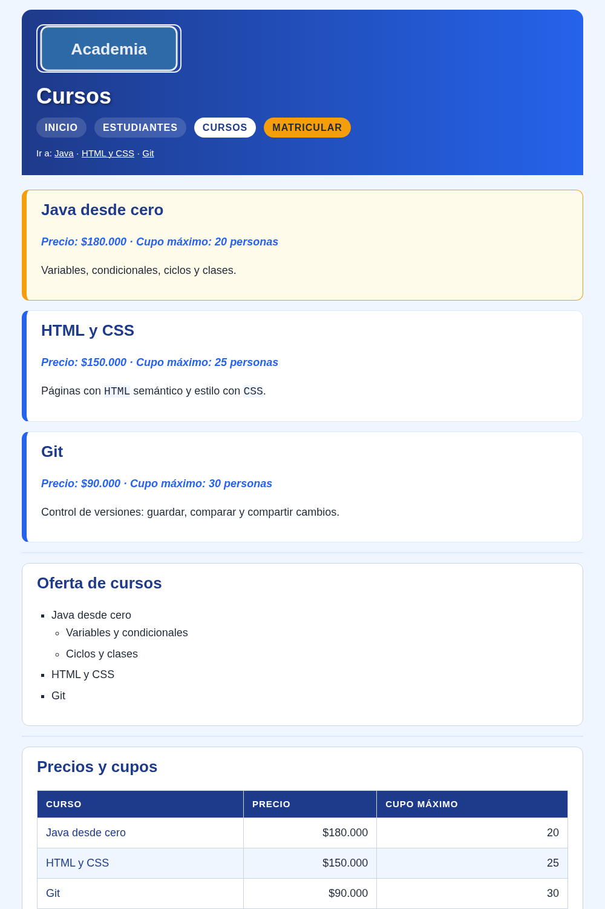
>
> 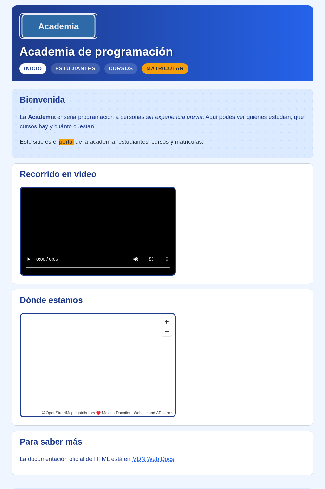
>
> 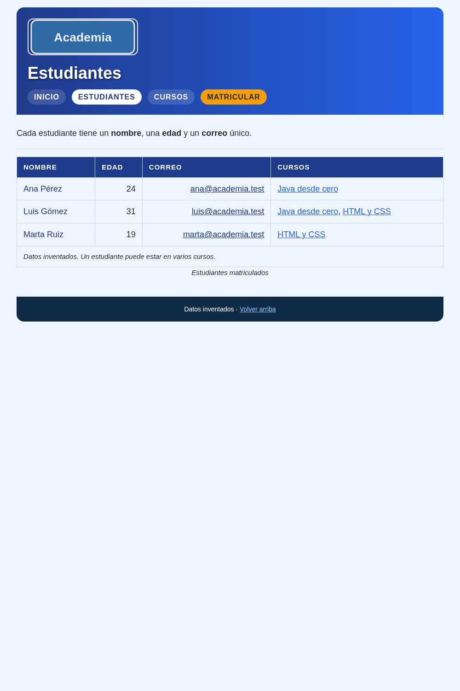
>
> 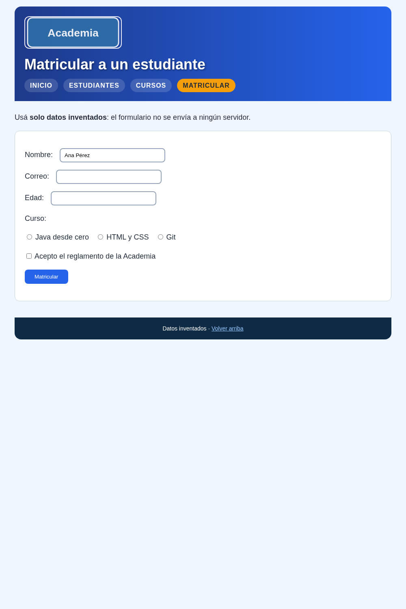
>
> 💡 El mapa de `index.html` puede verse en blanco sin conexión a internet: es un `iframe` externo.

</details>

---

## 🏁 Revisión final

🧑‍🎓 **Lista para el estudiante** (se tilda en voz alta):

- [ ] Las cuatro páginas enlazan las **cuatro hojas** en el mismo orden.
- [ ] No hay `style=""` ni `<style>` en ninguna página (RNF-02).
- [ ] Todos los colores salen de `var(--color-…)` (RNF-03). *Excepción: `#0f2a44`, `#94a3b8`, `#cbd5e1` y `#6d28d9` están fijos: **¿los pasás a variables?** (Reto 1).*
- [ ] Al pasar el cursor y con `Tab`, **todo lo que se puede pulsar** reacciona.
- [ ] Al achicar la ventana, la página **se achica** y la tabla gana su barra, sin que aparezca scroll horizontal en toda la página.
- [ ] Las páginas validan: `python3 herramientas/validar_html.py academia-css` y `validar_css.py --nivel 4` (el validador del curso revisa archivo por archivo: si avisa «variable sin definir» en `componentes.css`, es porque `--color-…` vive en `base.css`).

### 🔍 Cómo comprobar con números (para el docente)

Con las herramientas del curso se pueden medir los estilos reales de cada página:

```bash
python3 herramientas/probar_estilos.py guias/codigo/academia-css/cursos.html \
  'body|font-size' 'h1|color' '.curso--destacado|background-color' '.tabla|border-collapse' 'body|max-width'
```

Resultado esperado: `18px`, `rgb(255, 255, 255)`, `rgb(255, 251, 235)`, `collapse`, y `960px` como valor de `max-width` de `body`.

---

## 🧪 Ponelo en práctica — retos

| Reto | Qué hacer | Módulo |
|---|---|---|
| **1. Más variables** | Pasá a variables los colores que quedaron fijos (`#0f2a44`, `#94a3b8`, `#cbd5e1`, `#6d28d9`). Cambiá la marca a **verde** tocando solo `:root`. | 03 |
| **2. Tema propio** | Elegí otra paleta y otro gradiente para la cabecera (ángulo distinto). | 03 |
| **3. Enlaces externos** | Agregá un selector que marque con otro color los enlaces cuyo `href` **empiece con `https`**. | 04 |
| **4. Cada tres filas** | En la tabla de estudiantes agregá 3 filas más y pintá **una de cada tres** (`:nth-child(3n)`). | 04 |
| **5. Solo el último** | Dale un estilo distinto a la **última tarjeta de curso** con `.curso:last-child`. ¿Funciona? ¿Por qué? | 04 |
| **6. Tipografía** | Cambiá la familia de los títulos a una con serifa (`Georgia, serif`) y comprobá la alternativa. | 05 |
| **7. Texto largo** | Poné un texto de 6 líneas en la cita y ajustá `line-height` y `max-width` para leer cómodo. | 05 |
| **8. La caja** | Con `F12` medí el ancho real de una tarjeta. Sacá `box-sizing: border-box` y mirá qué cambia. | 05 |

> 💡 **Pista del reto 5.** `:last-child` exige que sea el **último hijo del padre**; después de la tarjeta `git` vienen un `hr` y otras secciones. Esa es la respuesta: se pide a los estudiantes que **la expliquen**.

---

## 🚧 Errores frecuentes y cómo se ven

| Síntoma | Causa probable | Cómo se arregla |
|---|---|---|
| La página no cambia nada | Ruta de `href` mal escrita o archivo sin guardar | Revisá `css/base.css` y recargá con `Ctrl+F5` |
| Un color «se pierde» | Otra regla **más específica** o **más abajo** lo pisa | `F12`: la regla tachada pierde |
| `var(--color-x)` no pinta | El nombre no coincide, o falta `--` | Comparar con `:root` |
| El nombre de clase no hace nada | `class="curso__titulo"` sin punto en CSS, o con punto en HTML | CSS: `.curso__titulo`; HTML: `class="curso__titulo"` |
| El modificador no se aplica | Falta la clase del bloque | `class="curso curso--destacado"` |
| Todo se sale del contenedor | Falta `box-sizing: border-box` | Regla `*` de `cajas.css` |
| La imagen de fondo no aparece | `url()` relativa al HTML en vez de al CSS | `../imagenes/…` |
| Aparece scroll horizontal | Una caja con `width` fijo mayor que su contenedor | `max-width: 100%` |

---

## 🔭 Qué sigue

- **Módulo 06 — Unidades relativas:** cambiar los `px` por `rem`, `em`, `%` y `vw`. Este mismo proyecto es el punto de partida.
- **Módulo 07 — Grid y diseño adaptable:** poner el `aside` **al lado** del contenido y las tarjetas de curso **en columnas**.
- **Módulo 08 — Animaciones y transiciones:** suavizar el `hover` del menú y del botón.
